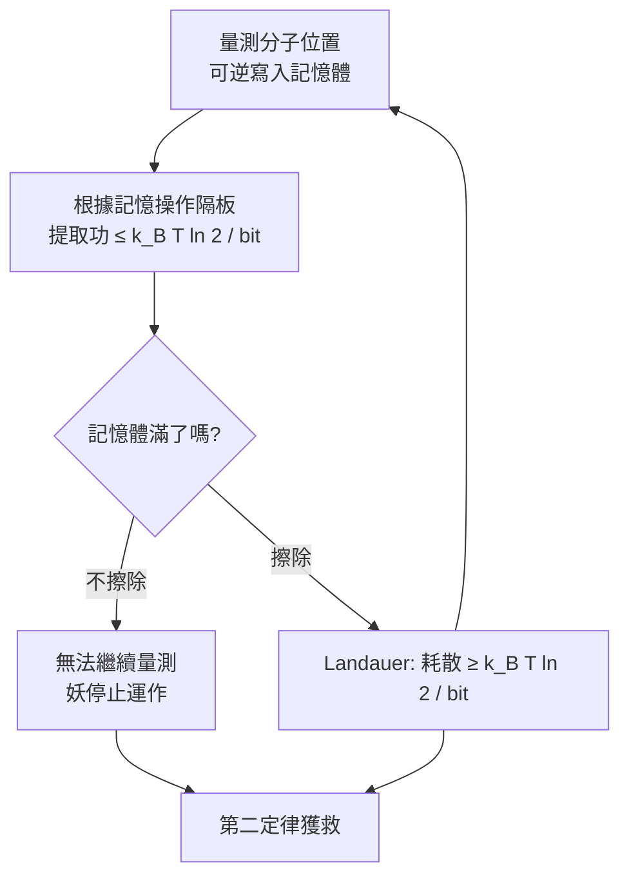
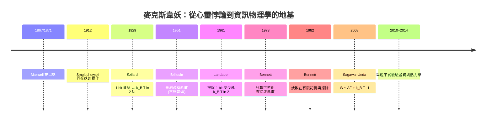

# 貝內特與麥克斯韋妖的終結

## 一個被糾纏了 110 年的幽灵

1871 年，麥克斯韋在一封私人信件中寫道：「一個非常機敏、手指靈巧的存有」，能夠分辨冷熱分子，讓熱自動從冷處流到熱處—違反第二定律。之後一百年，這個「妖」讓所有熱力學家又愛又恨：它若存在，第二定律只是經驗規則；若不存在，**為什麼不存在？**

到 1980 年代，主流答案分成兩派：

- **布里盧安派**：量測有成本，妖必須用高能光子照亮分子，這一步就付了熵；
- **西拉德派**：資訊本身的處理（在妖的腦中）會產生熵。

兩派都不夠根本：妖難道不能用「零耗散」的可逆方式量測嗎？難道資訊在腦中的處理（運算）本身要耗能嗎（我們知道可逆邏輯在原則上不耗能）？

1982 年，IBM Yorktown 的 Charles Bennett 用〈The Thermodynamics of Computation—a review〉一文給出最終答案。

## Bennett 的洞見：問題出在「擦除」，不是「量測」

Bennett 的關鍵一步，是把妖身上「量測」「記錄」與「擦除」拆開：

1. **量測**：妖觀察分子位置，把結果寫入自己的記憶體。這一步可以做到**熱力學上可逆**：用可逆邏輯、無限緩慢地進行，不需耗散。布里盧安派的「量測必有成本」論證，被證明不夠普遍；
2. **決策與操作**：妖根據記憶體內容操作隔板、提取功。這一步可以一併可逆化；
3. **擦除**：妏的記憶體有限，一輪循環之後**必須重置為 0** 才能接受下一次量測。根據 Landauer 1961，**重置 1 bit 必須耗散至少 $k_B T \ln 2$**；
4. 結論：**擦除的耗散，正好或超過量測—做功循環所提取的功**。第二定律安然無恙。

換句話說：麥克斯韋妖的全部魔法，被縮減到一個非常工程化的問題—**「快取滿了怎麼辦？」** 妖是一台有有限記憶的電腦，資訊不會憑空消失；若把記憶填滿而拒絕擦除，它就不能繼續量測下一輪；若擦除，就按 Landauer 付帳。

這個解答的哲學深度在於：**第二定律之所以成立，不是因為「量測很貴」或「資訊有重量」，而是因為「資訊處理者必須有有限的實體記憶，而記憶的清理是不可逆的」**。妖的胃口終究有限。

## 從理論到實驗：Sagawa–Ueda 的量化

Bennett 1982 完成了定性勝利，但要到 2008 年，東京大學的佐野〜真（Takahiro Sagawa）與宇好正美（Masahito Ueda）把它變成一條**定量不等式**。他們推導：一個帶回饋（measurement-and-feedback）的熱力學循環中，妖能最多多提取的功，被「量測取得的資訊量」所約束：

$$
W_{\text{extract}} \le \Delta F + k_B T \cdot I
$$

其中 $I$ 是量測和系統狀態之間的互資訊（mutual information）。這就是「資訊—功等式」（information–work identity）；取平均後成為廣義第二定律：

$$
\langle W_{\text{extract}}\rangle \le \Delta F + k_B T \, I_{\text{info}}
$$

**你取得多少資訊，就能多偷多少功；但你擦除這些資訊時，就得把同樣的熵還回去**。Bennett 的定性敘事與 Sagawa–Ueda 的定量公式在同一個架構下圓滿。

## 實驗驗證：2010–2014 的黃金年代

Bennett與佐野派的理論，在 2010 年代被單分子、單顆粒子實驗驗證：

- **2010**：日本一組實驗者在膠體系統上驗證了資訊—功關係：他們用即時觀測决定「何時傾斜勢阱」，測得每取得 1 bit 資訊，平均可多提取 $\sim k_B T \ln 2$ 量級的功，且由於是「非準靜態」操作，可以超過這個值，但受 Sagawa–Ueda 不等式約束；
- **2012**：柏林自由大學的實驗室以光學鑷子做「Landauer 擦除」的直接驗證，Nature 同年 3 月刊出：擦除 1 bit 最少耗 $k_B T \ln 2$，在準靜態下逼近極限；
- **2014**：法國與澳洲的團隊在納米機械與單電子系統上重複這類驗證，並建立「資訊熱力學」（information thermodynamics）的次領域，包含把 Sagawa–Ueda 推廣到多粒子、量子系統與 non-Markov 過程。

這一系列工作，讓資訊熱力學成為 2010 年代統計物理最活躍的分支之一。

## 全景：妖的百年命運

回顧這一百五十年，一個看似「耍嘴皮」的心智實驗，驅動了整個資訊熱力學的誕生。妖沒有打破第二定律，但它的掙扎逼出了：資訊與能量的等價尺度（Szilard）、計算的物理極限（Landauer）、可逆計算的理論（Bennett/Fredkin/Toffoli）、資訊燃料的定量公式（Sagawa–Ueda），乃至現代量子資訊科學的核心架構。

**資訊的溫度被找到了，但資訊的算術呢**？接下來的兩章，我們轉向另一條路徑—不這不是關於能量，而是關於資訊本身的形而上結構。
