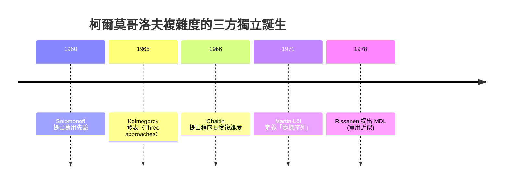

# 柯爾莫哥洛夫複雜度：最短程式與隨機性

## 蘇聯數學帝國的皇帝

Andrey Nikolaevich Kolmogorov，1903 年生於坦波夫（Tambov），由母親的妹妹在鄉下撫養長大。他一生的學術根基，是斯大林時代前後的莫斯科大學；在那個制度化的學術帝國裡，他先以**機率論的公理化**（1933，《Grundbegriffe der Wahrscheinlichkeitsrechnung》）確立了與歐洲數學主流平起平坐的地位，之後成為莫斯科數學圈的核心人物： topology（拓撲）、 dynamical systems（動力系統）、 turbulence（湍流）、 chain of complexity（複雜性理論）、創立了帝國式的學派。

蘇聯的制度塑造了科學的一個特殊性：**學術生涯高度依賴導師—學生的垂直傳承**，而不像美國那樣靠論文發表次數與引用的量化評估。Kolmogorov 不僅生產概念，還**生產人**：Arnold、Gelfand、Shiryaev、甚至一度收編了離經叛道的天才 Martin-Löf。這種「學術 政治」讓一個概念從誕生到成為學派，可以透過「師承的威望」迅速擴散。

## 1965：資訊的第三種面貌

Shannon 的資訊論定義了一連串信號的熵 $H$：需要知道「這串資料**平均**需要多少 bit 來編碼（在已知道機率分佈的前提下）」。但 Shannon 的熵**必須先有一個機率分佈**才能算，這對「一段特定的字符串是否隨機」的問題無法回答。

1965 年，Kolmogorov 在《Problemy Peredachi Informatsii》發表〈Three approaches to the quantitative definition of information〉，提出一個把事情翻轉的想法：

$$
K(x) = \min_{p:\ U(p)=x} |p|
$$

**一串資料的複雜度，定義為輸出這串資料的最短程式的長度**（$U$ 是萬用圖靈機）。這就是「**算法資訊量**」。

這一招把 Shannon 的「統計平均」翻成「**—for 一段特定資料—最是如何被無中生有地描述**」。資訊的「真實面貌」不再是機率，而是**程式碼的長度**。

## 圓周率為什麼不隨機？

$\pi = 3.14159\dots$ 的小數展開，在直覺上「看起來極像亂碼」。但它的 Kolmogorov 複雜度極低：

```pi
程式長度 O(1): "給定 n，計算 pi 的第 n 位"
→ K(pi 的任何前綴) ≈ K(n) + O(1) ~ log n
```

因此 **$\pi$ 不是隨機的**，它是「有序但表面上不可讀」的典型。真正的隨機 string（例如 RAAM 源產生的 bit stream）則對應到 $K(x) \approx |x|$ 的極限—**最短程式就是「把它印出來」本身**。這就是「**不可壓縮性**」的定義：

$$
K(x) \ge |x| - c \quad \Leftrightarrow\quad x \text{ 是 (c-) 隨機的}
$$

如此一來，「隨機性」有了**算法的面貌**：**隨機 = 不可壓縮**。

## Solomonoff 與 Chaitin：三個獨立的發現

Kolmogorov 並不是唯一的提出者：

- **Ray Solomonoff**，1960 年代初。他在 MIT 前線（處理貝葉斯歸納）中，獨立定義了「萬用先驗」（universal prior）：對一段資料，從**所有可能生成它的程式**上加權求機率。這個方案直接通往今日的 Solomonoff 歸納，可視為「理論上最完美的機器學習」基準；
- **Gregory Chaitin**，當時還是個十幾歲的少年，1956 年在紐約的哥倫比亞大學就提出「程式長度做為複雜度」的想法，1966 年正式發表。他後來以此為基礎推出「Chaitin 不完備定理」：像哥德爾不完備一樣，**一個形式系統無法證明某些字串的複雜度大於某個閾值**。

三人幾乎同時、互不通信（或幾乎不通信）得出了相同的核心概念，在**冷戰時代的鐵幕兩邊**完成了同一個數學創作。這在二十世紀數學史上是罕見的有趣景觀。



## $K(x)$ 不可計算

柯爾莫哥洛夫複雜度有一個致命的特點：**$K(x)$ 是不可計算的**（Kolmogorov 自己在 1965 年也證明了）。證明是很「圖靈式」的自指：

> 假設有一個程式 `P` 能計算 $K(x)$，則寫出這樣一個程式 Q：「找到第一個 $K(x) > n$ 的 $x$，輸出 $x$」。Q 的長度是常數 $+\log n$，但 $x$ 的複雜度大於 $n$。矛盾。

這意味著：**「隨機性」這個概念本身不可判定**。我們永遠無法確定一段資料是不是「真的並且確定地」隨機。這在哲學上的震撼不亞於哥德爾不完備。

## 實踐近似：壓縮與 MDL

既然 $K(x)$ 不可計算，我們只好用**實用的壓縮演算法**做為上界：gzip、LZ77、LZ78、算術編碼等，都只是「$K(x)$ 的某個可計算的上界」。壓縮率成為「複雜度的一種近似」——**壓縮演算法就是一種不完美但可操作的創造論者**。

1978 年，芬蘭學者 Jorma Rissanen 把這個思想推向統計學：**最小描述長度（MDL, Minimum Description Length）** 原則：

$$
\text{Description length} = L(\theta) + L(x\mid\theta)
$$

模型的好壞，不是取決於它「擬合得多好」，而是取決於「**模型 + 殘餘資料的總描述長度是否最短**」。這在現代機器學習中成為「泛化能力」「避免 overfitting」的理論根基，並在理論上和 Vapnik–Chervonenkis、Bayesian model selection（BIC）相互呼應。MDL 是柯爾莫哥洛夫複雜度在**實際資料科學中的存在意義**。

## 制度背景：為什麼是蘇聯？

Kolmogorov 學派能把「算法資訊論」發揚光大，與蘇聯的制度特殊性有關：蘇聯的數學家對於「統計、圖靈機、邏輯」的跨界，沒有西方學科壁壘的壓力；同時史達林晚期及蘇聯解凍時代，數學是少數「政治上相對安全的資優生巢」。柯爾莫哥洛夫選擇了在這個安全區內做**普適性理論**，並意外地在三十年後接上了全球的資訊工業—**壓縮、密碼學、機器學習**。

而這一切，都源於一個簡單到近乎天真的問題：

> **一串資料，能不能只用「你怎麽描述它」來衡量它有多複雜？**
