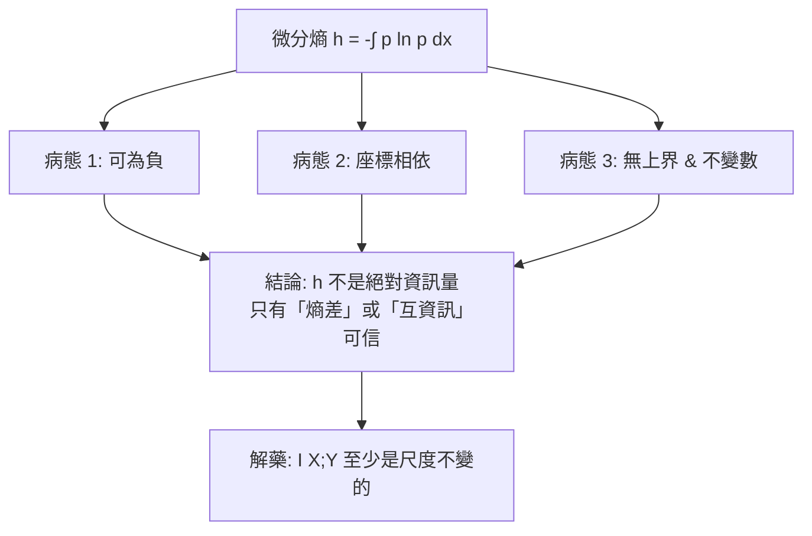

# 微分熵與幾何熵：連續變數的副量

## 離散熵之後

Shannon 的熵 $H(X) = -\sum_x p(x)\log p(x)$ 定義在**離散**符號集合上。但物理世界充斥連續量：雜訊電壓、溫度起伏、布朗運動的位置。想把「熵」搬到連續變數，第一個直覺做法是把積分想成求和的極限：

$$
h(X) = -\int_{-\infty}^{\infty} p(x)\ln p(x)\,dx - \infty?
$$

這裡就是問題的開始。把離散概率均分到 $n$ 個格子，每格有 $p(x_i)\delta x$；離散熵是

$$
H_n = -\sum_i p(x_i)\delta x \log\bigl(p(x_i)\delta x\bigr) \approx h(X) - \log(\delta x)
$$

當 $\delta x \to 0$，$H_n \to -\infty$。**連續熵差的部份才是有限且自然的**，而**絕對熵是在取極限時發散的**。Shannon 把 $h(X)$ 定義成 (離散熵的極限)—丟掉發散項後的「副量」—並稱為 **differential entropy（微分熵）**。

## 微分熵的三種病態

微分熵幾乎繼承了離散熵的符號形式，卻失去了離散熵的精神。它有三種「病態」：

### 1. 可以是負數

對均勻分佈 $U[0, a]$：

$$
h = \ln a
$$

若 $a < 1$，$h < 0$。離散熵永遠 $\geq 0$（1 bit 資訊起跳），微分熵則**沒有下界**。這暴露出guy一块：**連續變數下的「資訊量」不能有絕對零點**。

### 2. 座標依賴

若把 $x$ 換成 $y = 2x$，機率密度變成 $p_y(y) = p_x(y/2)/2$，於是

$$
h(2X) = h(X) + \ln 2
$$

**光是把公尺換成公分，熵就增加了** $\ln 100$。顯然這不是「真實的資訊量」，而是**單位選擇的副作用**。離散熵沒有這個問題：換一個符號編碼頂多改變常數。

### 3. 沒有最大值

在固定方差的約束下，微分熵有最大值（見下一節）；但若不固定方差，你可以把分佈拉得有多寬，熵就多大。因此微分熵**只能做為相對量使用**。

## 高斯是最大熵分佈

微分熵的第一個「好消息」是在**固定方差**這約束下，有一個唯一（漂亮）的贏家：

$$
\text{固定 } \mathrm{Var}(X) = \sigma^2,\ \text{求最大化}\ h(X)
$$

這是一個變分法問題：**拉格朗日乘子法**指出，最大熵分佈必須有形式 $\exp(\alpha + \beta x + \gamma x^2)$，加上歸一化與二階矩條件，恰好就是**高斯**：

$$
p(x) = \frac{1}{\sqrt{2\pi\sigma^2}}\exp\!\left(-\frac{(x-\mu)^2}{2\sigma^2}\right), \qquad h = \frac{1}{2}\ln(2\pi e\sigma^2)
$$

這個結果在兩個方面接上了物理與統計的思想：

1. **最大熵推論**（Jaynes 1957）：若你只知道方差（二階矩）而以外一無所知，那最合理（最不瞎猜）的模型就是高斯。**常態分佈的普遍性，不僅僅來自 CLT，也在於它是「不偷渡任何額外資訊」的模型**。CLT 說「很多獨立隨機源加上來是高斯」，最大熵說「只有方差約束的最無偏模型是高斯」：兩者從不同方向，都指向了同一個分佈；
2. **通訊工程**：在加性高斯白噪聲信道（AWGN）的容量公式中，噪聲的熵正是 $\tfrac12\ln(2\pi e\sigma^2)$。**Shannon 容量公式的數學核心，正是這裡的高斯最大熵性質**。

## 真正不變的量：互資訊

杜絕座標依賴的解藥，是**互資訊**：

$$
I(X;Y) = h(X) - h(X\mid Y) = h(X) + h(Y) - h(X,Y)
$$

當 $X, Y$ 同時進行可逆變換，$h(X)$ 與 $h(X\mid Y)$ 都各自加常數，**相減後常數消失**：

$$
I(f(X);\, g(Y)) = I(X;\, Y) \quad \text{（f, g 可逆變換）}
$$

這說明：**在連續系統上，資訊量唯一具有「本體位階」的量，是互資訊**；微分熵本身只能以「相對於背景期望」的方式使用。（同樣的邏輯也出現在 Renyi、Tsallis 等廣義熵的連續版本中，但 $I$ 的尺度不變性是 Shannon 系統獨有的美學特點。）

## 動力系統的熵：拓撲熵與 Kolmogorov–Sinai entrop) 

上一章談 Kolmogorov 複雜度：一段固定序列的複雜度。那麼「**一個動力系統的軌跡**」呢？1960 年代：

- **Kolmogorov** 1958 年在莫斯科的動力系統討論班，與他的學生 **Yakov Sinai** 一起定義了 **Kolmogorov–Sinai 熵**（也稱度量熵 measure-theoretic entropy）：一個混沌動力系統每步迭代平均產生多少位新的（不可預測的）資訊。對可微系統，這個熵與 **Lyapunov 指數** 相關：

$$
h_{KS} = \sum_{\lambda_i > 0} \lambda_i \quad \text{（Pesin 定理）}
$$

也就是：**每秒的正 Lyapunov 指數之和，就是「混沌系統每單位時間吐出多少新 bit」**；這就是「資訊流率」—混沌的一個算法資訊量刻度；
- **拓撲熵**（Adler、Konheim、McAndrew 1965）：純拓撲的刻度，用「區間的像有多少段」來定義，比起 KS 熵更「幾何」。

**動力系統的熵，是「資訊論之後」才被成功定義的**：如果沒有 Shannon 的資訊量，混沌理論就無法被數學化。

## 幾何熵：現代的延伸

晚近的數學物理，把熵推廣到**幾何與拓撲**的層次：

- **Perelman 的熵**：2002–2003 年，Grigori Perelman 在證明龐加萊猜想的 Ricci flow 架構中，定義了流形上的「$\mathcal{F}$-熵」與「$\mathcal{W}$-熵」，用**單調性**取代了 Bishop–Gromov 體積比較—幾何熵做為「能否單調不減」的動力系統切面；
- **CFT / holographic entropy**：量子場論與全息原理裡，糾纏熵 $S = \mathrm{Area}(\gamma)/4G$ 的 Ryu–Takayanagi 公式；這些是**另一種**「熵 = 幾何」的對應。

這些現代工作遠在本卷的範圍之外，在此只是**註腳**：熵，這個從熱力學蒸汽機時代出發的概念，如今滲透到從微分幾何到量子引力的所有數學領域。

---

回顧本章，微分析與幾何分析兩種進路給我們同一個教訓：

> **在連續世界，「絕對熵」是不可信的；可信的是熵差、互資訊與那些「單調的量」**。資訊與物理在連續變數的世界中，都更願意討論「關係」，而不是「本體」。
