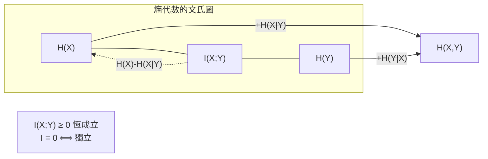
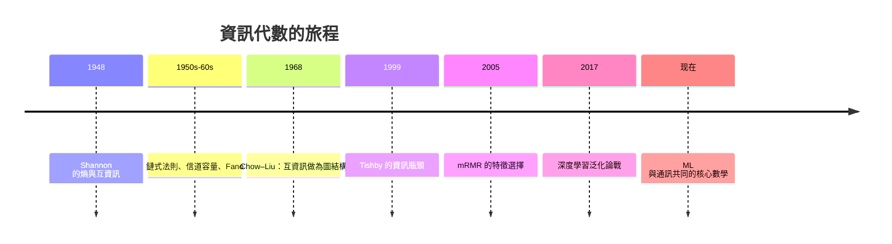

# 聯合熵、條件熵與互資訊：資訊的代數

## Shannon 之後：資訊有了算術

1948 年的 Shannon 給了資訊一個度量 $H$。但真正讓資訊論成為一門**數學**的，是接在 $H$ 後面的那套**代數**：聯合、條件、以及最重要的—**互資訊**。就像 1933 年 Kolmogorov 給機率公理化、讓機率論成為測度論，這些恆等式讓資訊從「直覺量」升格為「結構」。

## 四個基本量

設兩個隨機變數 $X$、$Y$：

**聯合熵**：描述兩個變數所需的總資訊，

$$
H(X,Y) = -\sum_{x,y} p(x,y)\log p(x,y)
$$

**條件熵**：在知道 $Y$ 之後，$X$ 還剩多少不確定，

$$
H(X\mid Y) = -\sum_{x,y}p(x,y)\log p(x\mid y)
$$

**鏈式法則**（第一條結構恆等式）：

$$
H(X,Y) = H(X) + H(Y\mid X) = H(Y) + H(X\mid Y)
$$

以白話說：**描述兩件事，可以「先說第一件、再說第二件的剩餘」**。注意 $H(Y\mid X)\neq H(X\mid Y)$—「知道 $Y$ 後 $X$ 的剩餘」與「知道 $X$ 後 $Y$ 的剩餘」一般是不同的。

**互資訊**（資訊論的核心）：兩個變數共享多少資訊，

$$
I(X;Y) = H(X) - H(X\mid Y) = H(Y) - H(Y\mid X) = H(X)+H(Y)-H(X,Y)
$$

它有三個驚人的性質：**對稱**、**非負**、**對可逆變換不變**（在連續情形）。而且：

$$
I(X;Y) = 0 \quad\Leftrightarrow\quad X \perp Y \text{（統計獨立）}
$$

**資訊量為零，等價於獨立性**。這使得互資訊成為「相關性」的一個超越版本—它可以捕捉非線性依賴，而相關係數不能。

## 鏈式法則與圖結構

鏈式法則可以推廣到多個變數：

$$
H(X_1,\dots,X_n) = H(X_1) + H(X_2\mid X_1) + \dots + H(X_n\mid X_1,\dots,X_{n-1})
$$

這條恆等式看起來平凡，但它是**整個機率圖模型（Bayesian network）資訊分析的基石**。若一群變數之間具有稀疏依賴（例如 Markov chain $X \to Y \to Z$），就能寫出精簡的分解：

$$
H(X,Y,Z) = H(X) + H(Y\mid X) + H(Z\mid Y)
$$

**資訊代數與圖結構合體，就成為因果與統計學習的通用語言**。

## Chow–Liu 樹：資訊代數的第一個演算法實踐

1968 年，Chow 與 Liu 在《IEEE Transactions on Information Theory》發表〈Approximating discrete probability distributions with dependence trees〉：

> **給定一堆二元變數，如果要建一個機率模型、允許任意樹狀結構，那麼最優結構就是「以互資訊為邊權重」的最大生成樹。**

具體做法：$n$ 個變數兩兩算 $I(X_i;X_j)$，做最大生成樹（Kruskal/Prim），得到一枚**貝氏網路的樹狀近似**。這是**第一個把 Shannon 的概念直接轉成機器學習演算法**的工作，比 AI 的「神經網路熱潮」早了三十年，至今仍是結構學習（structure learning）的教科書基準。

## 五種現代實踐

### Feature selection：mRMR

在 ML 的特徵選擇問題中，Peng 等人 2005 年提出的 **mRMR（minimum Redundancy Maximum Relevance）** 原則值得大書：

$$
\text{score} = \max_{x_i}\left[\, I(x_i; Y) - \frac{1}{|S|}\sum_{x_j\in S} I(x_i;x_j)\, \right]
$$

**選擇特徵時，要「與標籤相關最高」且「與已選特徵冗餘最低」**。這其實就是互資訊代數的直接應用：relevance 是 $I(x_i; Y)$，redundancy 是 $I(x_i; x_j)$。資訊代數找到了自己的「最速爬山法」。

### 資訊瓶頸：Tishby 的思想

1999 年，以色列希伯來大學的 Naftali Tishby 與兩位同事，在《Nature》發表了〈The information bottleneck method〉。他們問一個看似天真的問題：

> **壓縮「輸入 X」得到「表示 Z」，同時要盡量保留關於「標籤 Y」的資訊；這最優平面在哪？**

形式上是優化：

$$
\max_{p(z\mid x)}\; \bigl[\, I(Z;Y) \;-\; \beta\, I(Z;X)\,\bigr]
$$

也就是**同時平衡「壓縮多狠」（$I(Z;X)$ 小）與「保留多少關於答案的資訊」（$I(Z;Y)$ 大）**。

### 2017 年的深度學習大論戰

資訊瓶頸迎來了它的高光與爭議。2017 年，Tishby 與他的博士生 Shwartz-Ziv 在一篇著名的論文宣稱：

> **訓練中的深度網路分兩個階段：第一階段「擬合」（增加 $I(Z;Y)$），第二階段「壓縮」（減少 $I(Z;X)$），而壓縮才是泛化的關鍵**。

這個說法引發了 Andrew Saxe、Yoshua Bengio 等人的質疑（他們在 2018 年反駁：在某些激活函數下，$I(Z;X)$ 根本不會減小），掀開了「**資訊瓶頸是否解釋了深度學習的泛化**」的大論戰。不論最終裁決如何，這場辯論的本身**已經把資訊論代數，推到了現代 AI 理論的菲律賓**。

### 資訊與因果

近年來，「互資訊 → 因果」的研究方向正在爆發：條件互資訊 $I(X;Y\mid Z)$ 用來量化「在已知 $Z$ 下 $X$ 與 $Y$ 的剩餘依賴」，是判定因果結構（D-separation）的工具；「部分資訊分解」（Williams & Beer, 2010）嘗試把互資訊拆解成「獨有、冗餘、協同」三個成分。這是資訊代數的下一章。

## 台柱：Shannon 容量與 Fano

資訊代數在經典理論中的兩個**頂點**必須記住：

**Shannon 信道容量**：對於加性高斯噪聲信道，可達到最大的資訊傳輸率是

$$
C = B \log_2\!\left(1+\frac{S}{N}\right)
$$

它是通訊工程的一切，但其數學內核就是**高斯的最大熵性質**（見上一節）。

**Fano 不等式**：若你要從 $H(X\mid Y)$ 中猜 $X$，則錯誤率 $\Pr[\hat X \neq X]$ 有下界

$$
\Pr[\hat X \neq X] \ge \frac{H(X\mid Y) - 1}{\log_2|\mathcal{X}|}
$$

這條不等式的訊息：**剩餘熵（還剩多少不確定）直接限定了「猜錯的可能性」**。Fano 不等式在 ENCODED **證明** 幾乎所有「無法猜對」的定理（包括 channel capacity 的 converse、lower bound on generalization error）中，是最常用的工具。

## 一個通用語言的誕生

回望從 Shannon 1948 到 Tishby 1999 的半個世紀，**資訊代數經歷了一個不尋常的命運**：

今天，資訊代數同時活在兩個看似不相干的工業中：**通訊**（5G、衛星、編碼理論）與**機器學習**（表示學習、資訊瓶頸、特徵選擇）。它們的底層是**同一套恆等式**。

而這一切，源於 1948 年的一封長文、一群工程師想解決的「**電話線上的噪音**」問題。**所有偉大的代數，都始於一個非常務實的問題**。
