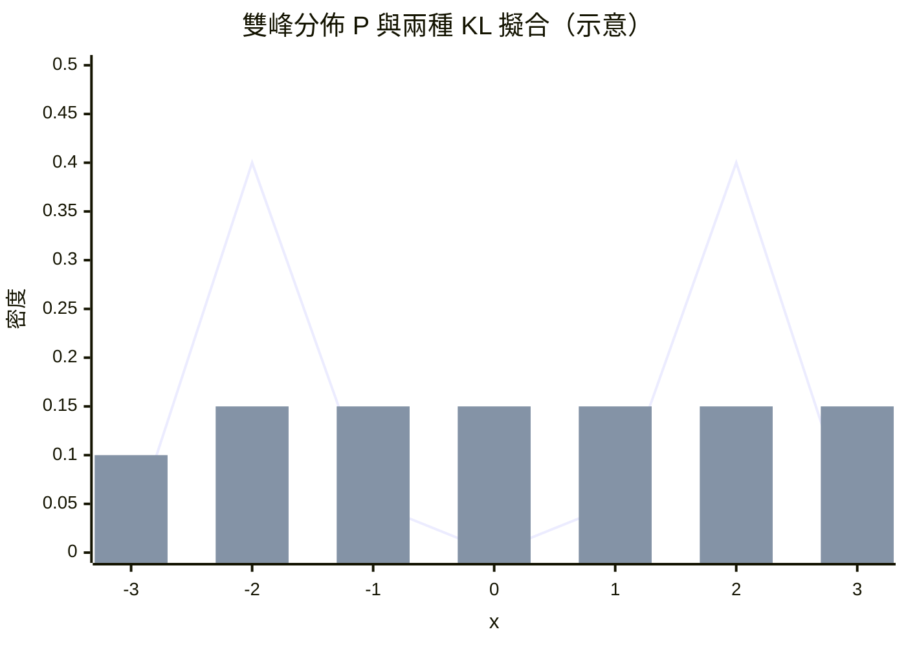

# KL 散度：衡量兩個分佈差異的資訊學尺規

## 從密碼室走出來的兩位統計學家

1951 年，《The Annals of Mathematical Statistics》刊登了一篇篇幅不長的論文〈On Information and Sufficiency〉，作者是索羅蒙·庫爾貝克（Solomon Kullback）與理查德·萊布勒（Richard Leibler）。這篇論文後來被引用超過十萬次，成為整個機器學習時代最常用的「距離」之一。但它的誕生，得從第二次世界大戰的密碼分析室說起。

庫爾貝克是布魯克林人，1927 年自紐約城市學院畢業，與萊布勒一同被美國陸軍通訊兵團招入信號情報處（Signals Intelligence Service, SIS，後來的陸軍安全局）。1930 年代末，兩人參與了著名的「紫密碼」破譯工作——日本外務省的 97-shiki ōbun imú 機械密碼。1940 年，SIS 團隊成功復原紫密碼的加密機，為此後截聽日方外交電報打下基礎。戰後庫爾貝克繼續在密碼界服務多年，最終晉身陸軍安全局首席科學家，1958 年才轉赴喬治·華盛頓大學任統計學教授。

密碼分析的本質，是判斷「這串訊號出自哪個來源」：是德軍的模式，還是敵方故意布置的誘餌？這正是兩個機率分佈的辨別問題。香農 1948 年的《通信的數學理論》問世後，庫爾貝克立刻意識到：資訊論不僅能算出一個分佈的資訊量，更能定義**兩個分佈之間差了什麼**。戰場上的直覺，化成了數學。

## 定義：一種「不等距」的距離

對離散分佈，KL 散度的定義是：

$$D_{\mathrm{KL}}(P \,\Vert\, Q) = \sum_{x} p(x) \log \frac{p(x)}{q(x)}$$

連續情形則把求和換成積分。它有兩個關鍵性質：

1. **非負性**：$D_{\mathrm{KL}} \geq 0$，且等於 0 若且唯若 $P = Q$（在 $Q$ 支集涵蓋 $P$ 的前提下）。這正是吉布斯不等式的資訊論化身。
2. **非對稱性**：$D_{\mathrm{KL}}(P \,\Vert\, Q) \neq D_{\mathrm{KL}}(Q \,\Vert\, P)$。它不是度量（metric），因為違反對稱性與三角不等式。

庫爾貝克與萊布勒在原始論文中正是透過「兩套假設之間的判別統計量之期望值」導出這個量：$n D_{\mathrm{KL}}(P\Vert Q)$ 正是似然比檢定在 $P$ 為真時，對數似然比期望值的 $n$ 倍——也就是密碼分析員每天在做的事的數學化。

若比較《熵的故事》前章的記號，易見 KL 散度就是「相對熵」：

$$D_{\mathrm{KL}}(P \,\Vert\, Q) = H(P, Q) - H(P)$$

其中 $H(P,Q) = -\sum p \log q$ 是交叉熵。換言之，KL 散度是「用錯誤的模型 $Q$ 編碼真實分佈 $P$，每天白白多付的位元數」。這種編碼式解讀，使它天然成為機器學習損失函數的語言。

## 前向與後向：兩種錯法，兩種性格

非對稱性不是瑕疵，而是豐富的設計資源。考慮目標分佈 $P$（如藍色資料）與簡化模型 $Q$（如蛋糕袋）：

- **前向 KL** $D_{\mathrm{KL}}(P\Vert Q)$：期望在真分佈下取平均。凡 $P$ 概率不為 0 之處，$Q$ 若冷落便得付無限代價。被迫「攤平」整個 $P$ 的支集——**mode-covering**：模型寬而保守，寧可錯殺不可錯放。
- **後向 KL** $D_{\mathrm{KL}}(Q\Vert P)$：期望在模型分佈下取平均。$Q$ 敢將概率放在 $P$ 的肩上，但只要漏掉一個峰，便要付無窮代價——**mode-seeking**：模型窄而自信，寧缺勿濫。

一張 mermaid 圖呈現兩者對雙峰 $P$ 的不同擬合：

具體地說，變分推論中若選 q 比 p 窄、會走後向 KL 尋峰、kal outright； q 比 p 寬（如高斯 q 對多峰 p），則走前向 KL 會給出大雜燴，各峰都顧。面對雙峰 $P$，後向 KL 的 $Q$ 常常整個貼在其中一峰上（尋峰）；前向 KL 的 $Q$ 則傾向攤在兩峰之間（蓋峰）。哪一種對，取決於下游任務：做壓縮時不可遺漏任何模式（前向），做決策時只需要對的地方（後向）。這條分界線，日後貫穿了變分自編碼器、強化學習软策略與 RLHF 的全部技術論爭。

## 散度家族：KL 只是起點

KL 散度開啟了兩個「散度家族」的研究方向。**f-散度**是這樣的泛函族：

$$D_f(P\Vert Q) = \int f\!\left(\frac{p(x)}{q(x)}\right) q(x)\,dx, \qquad f(\text{凸函數, } f(1)=0)$$

選 $f(t) = t \log t$ 得回 KL；選 $f(t) = \frac12 |t-1|$ 得全變差（total variation）；選 $f(t) = (\sqrt t -1)^2$ 得 Hellinger 距離。1959 年 Ali 與 Silvey、1967 年 Csiszár 系統化了這個家族，日後的生成對抗網路（GAN）諸多變體，本質上只是在 f-散度菜單上換一道主菜。

另一支是 **Bregman 散度**：對一個凸函數 $F$，定義 $D_F(x, y) = F(x) - F(y) - \langle \nabla F(y), x-y\rangle$。神奇的是，以熵函數 $F = \sum p \log p$ 生成的 Bregman 散度，恰好就是 KL 散度（差一符號與歸一化常數）。這讓 KL 散度成為一族「廣義距離」中對指數族分佈唯一的自然選擇——統計學、資訊論與幾何，在此三方會師。

## 夥伴與子嗣

KL 散度在現代機器學習中的觸角極廣：

- **EM 演算法**（Dempster, Laird & Rubin, 1977）：其 E 步維持 ELBO，M 步升級 ELBO，整個演算法等價於最小化 $D_{\mathrm{KL}}(P \Vert Q_\theta)$，即迭代拉近數據分佈與模型分佈。
- **變分推論**：目標 $D_{\mathrm{KL}}(q(z)\Vert p(z|x))$ 不可算，故最小化其上界 ELBO，KL 作為正則項登場。
- **信賴域策略優化（TRPO, Schulman et al. 2015）**：在策略空間為每步更新畫一個 KL 信賴域，「一次只能變動這麼多」，避免一次大改讓策略崩潰。後繼者 PPO 用剪裁替代顯式 KL，到了 RLHF（InstructGPT, 2022）更直接把 $D_{\mathrm{KL}}(\pi \Vert \pi_\text{ref})$ 寫進獎勵函數，捆住模型不要太偏離原始面貌。
- **知識蒸餾**（Hinton et al., 2015）：以 $D_{\mathrm{KL}}(\text{teacher} \Vert \text{student})$ 為損失，把大模型知識壓進小模型。

## 信息尺規的誕生

回望熵概念的百年遷徙：克勞修斯 1865 年為熱機立名，波茲曼 1877 年為分子清點狀態，吉布斯 1902 年為系綜取平均，香農 1948 年為通信計價，庫爾貝克與萊布勒 1951 年為分佈造尺。每一步都在回答同一個問題：「怎麼定量地說出**不確定性**與**差異**？」

KL 散度不對稱、非負、在零點唯一，像一把單向的尺規：你只能用它丈量「以假亂真的代價」，而代價的支付者——是那個做出錯誤模型的觀察者。機器學習時代的一切訓練，說穿了，都是拿這把尺規不斷逼近：$D_{\mathrm{KL}}(\text{世界} \,\Vert\, \text{模型}) \to 0$ 而已。
