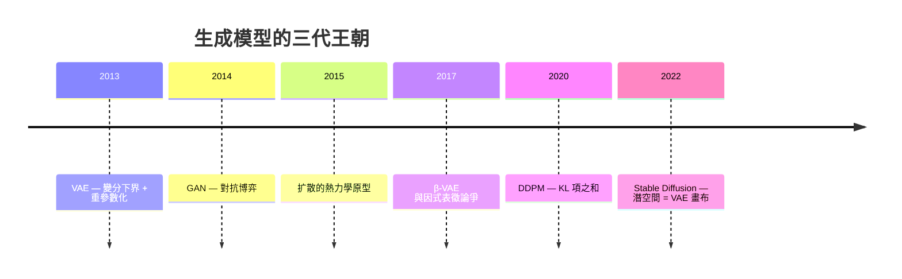

# VAE 與 KL 正則化：生成式 AI 的隱空間

## 兩堵牆之間的生成模型

2014 年之前，生成模型卡在兩堵牆之間。玻茲曼機族的模型有嚴謹的機率語義，但配分函數算不動；省略配分函數的技巧(GAN 尚未成熟)則太脆弱。杜倫大學的 Diederik Kingma 與阿姆斯特丹大學的 Max Welling,在2013 年寫出了〈Auto-Encoding Variational Bayes〉,次年發表於 ICLR。這篇論文與 GAN(Goodfellow 等, 2014)幾乎同時問世,共同開啟了「深度生成模型」的黃金十年——而它的核心引擎,仍是熵家族的老朋友:KL 散度。

## ELBO:一條下界,兩種張力

設數據 $x$ 由隱變數 $z$ 生成,我們想最大化對數概似 $\log p_\theta(x)$,但它被積分 $\int p_\theta(x,z)\,dz$ 卡死。變分貝葉斯的古典解法是引進可優化的代理分佈 $q_\phi(z|x)$,推得**證據下界**(ELBO):

$$\mathcal{L} = \mathbb{E}_{q_\phi(z|x)}\big[\log p_\theta(x|z)\big] - D_{\mathrm{KL}}\big(q_\phi(z|x) \,\Vert\, p(z)\big)$$

由 Jensen 不等式,$\log p_\theta(x) \geq \mathcal{L}$,故抬升 ELBO 便是在抬升概似的下界。這個目標天然分成兩股張力:

- **重建項**:給定 $z$,輸出要像 $x$。它要求隱空間保有豐富細節。
- **KL 正則項**:把每個 $x$ 的後驗 $q_\phi(z|x)$ 拉向先驗 $p(z)$(常為標準常態)。它要求隱空間整齊、平滑、連續——好讓從 $p(z)$ 抽樣的新點被解碼成合理圖像。

兩股力量互相拉扯:KL 想把一切後驗壓向相同的高斯(資訊歸零),重建想把各點拉得彼此遠離(資訊豐富)。這正是《熵的故事》的母題重演:過度的約束使系統僵死,過度的自由使它崩解。VAE 的隱空間,就是熵與資訊的談判桌。

## 重參數化技巧:讓隨機性可以反向傳播

變分方法在神經網路上卡了幾十年,原因在於 ELBO 的期望項 $\mathbb{E}_{q}[\cdot]$ 涉及**抽樣**,而抽樣沒有梯度。Kingma 與 Welling 的關鍵一步(與 Rezende、Mohamed、Wierstra 的〈Stochastic Backpropagation〉同期)是**重參數化技巧**:把 $z \sim \mathcal{N}(\mu_\phi(x), \sigma^2_\phi(x))$ 改寫為

$$z = \mu_\phi(x) + \sigma_\phi(x) \cdot \epsilon, \qquad \epsilon \sim \mathcal{N}(0, I)$$

隨機性被移出計算圖、封裝在外生噪音 $\epsilon$ 中,$z$ 對 $\phi$ 成為確定的可微函數——整個 ELBO 便能以反向傳播端到端訓練。訓練 VAE 從此與訓練普通神經網路一樣簡單。這項技巧如今已是所有包含隨機層之模型(含扩散模型的前身、RL 中的隨機策略梯度)的標準工具。

```mermaid
flowchart LR
    x[輸入 x] --> E[編碼器 q_phi<br/>輸出 μ, σ]
    E --> N[ε ~ N 0, I]
    E --> C[z = μ + σ·ε]
    N --> C
    C --> D[解碼器 p_theta x|z]
    D --> R[重建項]
    C -.-> K[KL: q z|x vs p z]
    R --> L[ELBO 最大化]
    K --> L
```

## 後驗坍縮:KL 的黑暗面

正則項太強,便得「**後驗坍縮**」(posterior collapse):解碼器足夠強大(如自回歸 RNN)時,它不經 $z$ 也能重建數據,$q(z|x)$ 遂被 KL 壓成毫無資訊的 $p(z)$,隱空間整片荒蕪。對策諸多:KL annealing(Bowman et al., 2016,訓練初期關閉 KL 項的係數,先學重建再談紀律)、free bits、弱化解碼器等。「何時該聽話、何時該放縱」——熵的調度成為一門手藝。

## β-VAE:因子化,還是幻象?

2017 年,Higgins 等人在 Google DeepMind 提出 **β-VAE**:把 KL 項乘上係數 $\beta$,

$$\mathcal{L}_\beta = \mathbb{E}_q[\log p_\theta(x|z)] - \beta \cdot D_{\mathrm{KL}}(q(z|x) \Vert p(z))$$

$\beta > 1$ 時正則更強,逼迫各個隱維度彼此因子化(disentangle),讓「旋轉」「大小」「顏色」各佔一維。這引發了表徵學習的論爭:Locatello 等 2019 年的 ICML 論文(以理論與大規模對照實驗)證明**無監督下因子化表徵原則上不可辨識**——$\beta$-VAE 學到的分離,頗程度依賴資料集的偏置。這場論爭的核心,仍是一個熵的問題:我們希望模型把世界的變異拆成多少份互資訊,而拆法的天平,就架在 $\beta$ 這個旋鈕上。

## 通往扩散模型之路:一幅未完成的理論地圖

2017–2020 年,生成模型的王座易手。GAN 先行崛起,但真正後繼者是**扩散模型**。奇妙的是,VAE 的理論框架並未退場,反而成為扩散模型的骨架:Sohl-Dickstein、Weiss、Maheswaranathan、Ganguli 2015 年的〈Deep Unsupervised Learning using Nonequilibrium Thermodynamics〉——注意這標題的熱力學血統——與 Ho、Jain、Abbeel 2020 年的 DDPM,其訓練目標皆可寫成**隨時間展開的變分下界**:一串 KL 項之和,正是 ELBO 在每一步加噪後的推廣。Stable Diffusion(2022)背後的潛空間扩散(LDM, Rombach et al.),更乾脆先以 VAE 把像素壓入潛空間再跑扩散——**VAE 的隱空間,成為了 Midjourney 圖像的畫布**。

生成式 AI 的演化,可畫成這樣的譜系:



## 生成是另一種壓縮

回到這本書的母題,VAE 最大的理論遺產是:**生成即壓縮的逆命題**。ELBO 明確地將 $\log p_\theta(x)$ 拆為「描述 $z$ 所需的碼長(KL 項)」與「以 $z$ 重構 $x$ 的殘差碼長(重建項)」——這是率失真理論(rate-distortion, Shapiro 1952; Tishby 1999 年的資訊瓶頸)的直接重演。訓練 VAE,等價於學會為世界設計一套兩段式編碼:先用少量位元抓住本質,再用可讀的代價修補細節。香農 1948 年的通信題,在 2013 年被重新問了一次——只是這回,提問的不再是工程師,而是機器自己。
