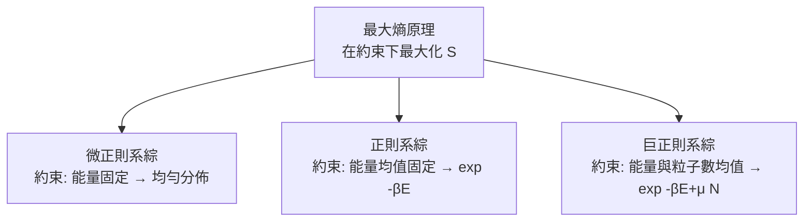

# 賈恩斯最大熵原理：最客觀的推論

## 一位反叛的物理學家

1957 年,〈Physical Review〉第 106 卷與第 108 卷連續刊出兩姊妹作:〈Information Theory and Statistical Mechanics〉I 與 II。作者埃德溫·湯普森·賈恩斯(Edwin T. Jaynes, 1922–1998)當時任教於史丹佛大學(早歲在華盛頓大學聖路易斯分校取得學位,後長期任教華盛頓大學聖路易斯)。這兩篇論文做了一件大膽的事:**把整個統計力學,重述為資訊論的一個特例**。平衡態分佈不再是自然界的神秘法則,而是理性推論在給定資訊下的唯一誠實答案。

## 最大熵原理:最少主觀的立場

賈恩斯的論證從香農熵出發。設我們對系統只知道若干宏觀約束(能量均值、粒子數均值等),其餘一無所知。那麼對微觀狀態的機率分佈,我們該選哪個?賈恩斯答:選**在滿足全部已知約束之下,熵 $S = -k \sum p_i \log p_i$ 取最大的那個**。任何其他選擇,都等於暗中自稱知道了約束之外的資訊——那便是主觀臆測。

最大熵分佈可由拉格朗日乘數法一舉求出。在三個經典系綜上,原理一一兌現:

| 系綜 | 約束 | 最大熵解 |
|---|---|---|
| 微正則 | 總能量固定(各態等可能) | 均勻分佈 |
| 正則 | $\langle E\rangle$ 固定 | $p_i \propto e^{-\beta E_i}$——波茲曼分佈 |
| 巨正則 | $\langle E\rangle$、$\langle N\rangle$ 固定 | $p_i \propto e^{-\beta E_i + \mu N_i}$ |

換言之,統計力學教科書花百年苦心「導出」的三大系綜,在最大熵原理下一頁寫完。溫度 $\beta$ 所以出現,只因為它是「能量均值約束」的拉格朗日乘數——熱力學被還原為資訊論的影子。第二篇論文更把不可逆過程與輸運理論也拉進同一框架。

## 哲學立場:機率是邏輯的延伸

賈恩斯更深層的目標是整個機率論的詮釋之爭。他繼承哈羅德·傑佛瑞(Harold Jeffreys)與 R. T. Cox 1946 年的論證,主張機率不是頻率,而是**合理信念的度量**——貝葉斯主義的邏輯化版本。他晚年傾三十餘年之力撰寫《Probability Theory: The Logic of Science》。書未完成,1998 年 7 月他病逝於密蘇里州;書稿由劍橋大學的 G. Larry Bretthorst 整理,2003 年由劍橋大學出版社刊行,留下未完成的尾聲章。

在他看來,最大熵原理是貝葉斯主義的「先驗選擇器」:當你對先驗一無所知時,最大熵分佈是唯一不自欺的選項。他常舉的例子是骰子:已知均值為 4.5 的骰子,最大熵給出的分佈與直覺高度吻合,而任何「坦率」的等機率先驗反而是對「已知均值」這條資訊的浪費。這種「不用無根據的臆測」的哲學,使他成為 20 世紀後半貝葉斯復興的思想旗手之一——與 Lindley、Savage、de Finetti 並列。

## 通告整個學界的窗口

賈恩斯不只在紙上立論。他開設的「機率論的邏輯」課程與長年主編的《Maximum Entropy Formalism》會議文集(Michigan 州立大學 1978 起),把最大熵方法送到許多領域的門口。他本人也親手示範:Time delay 方法從實驗訊號重建物理量、用最大熵譜估計(Burg 方法,1967)從極短的振動數列推斷譜峰——工程界至今仍在使用的最大熵譜估計,是原理最直接的操作型兌現。教育面的意義同樣深刻:他的講義《Clearing up Mysteries — The Original Goal》與多份手稿在網路世紀被反覆轉貼,成為新一代貝葉斯工程師的共同讀物。

## 爭議與迴響:它是物理,還是推論?

批評一波未平。物理學家質疑:若最大熵只是推論工具,為何真實物質的溫度、比熱又真實地服從波茲曼分佈?熵的物理性(可測量、可轉化為功)豈是主觀信念所能承載?論戰延續數十年,其他學派提出對策:Zanghì 與 Shimony 的反例、Shore–Johnson 1980 年對原理之公理化(要求推論不因座標重標而改變),以及後來 Skilling、Caticha 的幾何重構。無論立場如何,最大熵方法已作為實用工具滲透各域:影像重建(Frieden 1972 年天文學應用)、譜分析、稀有事件統計、甚至生態學的物種分佈推斷。

回望這段歷史,最大熵原理的意義不在於「證明統計力學只是心理學」,而在於揭示一條更深的對稱:**自然選擇最可能狀態的方式,同構於理性主體在資訊匱乏下的最誠實賭注**。熱力學第二定律與貝葉斯更新,原來是同一枚硬幣的兩面。
