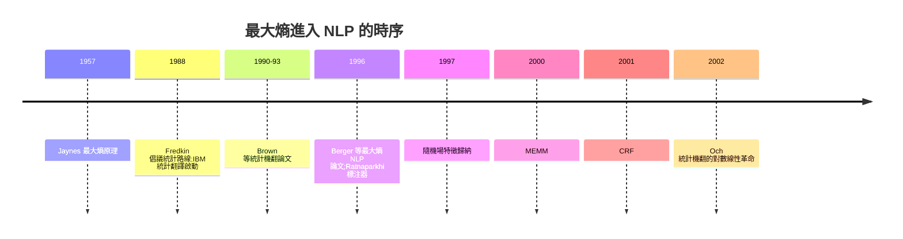

# MaxEnt 在 NLP 與統計建模的應用

## 語言,原來是統計的

1996 年,《Computational Linguistics》刊出 IBM 華生研究中心的論文〈A Maximum Entropy Approach to Natural Language Processing〉,作者亞當·伯格(Adam L. Berger)、文生·德拉·皮耶特拉(Vincent J. Della Pietra)與史蒂芬·德拉·皮耶特拉(Stephen A. Della Pietra)。這篇論文把賈恩斯 1957 年的原理,從物理系統搬到了人類語言——並在往後十年,把整個自然語言處理(NLP)的技術路線拉上統計軌道。

背景是 IBM 的機器翻譯計畫。1990 年前後,IBM 的 Peter Brown、Robert Mercer 與德拉·皮耶特拉兄弟發表了著名的統計機器翻譯系列(Brown et al., 1990/1993,《A Statistical Approach to Machine Translation》),以加拿大國會雙語記錄(Hansard)為語料,訓練 n-gram 與對齊模型。這些模型都是概率分佈——問題來了:數十萬條特徵(詞共現、詞性搭配、句法約束)同時要求模型貼合樣本統計,該怎麼把這些軟約束合為一個自洽的分佈?

## 最大熵原則:貼合約束,不作多餘假設

伯格等人的答案是最大熵:在滿足所有已知特徵期望等於其觀測期望的條件下,選出熵最大的分佈。形式上,模型族為

$$p_\lambda(y|x) = \frac{1}{Z(x)} \exp\!\Big(\sum_i \lambda_i f_i(x, y)\Big)$$

其中 $f_i$ 是二值特徵指示函數,$\lambda_i$ 是權重,$Z(x)$ 是配分函數。在約束 $\sum_{x,y} \tilde p(x,y) f_i(x,y) = \sum_{x,y} p_\lambda(x,y) f_i(x,y)$ 下最大化熵,拉格朗日對偶理論立刻斷言:**唯一解正是上述指數族(log-linear)形式**。

這個形式的歸一化指數形狀,工程師叫它 **softmax** 在多類條件下,它就是**邏輯迴歸**(logistic regression)的一般化。統計學家 1950 年代已熟知——Cox 1958 年的邏輯模型——只是名字不同。NLP 圈的叫法是「最大熵分類器」或簡稱 maxent。數學上,最大熵與最大概似在指數族上是**對偶的**:伯格等人的論文證明,最大熵解即提昇對偶似然函數的解,兩條路殊途同歸。這一對偶結構(Della Pietra 兄弟與 Lafferty 1997 年的〈Inducing Features of Random Fields〉進一步推到隨機場)成為往後條件隨機場(CRF, Lafferty、McCallum、Pereira 2001)的理論基座。

## 為什麼火?三個時代條件

1990 年代 maxent 爆紅,靠的不只是數學優雅,還有三個經濟與制度條件:

1. **特徵工程的彈性**。規則式 NLP(如當年的句法剖析器)需人工寫數百條規則;maxent 只需定義特徵,學權重交給演算法(改進迭代尺度 IIS,由 Della Pietra 兄弟與 Berger 在同一論文中提出;後來有更快的 L-BFGS 與 GIS 變體)。語言學家陡然從「寫規則的人」變成「造特徵的人」。
2. **語料的量化擴張**。1990 年代 LDC(Linguistic Data Consortium, 1992 年成立)開始大規模分發標註語料(賓州樹庫 Penn Treebank 等)。沒有語料,maxent 無米下鍋;語料經濟的產業化,直接餵養了統計 NLP。
3. **算力的降價**。指數模型的訓練是迭代優化,1990 年代中期工作站已可承受中等規模任務。

聯邦資助的 DARPA 系列評測(MUC 資訊抽取、TREC 檢索)則是制度層的催化劑:每年比賽,好壞一目了然,統計路線的得分碾壓規則路線,經費遂逐年轉向。

## 任務版圖:從 Pos 標注到翻譯

隨後十年,maxent 攻下了 NLP 幾乎所有任務:

- **詞性標注(POS tagging)**:Ratnaparkhi 1996 年的 maxent 標注器在中精度上首次追平規則系統。
- **句法剖析**:Ratnaparkhi 1997/1999 的 maxent 剖析器;Michael Collins 的模型實質混用 maxent 特徵與生成式結構。
- **機器翻譯**:Och 與 Ney 2002 年的對數線性翻譯模型(留意其表述完全以最大熵論證)。
- **序列標注**:2000 年 McCallum、Freitag、Pereira 提出最大熵馬可夫模型(MEMM);2001 年 Lafferty 等的條件隨機場(CRF)修正其標註偏置。全族都是「條件最大熵 + 馬可夫假設」的不同分支。

## 香火的延續

最大熵模型在 2010 年代被神經網路取代了「名分」,卻保留了「實體」。現代 Transformer 主幹是函數逼近器,但**分類頭就是 softmax + 交叉熵**——教科書中最純粹的條件最大熵模型;語言模型的目標(最大概似)與 maxent 的對偶目標等價,只是在什麼是「特徵」上換了答案:由人工設計的稀疏指示函數,換成由注意力層自動學出的稠密表示。此外,統計語言模型中的**平滑**(smoothing,如 Katz、Kneser–Ney,1995)在推導上同樣可從撥節中的最大熵或 Kullback 最小化印證;資訊檢索的查詢擴張(query expansion)與語言模型檢索模型(Ponte & Croft 1998 的 IR 語言模型、Zhai & Lafferty 的 risk 均值)皆以多項分佈的最大熵估計為骨架。換句話說,2017 年 Attention Is All You Need 的自我注意力,是給定上下文下對下一 token 分佈的最大熵估計的**非線性化身**:同樣的目標、同樣的對偶、只是由不同的特徵前所未有的表達力承載。

熵概念的旅程,於此完成另一次遷徙:1850 年代從熱機出發,1948 年進入通信,1957 年進入推論,1996 年進入語言——而最終,每一個和你對話的大語言模型,都還在日夜最小化那個 19 世紀的量。
