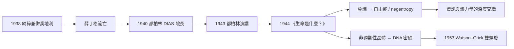

# 節標題：薛丁格 1944——生命以負熵為食

## 一位物理學家的越界之作

1943 年 2 月，都柏林三一學院的講堂裡，一位白髮的奧地利物理學家正在對付一批「不是物理學家」的聽眾。欧文・薛丁格（Erwin Schrödinger）——量子力學波動方程的締造者、1933 年諾貝爾獎得主——此時的第一身分，其實是都柏林高等研究院（DIAS）的院長，一個由首相瓦萊拉（Éamon de Valera）親手為這位流亡學者打造的職位。瓦萊拉本是數學出身，一心想在都柏林複製普林斯頓高等研究院，而把薛丁格從被納粹占領的歐洲挖來，正是這個雄心的核心。這段流亡史，也是本書這一章必要的背景：沒有 1938 年德國兼併奧地利、沒有薛丁格因政見與私德問題離開牛津與格拉茨，就不會有 1943 年都柏林這場演講。

演講在 1944 年結集成書——《生命是什麼？》（*What Is Life?*）。這本不到百頁的小書，副標題寫著「生命細胞的物理觀」，而它的讀者恰恰就是那些年輕的、不滿足於傳統生物學的非物理學家。

## 負熵：一句被誤讀半世紀的名言

書中最著名的一句話是：「生命以負熵為食。」（Life feeds on negative entropy.）薛丁格的原意是：生物不是靠「能量」生存——而機械論的生命觀如此說——因為能量在轉換中只是從高品位變成低品位的熱，整個宇宙的熵增加。生物真正吸收的，是「負熵」，即低熵的秩序：食物、陽光、清潔的空氣，都是高度有序的自由能載體。生命是開放系統，它把秩序吸進來，把混亂（熱、廢物、二氧化碳）吐出去，從而在自己體內維持一片熵的窪地。

薛丁格本人很快意識到「負熵」這個詞不夠精確。熵本質上就是負的對數概率，說「負熵」等於說「負的負對數」語法彆扭。他承認更正確的說法應當是「自由能」（free energy）——生物代謝的真正貨幣是吉布斯自由能，而非熵本身的差額。1950 年代，這一「自由能說」由莫羅維茨（Harold Morowitz）等人進一步系統化，把「生命靠能量流維繫結構」的圖像建立在嚴格的熱力學基礎上。

事情的結尾枝節出在 1949 年：法裔物理學家里昂・布里淵（Léon Brillouin，IBM 的應用數學家）發文批評「negative entropy」是語言上的曖昧發明，主張改用「negentropy」以區別數學上的負熵概念。一場術語之爭，背後是兩派人對資訊與熱力學關係的不同理解——布里淵主張把資訊論直接嫁接到熱力學上，薛丁格則要為生命作詩意的定性。今天，「negentropy」與「自由能」兩個詞並存，都源自薛丁格那個初稿般的洞見。

## 非週期性晶體：一個預言的誕生

這本書更持久的影響，其實不是負熵，而是另一個概念——「非週期性晶體」（aperiodic crystal）。

薛丁格問：基因是什麼？1943 年，遺傳物質的化學身分還是一場混亂的爭論——多數人押注蛋白質，核酸（DNA）被認為只是結構上的「支架」。薛丁格不去押注化學，而是從物理穩定性倒推：突變是罕見的、精確的、可持續千萬代的事件，這用普通的化學反應解釋不通。他推算，要讓遺傳密碼抵抗熱漲落，密碼本必須是一種固體——但又要能攜帶海量資訊。週期性晶體（像一塊食鹽）重複同一段內容，攜帶不了資訊；答案只能是「非週期性晶體」：一個由少數原子組成的骨架，上面的原子排列在一維上不重複，像摩斯密碼的點劃一樣編碼資訊。他估算染色體裡的一個基因可能只包含幾百到幾千個原子，卻把整個生物的「密碼本」壓縮其間。

這是一個純粹由熱力學與量子論推導出來的、超越當時實驗能力的預言。而它講對了。

## 下一代科學家的啟蒙書

1953 年，華生（James Watson）與克里克（Francis Crick）在劍橋解出 DNA 雙螺旋。華生後來回憶，自己在芝加哥大學念書時因為讀了《生命是什麼？》而從鳥類學轉向遺傳學。威爾金斯（Maurice Wilkins，與華生、克里克同獲 1962 年諾貝爾獎）也在回憶錄中承認，是這本書讓他從物理轉向生物。克里克則說得更微妙：「書不能告訴你怎麼做研究，但吉姆讀了它，我也讀了。」一句「非週期性晶體」與一句「生命以負熵為食」，直接把戰後一代的青年物理學家趕進了生物學——這是理論物理對實驗科學最乾淨的一次單向驅動。

## 未能統一的統一場論

薛丁格本人沒有跟上這場由自己引爆的革命。戰後的都柏林，他把主要精力投入統一場論——重複愛因斯坦晚年失敗的路線。1956 年他發表的統一場論論文甚至以愛因斯坦的名義宣稱，隨即被同行指出錯誤，成為一樁尷尬。他兩年後返回維也納，1961 年病逝。

作為傳記背景，有一點無法迴避卻也無需渲染：薛丁格的私生活在牛津、都柏林時期皆非傳統模範，他公開的「開放婚姻」與多重伴侶關係在當時造成爭議，也讓某些機構對他的聘任舉棋不定。這些是史實，但它們不影響本書的主題：一個人在最晚的学年、最不被看好的學科邊界上，憑一次演講改寫了整個世紀的生命科學方向。

## 數學片段

薛丁格對「生命的熵帳本」的形式化寫法是：

生命體的 entropy 不可持續上升，故

$$\frac{dS_{\text{organism}}}{dt} \le 0 \quad \Longleftarrow \quad \dot S_{\text{in}} < \dot S_{\text{out}}$$

即生命必須向環境排出比自身吸收更多的熵——這就是「以負熵為食」的嚴格版本，也是後來開放系統非平衡熱力學的種子。
