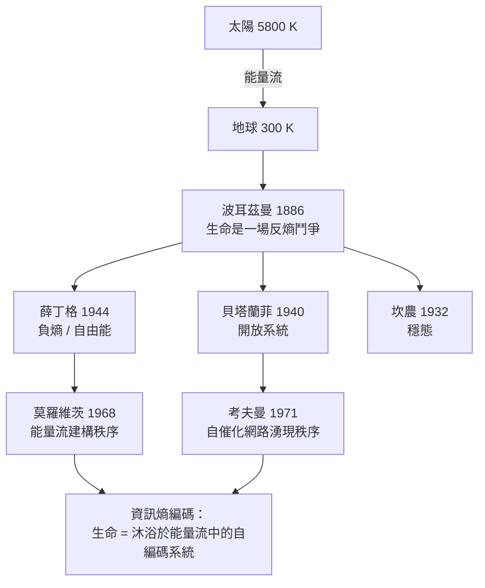

# 節標題：開放系統與遠離平衡態——生物亮著一扇窗的秩序

## 波耳茲曼的鬥爭宣言

早在量子力學與分子生物學之前，熵的代言人之一、維也納的路德維希・波耳茲曼（Ludwig Boltzmann）就已經把生命的處境說得清清楚楚。1886 年，他在一場公開演講中說出那個日後被反覆引用的句子：

> 生命的普遍鬥爭，不是為了物質——每個生物周圍的空氣與水都取之不盡——也不是為了能量，每個生物最終都把多餘的熱散給環境。這場鬥爭是為了「熵」，它由太陽的熾熱到地球的冷寂之間的流變所提供。

波耳茲曼的意思，用今天的語言講就是：生命不是在「省能量」，而是在「省熵」。太陽以約 5,800 K 的高溫輻射，地球以約 300 K 的溫度再輻射回去，兩者之間的能量流量是熱機的燃料——任何一片森林、一頭牛、一隻細菌，都是架在這座天然熱機上的小機器。波耳茲曼寫下這句話時只是隨口的哲學評論，卻在四十年後變成整個非平衡熱力學的宗旨。

## 開放系統：維也納的另一個聲音

波耳茲曼死後二十年，另一位維也納人接過了這條線——路德維希・馮・貝塔蘭菲（Ludwig von Bertalanffy），一位生物學家。從 1920 年代起，他在維也納大學研究生物生長，苦苦掙扎於一個當時主流生物學無法回答的問題：細胞裡的化學反應放在試管中很快就達到平衡，可生物終生都不平衡，反而穩定地「偏離平衡」生長、分化、修復。把細胞當成封閉的炸藥瓶，永遠算不出這件事。

1940 年前後，貝塔蘭菲把答案命名為「開放系統」（open system）與「系統論」（General System Theory）。封閉系統最終凝固成平衡態——熵最大、無流動、無差異；而開放系統持續與外界交換物質與能量，可以停在一個「穩態」（steady state）上——總量不變，流動不止，內在組織被源源不絕地重建。他寫下生物生長最根本的方程式：一個器官的生長速率既決定於自己的大小，也決定於整個系統對它的供給——這些量不是局域的，是全系統的性質。

貝塔蘭菲的洞見當時被物理學界視為「哲學家的清談」，但三十年後，它成了系統生物學、控制論、生態學共同的思想源頭。

## 穩態：身體內的永恆鬥爭

與貝塔蘭菲同時代，哈佛的生理學家沃爾特・坎農（Walter Cannon）在 1926 年創造了「homeostasis（穩態）」一詞，並在 1932 年《身體的智慧》（*The Wisdom of the Body*）中系統闡述。他的詞根用得講究：stasis 是「靜止」，homeo 是「相似」——不是「static blood」的絕對不變，而是「以變化維持相似」。血糖、體溫、pH、滲透壓，每項指標都在窄幅內被千百個負回饋迴路拉住。坎農描述的就是負熵的生理學版本：身體是開放系統，靠不斷攝入有序、排出無序，維持自己這片熵的低地。

## 能量流與食物階梯：莫羅維茨的帳本

1950–60 年代，耶魯的物理學家哈羅德・莫羅維茨（Harold Morowitz）把波耳茲曼與薛丁格的直覺寫成了熱力學帳本。在《生命 beings 的能量流》（*Energy Flow in Biology*, 1968）中他提出：生命的組織結構由「穿過系統的能量流」維持；陽光從 6000 K 落到 300 K，每跌一階，就能在地球上「付賬」在某種秩序的建造上。他把這條思路推到極處：只要一個系統沐浴在高品位與低品位熱庫之間，就必然會出現某種「中間狀態的秩序」——這為生命起源提供了一個純熱力學的入口，而不需要奇蹟。

莫羅維茨明確修正了薛丁格：正確的說法不是「生物以負熵為食」，而是「生物以自由能為生、以熵為付賬」。吉布斯自由能 $G$ 在恆溫恆壓的地球近地表環境下才是真正的貨幣，而熵只是這筆交易裡被交出去的代價。

## 自我組織：催化網路的邏輯

一九六〇–七〇年代又出現另一個純粹邏輯上的答案。史丹佛的斯圖亞特・考夫曼（Stuart Kauffman）在 1971 年前後研究「自治催化集合」（autocatalytic sets）：一組化學分子，若每個反應都有催化劑，且催化劑本身也是這組分子之一，那麼整個網路就會自動「點燃」、自我維持。他證明，當分子種類夠多時，這種「催化閉環」幾乎必然出現。生命的起源問題在這個圖像下不再需要一個「第一個自我複製分子」的奇蹟，只需要一鍋夠稠的化學湯加上能量流。這條線與後來的耗散結構、代謝理論共同指向同一結論：秩序可以湧現。

## 本書的資訊熵編碼線索

把這一章與本書已經建立的「資訊即熵」並排，可以看到一條貫穿的主線：

生命從熱力學角度算不算「違反第二定律」？答案一直是否定的——它用能量流在局部挖了一個熵的坑，同時向整個宇宙加倍地還債。真正困難的是另一頭：秩序是怎麼在物理上被「編碼」出來的；而這正是下一章——普里高津與耗散結構——要接管的故事。
