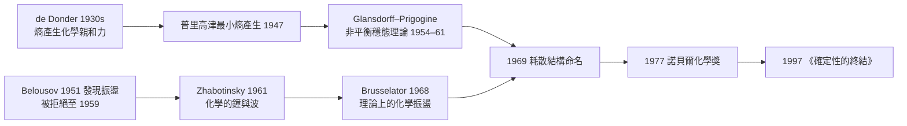

# 節標題：普里高津與耗散結構——非平衡熱力學的諾貝爾獎

## 從布魯塞爾到布魯塞爾

伊利亚・普里高津（Ilya Prigogine）1917 年出生於莫斯科，出生幾個月後布爾什維克革命爆發。他的父親羅曼・普里高津是化學工程師，家族在 1921 年踏上了漫長的西行流亡——柏林、然後 1929 年定居比利時布魯塞爾。這個命運安排的巧合無法被誇大：一個從「烏托邦革命」逃出的家庭，把兒子帶到布魯塞爾，而這位兒子終生要對付的另一種「烏托邦式必然論」是牛頓—拉普拉斯的決定論。

他在布魯塞爾自由大學（ULB）讀化學，1941 年獲博士，指導老師是蒂奧菲爾・德・東德（Théophile de Donder）——比利時熱力學的隱藏巨人。de Donder 在 1930 年代建立了「化學親和力」與「熵產生」的公式，把不可逆化學反應放進了熱力學第二定律的數學裡：一個反應的推進力 $A$ 與反應速率 $v$ 的乘積 $Av$ 永遠非負，這就是不平衡在世界裡真實發生的代價。普里高津把自己一生的研究定位為「de Donder 學派的延伸」。

## 布魯塞爾學派：把時間還給物理學

戰後，普里高津建立索爾維國際物理與化學研究所（後世稱「布魯塞爾學派」），正式開闢「不可逆過程熱力學」。1947 年他提出「最小熵產生原理」：一個線性區域內的近平衡系統，會演化到熵產生率最小的穩態——這解釋了為什麼近平衡系統會「安靜地穩定下去」，比方溫差驅動的熱傳導會自發從最大梯度降回平緩。

但生命的問題恰恰在另一頭：遠離平衡的地方，系統不安靜，它會「轉彎」。1949–1955 年間普里高津在布魯塞爾、和學生格蘭斯多夫（Paul Glansdorff）一起發展了非線性非平衡熱力學的普適進化判據：$\frac{1}{2}\frac{d^2 S}{dt^2} \le 0$——非平衡系統的穩定性不再是絕對的，某個參數一旦越過臨界值，原來的穩態會失穩，系統由此「分化」進入一個新的、有結構的狀態。1961 年《結構、穩定性與漲落》系統化了這一點；1968 年他與勒菲華（René Lefever）提出「三分子模型」（後世稱 Brusselator），在紙上第一個定量演示了化學振盪；1969 年在一篇關鍵論文中，他正式給這一族現象起了名字：**dissipative structures（耗散結構）**。

## 一個化學振盪器的孤獨與勝利

紙面上的 Brusselator 需要現實中的對照組，而現實早就造好了，卻被冷落了三十年。1951 年，莫斯科的蘇聯生物化學家 B. P. 別魯索夫（Boris Belousov）在尋找檸檬酸循環的無機仿製品時，發現溴酸鹽—硝酸鈰—檸檬酸混合液會在清澈與渾濁之間反覆擺盪——熱力學教科書上寫著化學反應必定單向趨於平衡，這怎麼可能？論文被拒兩次，編審說他「連實驗都做錯了」，他至死沒等到承認。1961 年另一位莫斯科化學家 Zhabotinsky 接手，擴充系統、加入鐵指示劑，做出會一圈圈擴散的螺旋波與同心圓——化學的鐘與化學的波，第一次被世界「看見」。

普里高津的布魯塞爾學派迅速接下了 Belousov–Zhabotinsky 反應的理論解釋：這是一張自催化耦合的非線性反應網路，在遠離平衡的驅力下自發產生時間與空間的圖案。化學課本那個「必定單向走向平衡」的教條，被一管液體砸碎了。

## 1977 年的斯德哥爾摩

1977 年，諾貝爾化學獎頒給普里高津，理由是「關於非平衡熱力學，尤其是耗散結構理論的貢獻」。這是這門「秩序的物理學」第一次被體制最高處承認。那個年代的同路人——生物學家用耗散結構解釋細胞分裂週期、發育形態、心跳規律；社會科學家拿它解釋城市擴張、經濟週期、革命。

## 《確定性的終結》：晚年的一次豪賭

1997 年，普里高津寫下了充滿哲學色彩的《確定性的終結》（*The End of Certainty*），同時也是他把自己一生事業推向極端的一步。他反覆主張：不可逆性、以及時間的方向（arrow of time），不是「表象」而是實在——量子力學與相對論在微觀層面上仍是決定論的，這是一個尚未被完全翻越的障礙。他推動了對量子系統中「熵—混合—Poincaré 耦合」的研究，特別是對開放量子系統的新的熱力學式表述。這不是一般公認的標準教科書結論，而是普里高津的形上學豪賭：他要物理學把「過去與未來不等價」當作基本原理，而不是誤差、不是粗粒化、不是哲學假象。

他甚至談到生命：「在遠離平衡的地方，物質獲得了新的屬性——它變得『活躍』而『敏感』，微小漲落被放大成全新的有序結構。這一點，使『活』的物質與死的物質之間那條線，變得比 牛頓—道耳頓 的時代淺得多。」

## 本書的串聯

普里高津把薛丁格「生命以負熵為食」的直覺，變成了一門有方程式、有臨界參數、有實驗對照的學科：秩序不需要被「外面」放進系統，只要系統夠開放、夠遠離平衡，秩序就會從漲落裡自己冒出來。這是關於生命的第一個現代性回答；但它仍然沒有回答第二個更尖銳的問題——宇宙最大的那幾個熵倉庫（黑洞）對熵的帳目又該怎麼算。那是下一章的主題。
