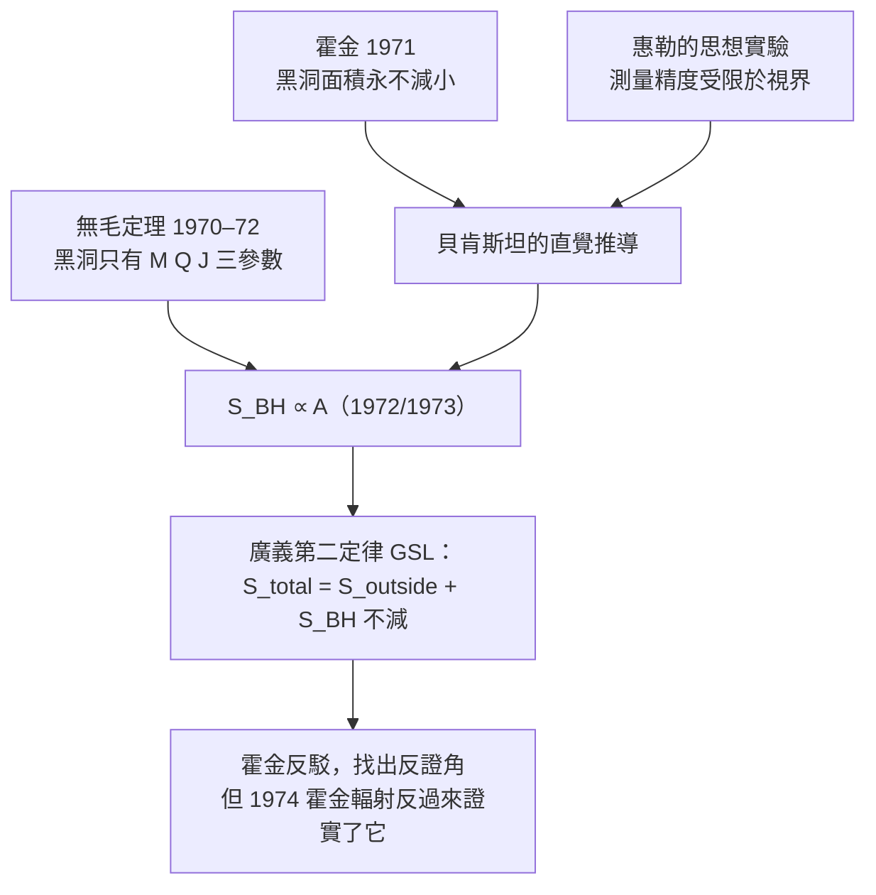

# 節標題：貝肯斯坦的黑洞熵猜想——一個博士生的膽識

## 普林斯頓的一場豪賭

1972 年，普林斯頓大學物理系的一間辦公室裡，一位 25 歲的博士生正在做一件大多數同行認為「不太嚴肅」的事：他要把熱力學第二定律加到黑洞身上。這個年輕人叫雅各・貝肯斯坦（Jacob Bekenstein），1947 年出生於墨西哥城一個猶太移民家庭，在普林斯頓的導師是約翰・惠勒（John Wheeler）——那個替「黑洞」這個名詞開過名的傳奇人物。

惠勒的指導風格在物理學界一枝獨秀：他從不讓學生安全地躲在自己身後，而是不斷問「你敢不敢想得更荒唐一點」。他敬畏聰明的年輕人，也樂於讓他們丟臉——他有一句名言：「沒有的事情不要誇大，隆起的地方把它隆起來。」在那間辦公室裡，惠勒鼓勵的正是這種「隆起」：如果熱力學跟黑洞放在一起，會發生什麼？

## 問題：黑洞吞掉了熵，宇宙怎麼辦？

問題來自一個簡單，而且極其惡毒的思想實驗。

設想一道氣體——放著巨大的熵，無序地充滿整個房間。現在把整盒氣體倒進一個黑洞。氣體消失，視界內的東西外界永遠看不到。問：這些熵去了哪裡？

如果黑洞「沒有熵」，那麼把一盒高熵氣體扔進黑洞，等於把宇宙的總熵**減少了**。這直接違反熱力學第二定律——一門一百五十年的老學科，被判了死刑。

貝肯斯坦面對的，是一門冰冷的老定理與一個年輕的物理怪物的正面相撞。他自己寫道：這看起來是個「不可繞過」的問題，而要保住第二定律，唯一辦法是承認——**黑洞本身有熵，而且黑洞把外面那盒氣體的熵，記在了自己的頭上。**

## No-hair 定理：黑洞只有三根頭髮

先看一個背景事實：黑洞幾乎沒有「個性」。1970 年代初，霍金、卡特、伊斯雷爾、魯賓遜等人逐步證出了「無毛定理」（no-hair theorem）：一個穩定黑洞的一切可觀測性質，完全由三個參數決定——質量 $M$、電荷 $Q$、角動量 $J$。丟進去一本《莎士比亞全集》、一台鋼琴、一片森林，黑洞外在上無一可以分辨。

這看起來反而把事情弄得更糟：如果黑洞只有三個參數，它怎麼可能承載「一盒氣體」那麼多亥姆霍茲自由度、那麼多微觀組態數？但貝肯斯坦看出這正是出路：熵是微觀組態數的對數 $S = k_B \ln \Omega$，「三根頭髮」的宏觀描述與「巨大熵」並不矛盾——就像一杯溫水只有溫度、體積幾個宏觀參數，其微觀組態數卻是天文數字。黑洞的熵，計數的是那些「掉進去就再也無法分辨的內部組態」。

## 猜想：熵正比於面積

要做就做得徹底。貝肯斯坦搬出同一時期霍金 1971 年證出的一條純經典定理：**黑洞的事件視界面積永遠不會減小**（黑洞合併、吞物，總視界面積只增不減）。這在形式上跟第二定律簡直是雙胞胎。

他又結合惠勒先前對「測量一個物體的最小精度」的思想實驗：任何對物體的無損測量，精度不能超過它的康普頓波長，否則測量本身就會造出一個新的、把它包住的黑洞。用這個粗糙而漂亮的物理直覺，他推出一條驚人結論：**黑洞的熵，正比於它的視界面積**。

$$S_{\mathrm{BH}} \propto A, \qquad A = 4\pi r_s^2 = \frac{16\pi G^2 M^2}{c^4}$$

1972 年他發表論文，1973 年又在 *Physical Review D* 上完整成形。他給出一個粗糙的係數估計（不是今天公認的 $1/4$），但核心結論站住了：**黑洞的熵與面積成正比**。這意味著一件和直覺完全相反的事：

> 一個星系那麼重的黑洞，熵比整個可觀測宇宙中所有普通物質加起來的熵還大得多。宇宙真正的熵倉庫不是氣體、不是恆星，是黑洞。

## 惠勒的平靜與同行的譁然

普林斯頓的走廊上，惠勒的反應是安靜的：「孩子，把它寫下來送出去，看看誰會撿起來。」但同行不於然。霍金的反應最激烈——他當時公開認為貝肯斯坦的想法「荒謬」：如果黑洞有熵、有溫度，那它就必須輻射；可「黑洞不輻射」是 1970 年前後幾乎所有相對論學者的共識，霍金為此還在 1972 年的萊蘇什（Les Houches）夏季學校上作了專場反駁。

貝肯斯坦多年後回憶，自己從頭到尾最害怕的是一個更小的問題：把一个真實的、會輻射的熱物體與黑洞放在一起，他自導的「廣義第二定律」（Generalized Second Law，GSL）——把黑洞熵與外部物質熵相加，總熵不減——在弔詭的狹窄區域還有幾個未定案的反例。這是個博士生在最冷門的題目上獨自打井，他自己都不知道水會不會冒出來。

## 命運的結算

離開普林斯頓後，貝肯斯坦回到以色列，先在比爾謝巴的本古里安大學，後來去耶路撒冷的希伯來大學拉卡物理研究所，在 2015 年病逝。他一生謙遜，不奪功。1974 年霍金做出了量子效應下的黑洞輻射，本來是「去反駁他」，結果卻算出了一個溫度、一條熵公式——係數恰好是 $\frac{1}{4}$。這個後來被稱為 **Bekenstein–Hawking 熵** 的公式，把黑體輻射、視界面積、普朗克尺度全部串成一條線：

$$S_{\mathrm{BH}} = \frac{k_B c^3}{4G\hbar}\,A = \frac{k_B}{4}\,\frac{A}{\ell_P^2}$$

一個博士生在 25 歲那年替宇宙寫下的「熵的存摺」，被整個世紀最尖銳的挑戰者確認了。兩位最強的對手，一起成為熱力學第四百年的最後一頁。
