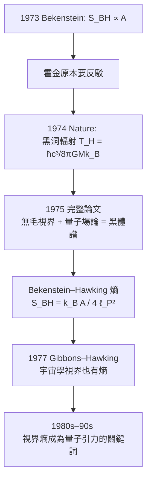

# 節標題：霍金輻射與黑洞熵公式——黑洞也會蒸發

## 「黑洞會爆炸嗎？」

1974 年 3 月，倫敦。霍金在《自然》（*Nature*）上發表了一篇兩頁半的短文，標題充滿英式挑釁：**Black hole explosions?**（黑洞會爆炸？）這是他在去蘇聯參加一場會議前，把自己的新結果趕製成短訊throw出去。次年 1975 年，他在《Communications in Mathematical Physics》上發表完整長文，把整個論證的數學骨架逐條鋪開。

故事要從他原本想做什麼說起。1971–72 年他與巴丁（James Bardeen）、卡特（Brandon Carter）合作，把熱力學四條定律一條條「翻譯」到黑洞力學上：

| 熱力學定律 | 黑洞力學對應 |
|---|---|
| 第零律：平衡系統溫度處處相同 | 穩態黑洞視界上表面重力 $\kappa$ 處處相同 |
| 第一定律：$dE = T\,dS + \dots$ | $dM = \dfrac{\kappa}{8\pi G}\,dA + \Omega\,dJ + \Phi\,dQ$ |
| 第二定律：熵不減 | 視界面積 $A$ 不減 |
| 第三定律：絕對零度不可達 | $\kappa = 0$ 的極端黑洞不可在有限步驟內達成 |

這張表的數學結構幾乎完美。但霍金仍然認為這只是「類比」，不是真的熱力學——因為當時共識：黑洞不會輻射。貝肯斯坦說黑洞有溫度，霍金公開說不正確，於是他決定用最嚴格的數學把這件事「算死」。

## 量子場論在視界旁的偷襲

霍金在 1973–74 年做的是一件極其精細的工作：把量子場論放進一個正在塌縮形成黑洞的時空裡，再去算出視界外觀察者看到的粒子譜。技術上他用了 Bogoliubov 係數把「早期入射真空」與「晚期出射態」聯繫起來。算到一半，他發現自己寫出了一個自己不願意相信的答案：

**黑洞在輻射，而且譜是完美的黑體譜。**

機制在半經典層面上可以說得很直觀：真空中的量子漲落會在每一瞬間成對產生虛粒子對；在視界附近，其中一個掉進黑洞、另一個逃出。掉進去的那半可以看作「帶著負能量」，於是黑洞質量減小；跑出來的那半變成貨真價實的輻射。這種敘述是簡化版，嚴格版本的意義是：**量子場論的「真空」依賴於觀察者的時間定義，而黑洞的視界把 vacuum 劈成了兩半**——外面那半對觀察者是熱騰騰的。

輻射的溫度只依賴一個量——質量：

$$T_H = \frac{\hbar c^3}{8\pi G M k_B}$$

這條公式驚人的地方在於比例的方向：**質量越大，溫度越低**。太陽質量的黑洞溫度只有 $6\times10^{-8}$ K，比宇宙微波背景（2.7 K）冷太多，所以今天 astronomically 還沒有一個黑洞在「淨蒸發」。反而小黑洞很熱，質量越小溫度越高、蒸發越快——這是一場加速的死亡，形式上像溫度正饋。用 $E = Mc^2$ 與 $T_H \propto 1/M$ 一起算，可推得黑洞的壽命 $t \propto M^3$；初生質量約 $10^{12}$ kg（小行星尺度）的原始黑洞（primordial black hole），恰好會在今天、宇宙年齡 138 億年時燃到最後一爆。

霍金回憶，他算出這個結果的那一晚幾乎睡不著——它一步一步把他推向他原本要「證偽」的結論：貝肯斯坦是對的。

## 三分之一個世紀的 1/4

更漂亮的事情發生在他把溫度代入熱力學第一定律之後。從黑洞力學第一定律 $dM = \frac{\kappa}{8\pi G}dA$ 和 $T_H$ 的定義，可以反推出黑洞的真正熵值：

$$S_{\mathrm{BH}} = \frac{k_B c^3}{4G\hbar}\,A = \frac{k_B}{4}\,\frac{A}{\ell_P^2}$$

其中 $\ell_P = \sqrt{G\hbar/c^3} \approx 1.6\times 10^{-35}$ m 是普朗克長度。這就是**Bekenstein–Hawking 熵**，那個神秘的 $\frac{1}{4}$ 就坐在那裡，幾十年都沒有一個更好的初等解釋。直覺上它很好懂：**熵正比於視界上「能塞多少個普朗克尺度的格子」，一格給 $\frac{k_B}{4}$ 的熵。**

貝肯斯坦給了式子，霍金給了係數。這是史無前例的一次合作——兩人在觀念上是對手，在結論上是搭檔。

## 熵的總帳：宇宙最大的倉庫

把公式代入實際黑洞，會得到一個讓人頭皮發麻的數字：一個太陽質量的黑洞熵約 $10^{54}\, k_B$（太陽在全生命週期裡輻射的總熵量在 $10^{58}\, k_B$ 的量級，但一潭水、一片森林、一個星系的總熵都遠遠小於一個黑洞）。星系中心的超大質量黑洞 $M\sim 10^9 M_\odot$ 的熵達 $10^{90}\, k_B$。可觀測宇宙中普通物質的熵總量約 $10^{88}\, k_B$——換句話說，**宇宙的熵絕大多數躺在黑洞裡**。這讓黑洞成為熱力學第三定律與第四定律的真正試金石。

普里高津與薛丁格講的「生命負熵」，在宇宙尺度上是局部的、微小的；而霍金與貝肯斯坦講的，是熱力學在宇宙最極端物體上的極限形式。兩個故事互相輝映——同一個第二定律，在地表與在視界上是同一條。

## 宇宙學視界：Gibbons–Hawking 熵

1977 年，霍金與 Gary Gibbons 把 1975 年的計算進一步推向宇宙學：一個含有正宇宙學常數（德西特空間）的宇宙，也有自己的視界——**宇宙學事件視界**，而且這個視界也輻射、也有溫度、也有熵，公式同樣是面積除四：

$$S_{\mathrm{dS}} = \frac{k_B}{4}\,\frac{A_{\mathrm{cos}}}{\ell_P^2}, \qquad T_{\mathrm{dS}} = \frac{\hbar \Lambda^{1/2}}{2\pi}\cdot\frac{c}{\sqrt{k_B G}}$$

也就是說，不只在黑洞旁，在那個加速膨脹的「空宇宙」的邊界上，量子場論同樣會產生熱譜。「視界都有溫度、都有熵」——這一句話，成了下一個三十年量子引力的中心命題。

## Stefan–Boltzmann 在黑洞身上的變形

黑體輻射的 Stefan–Boltzmann 定律 $P=\sigma A T^4$ 在黑洞身上差一點不成立——因為黑洞不是個完美球面黑體，它會吸收大部分角動量高的輻射模式、對不同頻率的「吸收截面」隨頻率變化，使得它的有效發射率（灰體因子 greybody factor）不等於 1。這個小小的修正被稱為黑洞的 greybody factor，是從霍金 1975 論文到今天仍在被計算的細節。

一場原本要「撲滅」貝肯斯坦概念的計算，反過來蒸發出了黑洞熱力學。但故事還沒完：如果黑洞會蒸發、會輻射、會最後消失，那麼它吞下去的那盒「莎士比亞全集」裡的資訊，最後變成了一鍋完全無序的熱輻射——**資訊到底去了哪裡？** 這個問題，將在下一節引發一場持續半個世紀的物理學大決戰。
