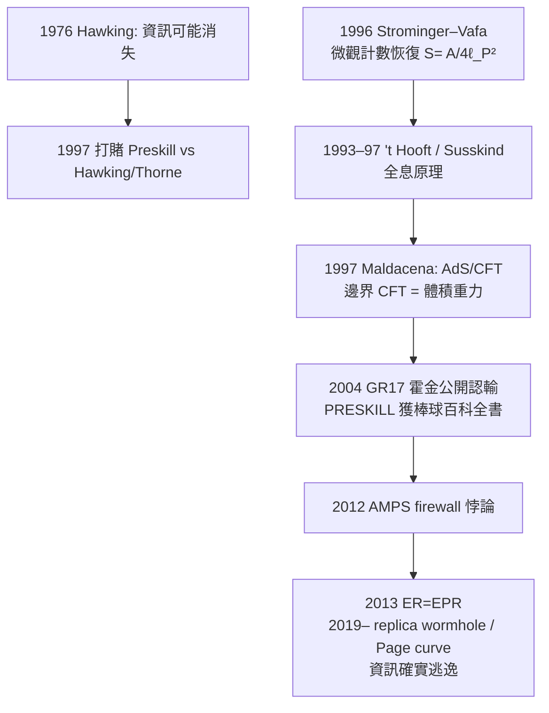

# 節標題：黑洞資訊悖論與全息原理——熵在邊界上

## 悖論的正門：熱輻射會殺死資訊

霍金 1975 年輻射公式的推論，其實比公式本身更兇。他算出的黑洞輻射譜是**純熱的**——只由溫度 $T_H$ 決定，與黑洞「過去吞了什麼」無關。一個黑洞可以吞下《百科全書》、一頭牛、一台鋼琴，但蒸發時吐出來的是完全相同的溫度譜、完全無結構的熱雜訊。

這在日常統計力學裡並不奇怪——一杯熱水把一塊冰化掉，微觀資訊並沒有「消失」，它只是被攪進了無數自由度，原則上仍可追溯。但在黑洞身上，這個「原則上」斷掉了：視界把內部自由度永久封死，等黑洞完全蒸發，那些自由度也消失了。這時，**一個純量子態（掉進去的物質）演化成了一個混合態（熱輻射）**——在量子力學的公理語言裡，這是絕對不被允許的事：么正性（unitarity）要求純態永遠演化成純態。

1976 年霍金把這一點正式寫成論文，標題毫不掩飾：**Breakdown of Predicatability in Gravitational Collapse**（重力塌縮中可預測性的崩潰）。他的立場是：資訊真的在黑洞裡消失了，量子力學在重力面前必須被修改。這是一個非常激烈的提法——為了一個黑洞，放棄一條幾十年來所有實驗都支援的基石。

## 一場被記錄在案的四十年打賭

物理學界最可愛的之一，是把這個哲學爭論變成了一份有公證人的賭約。1997 年，霍金與 Kip Thorne 一邊，John Preskill 一邊，立下賭約：霍金與 Thorne 賭資訊會迷失，Preskill 資訊會保存。賭注是一本棒球百科全書（Preskill 的選擇，他說「用書的形式來保存資訊是最恰當的」）。

2004 年 7 月，都柏林。霍金在第 17 屆廣義相對論與引力國際會議（GR17）上，面對幾百位同行，用黑板演示了他對黑洞路徑積分的重新計算——結論：黑洞路徑積分的拓撲只允許「保持么正」的那一解。他當場向 Preskill 遞交一本棒球百科全書《Total Baseball, The Ultimate Baseball Encyclopedia》，公開認輸。Thorne 不認。這是物理史上少數被正式作廢的一次學術立場，也是霍金人格裡非常耀眼的一面：**他能輸得起，而且輸得風度十足。**

## 微觀計數：Strominger–Vafa 1996

在霍金認輸之前，賭局的科學面其實已經被撬動了。1996 年，哈佛的兩位年輕弦論學者 Andrew Strominger 與 Cumrun Vafa 做出了二十世紀末物理學最漂亮的一擊。他們考慮一類特殊黑洞——五維時空裡、帶著電荷與角動量的極端黑洞——並用弦論的 D-膜（D-brane）描述其微觀自由度。數一數這些微觀狀態有多少種組態，再用 $S = k_B\ln\Omega$ 換算，得到：

$$S_{\mathrm{micro}} = \frac{k_B A}{4\ell_P^2}$$

與 Bekenstein–Hawking 公式**精確一致**——包括那個神秘的四分之一。這是黑洞熵第一次被從微觀量子態出發、顯式而徹底地推導出來。受限的是極端或近極端黑洞（以及特定維度），但方向已經宣判：黑洞熵的帳目是量子力學式的，第二定律是完整可救的。

## 全息原理：資訊不是在體積裡，是在表面上

Shrödinger 方程式不會告訴你熵藏在哪裡，全息原理會。1993 年，'t Hooft 提出、1995 年 Susskind 把它說得最直白的**全息原理**（holographic principle）主張：

> 一個重力理論裡，某一空間區域的最大資訊（熵）上限，等於這一區域**邊界**面積除以四倍普朗克面積——而不是等於體積，不是等於包含的物質數。

這是 Bekenstein–Hawking 熵的直接後果：黑洞是把這條上限做到極致的物體。一句話，**這個宇宙的自由度活在表面上**。

1997 年，阿根廷裔年輕學者胡安・馬爾達西那（Juan Maldacena）在哈佛寫下他如今被引用十萬次以上的論文，*The Large N Limit of Superconformal Field Theories and Supergravity*，提出 **AdS/CFT 對偶**：一個帶負宇宙學常數的反德西特空間中的重力理論（體積理論），精確等同於它邊界上的一個無重力的共形場論（CFT）。這是第一個數學上完全清楚的全息案例：體積裡的每一次重力事件，在邊界上都有一個對應的非重力描述。一個研究重力的物理學家、一個研究量子場論的物理學家，可以是同一個宇宙的兩種語言。Maldacena 因此在 2018 年獲得基礎物理突破獎。

2019 年，還有另一樁小事被廣泛引用：霍金遺產會與倫敦的科學博物館合作，把他的辦公室與論文完整保存——其中就包括 2004 年那本他送上門的棒球百科全書。一個悖論的最後一頁，成為了博物館的展品。

## Firewall：2012 年的重開局

故事沒有就此太平。2012 年，四個人——Ahmed Almheiri、Donald Marolf、Joseph Polchinski、James Sully（合稱 **AMPS**）——把老的悖論用更時髦的語言重新攤開。他們假設霍金輻射確實攜帶了資訊（即么正性成立），又假設在視界附近、對一個自由落進黑洞的觀察者來說物理上是平常的（等效原理），然後證明：這兩件事**不能同時成立**——在視界上必須有一堵殺死落體的「火牆」（firewall），即高速的高能量子效應。等效原理或么正性，必須犧牲一個。

這是一個比 1976 更能讓同行夜不能寐的悖論，因為現在兩邊都是「被證明過的東西」。它推動了 2010 年代 ER=EPR（Maldacena 與 Susskind 2013）、蟲洞—纠缠關係的提出，以及 2019 年通過可重整化量子極值面（replica wormholes 與 Page curve 計算）證明黑洞輻射的熵最終會下降、資訊確實逃逸——這是 2020 年代黑洞物理最重要的方向。

## 全息在今天的意義

這段故事最終回應了本書第 13 章的主題：熵到底是一個物體自身的性質，還是資訊的帳目。在黑洞身上，熱力學、量子力學、重力三者被逼到同一條狹縫裡，答案是——**熵的計數在表面上**。生命的熵帳在環境中，黑洞的熵帳在視界上，而兩個帳本用的都是同一條第二定律。這不是巧合，這是熱力學四百年的最後一頁，寫在最小的尺度上。
