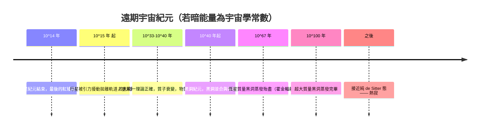

# 宇宙的終局：熱寂、黑洞蒸發與最大熵狀態

## 十九世紀的預言

1852 年，湯姆生（William Thomson，後來的開爾文爵士）在論文中寫下冷酷的推論：若機械能不斷耗散，宇宙終將「死寂而無生命的平衡」。克勞修斯 1865 年把它編成兩句口號——「宇宙的能量守恆；宇宙的熵趨於極大」——熱寂（heat death）自此成為維多利亞時代揮之不去的文化陰影，連哲學與文學都被它籠罩。這是人類第一次用物理定律讀出自己的結局。

## 今天的標準劇本：ΛCDM

二十一世紀的標準宇宙學模型 ΛCDM 給這個古老預言加了新的細節。1998 年，兩個超新星觀測團隊發現宇宙正在**加速膨脹**，暗能量（宇宙學常數 $\Lambda$）佔今日能量密度約七成。若 $\Lambda$ 恆定不變，宇宙將永遠加速膨脹，溫度漸近絕對零度。遠景是一張漫長的倒退車票：

終點是**德西特視界**：加速膨脹會像我們一樣劃出一個宇宙事件視界，視界帶有 Gibbons–Hawking 溫度與巨大的視界熵。當宇宙演化到接近純 de Sitter 態，熵達到實際意義上的最大值——那才是真正的熱寂：不是火災，而是**無差別**。任何梯度都消失了，而生命與計算，本質上依賴梯度。

## 替代劇本

- **大坍縮（Big Crunch）**：若暗能量會衰減逆轉，膨脹可以反轉，宇宙塌回奇點——但在 ΛCDM 的觀測限制下，此路機率不高。
- **大撕裂（Big Rip）**：Caldwell 等（1999 提出 phantom 能量，2003 正式命名 Big Rip）指出，若暗能量狀態方程參數 $w<-1$，膨脹會在同一時刻撕開星系、行星乃至原子。觀測目前偏向 $w\approx-1$，Big Rip 未被排除但無證據。
- **真空衰變**：希格斯場可能是亞穩態。若是，真真空泡可以內向外膨脹、以光速改寫物理定律——沒有預警。

## 戴森的長壽論證

1979 年，普林斯頓的弗里曼·戴森（Freeman Dyson）發表《Time Without End: Physics and Biology in an Open Universe》，做出一項驚人的計算：如果宇宙**永遠開放膨脹**（當時主流還這樣想），那麼一個有限能量的文明**未必會死**。他的關鍵洞見是：生命不必維持常溫。在漸冷宇宙中，一個文明可以持續**降低體溫、減緩思考時鐘**——冷卻使代謝耗能以 $T$ 的速度下降，而「主觀時間」的總量卻可以無限累積。戴森還設想了漂浮輻射生物（如「雪花跳舞的水熊」式想像）在星際塵埃帶間汲取微光。在 1998 年加速膨脹被發現後，人們發現事件視界打破了戴森的部分前提——宇宙學常數會普遍限制可達到的能量——但他提出的問題不朽：**思考的成本可以有多低？存在是否需要恆定的速率？** David Deutsch 在《無窮的開始》中從知識論回應：文明若持續創造知識，就具有無限的適應潛力，但這是論證而非物理保證。物理的帳本（視界、Landauer 極限 $E\ge k_BT\ln 2$）與意義的帳本，仍然是兩本帳。

## 熵的巨河流

回望全書，這條「熵的巨河流」已流經多少峽谷：克勞修斯在蒸汽機旁定義它，波茲曼用原子為它辯護而絕望自盡，吉布斯在耶魯的斗室裡為它繪出相空間地圖，香農把它變成通訊的貨幣，馮紐曼把它帶進希爾伯特空間，霍金讓黑洞也吐出溫度，潘洛斯指出它的源頭是宇宙誕生時那不可思議的低重力熵，柳與高柳則暗示它是時空的經緯。

第二定律教給我們的不是悲觀，而是**會計學**：宇宙的交易必須以熵支付，任何秩序——一座城市、一段記憶、一次革命——都是用更大的無序記帳換來的。文明不會打敗熵，只能與它輾轉周旋，在大崩塌前的瞬息裡，把低熵轉化為秩序、知識與意義。時間之箭射向熱寂，但箭桿上刻著我們的名字：在熵最大的終點到來之前，每一個「暫時」都值得認真地活。
