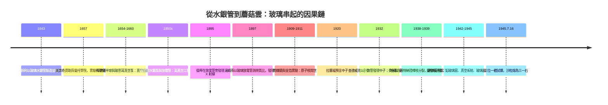

# 第 10 章：從水銀管到曼哈頓計畫

## 一封信改變的歷史

1939 年 8 月 2 日，一封由愛因斯坦署名、物理學家利奧·西拉德（Leo Szilard）起草的信送抵美國總統小羅斯福手中。信中警告：納粹德國可能正在發展一種基於鈾連鎖反應的「極高威力新型炸彈」，並建議美國關注鈾供應與研究。西拉德早在 1933 年就構想過中子連鎖反應；如今核分裂已被證實，德國戰爭機器又已吞併捷克並封鎖鈾礦出口，時間的壓力是真實的。

羅斯福設立了鈾委員會，起初撥款寥寥。但隨著 1941 年底珍珠港事件與英國 MAUD 報告（評估製造炸彈切實可行）的到來，美國的猶豫迅速轉為決心。1942 年，陸軍工程兵的曼哈頓工區接管一切，萊斯利·格羅夫斯（Leslie Groves）上校（旋即晉升准將）出任總管，並起用加州大學伯克利分校的羅伯特·奧本海默（J. Robert Oppenheimer）領導武器設計實驗室。計畫最終動員約十三萬人，耗資近二十億美元（今日逾三百億），散布在橡樹嶺、漢福德、洛斯阿拉莫斯與芝加哥等地，卻對外界嚴格保密。

## 玻璃的無名戰爭

談論曼哈頓計畫，人們記得鈾礦、迴旋加速器與數學家，卻極少想起玻璃。事實上，這場核計畫的每一道工序，都倚賴玻璃製品在無聲供應：

- **觀測窗**：放射性操作必須遠距離隔離。厚達數十公分、能屏蔽 γ 射線卻依然透明的**鉛玻璃**，被裝在熱室（hot cell）的牆上，讓操作者以機械手隔牆處理數百居里的放射性物質。玻璃在這裡同時扮演「屏障」與「眼睛」——正是托里拆利以來玻璃的雙重天賦。
- **真空系統**：同位素分離（電磁法）、鈽化學處理、金屬蒸餾與各類檢測，皆須高真空環境。從托里拆利、蓋斯勒一脈相傳的真空技術，此刻被放大到工業規模；真空管路、油擴散泵的視窗、蓋革—米勒計數管，全是玻璃或含玻璃的組件。
- **氣體擴散分離膜**：橡樹嶺的 K-25 工廠用數千級多孔膜分離鈾-235 與鈾-238。分離膜孔徑須達微米級且耐腐蝕氣體六氟化鈾，早期方案之一便是以玻璃與陶瓷材料為基底的微孔膜研發路線（工程上另採用燒結鎳膜，但玻璃微孔技術是探索中的關鍵備選）。把氣體「透過一層看不見的篩子」——這正是玻璃工藝的極致延伸。
- **實驗室玻璃器皿**：鈽的分離純化在所謂「化學谷」中進行，數以萬計的燒瓶、燒杯、移液管承載著人類第一次量產的鈽。強放射性下器皿會變色脆化，化學家們不斷更換、設計新式石英與硼矽玻璃器皿——當年佛羅倫斯玻璃匠的手藝，在荒漠中日夜運轉。
- **迴旋加速器真空室**：加速離子轟擊靶材以生產指示劑與研究數據，其巨大的扁平「餅狀」真空室與觀測窗，由玻璃與金屬精密封接——這種「玻璃—金屬封接」工藝本身，就是四百年玻璃科學的結晶。

## 三位一體

1945 年 7 月 16 日清晨五點二十九分，新墨西哥州阿拉莫戈多沙漠。人類第一顆原子彈「三位一體」（Trinity）在三十公尺高的鋼塔上起爆，當量約兩萬噸黃色炸藥。爆心的高溫把沙粒熔成淡綠色的玻璃狀物質，科學家們後來稱之為**三一石**（trinitite）——地球以一場爆炸，親手燒製出了新的玻璃。

希特勒已在春季自盡，德國投降，原為對抗納粹的炸彈轉而投向亞洲。8 月 6 日，廣島；8 月 9 日，長崎。兩座城市在瞬間被摧毀，十餘萬平民在爆心與後續的輻射傷害中喪生，倖存者終生背負輻射的陰影。8 月 15 日，日本宣布投降，第二次世界大戰落幕。這份傷亡的沉重，值得後世以最莊重的方式銘記：人類第一次掌握了足以自我毀滅的力量，而按下按鈕的，是當年從實驗室裡走出的知識。

## 完整的因果鏈

此刻，我們終於能夠回望這條跨越三百年的長鏈：

每一環的物質基礎都是玻璃：密封性圈住真空，透明性圈住射線，耐蝕性圈住放射性。如果沒有那根一公尺長的水銀管，「自然界厭惡真空」或許還要統治思想再一百年；沒有高真空的放電管，電子、X 射線將推遲登場；沒有計數管與閃爍鏡，中子與核分裂的故事無從講起；沒有鉛玻璃與玻璃器皿，鈽根本無法被安全地分離與測量。玻璃不是這段歷史的主角光環，卻是每一幕的**舞台地板**——沒有它，戲劇無法上演。

## 戰後：玻璃與矽的和平轉身

蘑菇雲升起後，科學家與世人一道陷入反思。奧本海默那句引自《薄伽梵歌》的話——「我如今成了死神，世界的毀滅者」——成為整個時代的註腳。但同一批人也在思考玻璃與物理的下一步。戰後的鐘擺開始轉向：核能用於發電，放射性用於醫療，而曾經承載電子束的玻璃管，將在另一條戰線上迎來意想不到的繼承者——純度不斷提升的**矽**，一種同樣源自沙子、同樣以玻璃態工藝被提煉與處理的物質。它將在下一章登場：從貝爾實驗室的鍺與矽晶體，到一塊巴掌大的晶片，玻璃的科學將完成它最後也最深刻的一次躍升。

## 因果鏈條

費迪南德二世的噴泉逼出托里拆利的水銀管；水銀管的真空孕育蓋斯勒管；蓋斯勒管的幽光吐出電子與 X 射線；閃爍鏡與計數管追蹤射線，逼出原子核、中子與核分裂；分裂的連鎖反應在曼哈頓計畫中化為現實——鉛玻璃窗後的操作者、真空室中的離子、燒瓶裡的鈽，全是那根佛羅倫斯玻璃管的遠房子孫。1945 年 7 月的沙漠中，爆炸把沙子燒成了玻璃，彷彿歷史畫下殘酷的圓：人類以玻璃認識世界，也以玻璃熔鑄了毀滅的火種。而火種之外，沙子裡還藏著另一個和平的答案——那要等到電晶體與晶片時代的來臨。
