# 玻璃的科學：從沙子、繪畫暗箱到矽晶片的 3500 年文明躍升

*The Age of Glass: How Sand Transformed Art, Science, and the Digital World*

以「玻璃（二氧化矽/矽）」為唯一主角，串聯跨越 3,500 年的藝術、化學、物理、天文與現代資訊文明。

## 全書因果鏈總覽

```mermaid
graph LR
    A[沙灘篝火<br/>SiO₂+純鹼熔融] --> B[羅馬吹製玻璃<br/>奢侈品變日用品]
    B --> C[穆拉諾 Cristallo<br/>純度競賽與鏡子]
    C --> D[眼鏡 13世紀末<br/>延長知識壽命]
    D --> E[望遠鏡與顯微鏡<br/>1608-1665]
    E --> F[燒杯與化學革命<br/>透明→可觀測可重複]
    F --> G[托里拆利真空管<br/>1643]
    G --> H[蓋斯勒管/克魯克斯管<br/>19世紀]
    H --> I[湯姆孫發現電子<br/>1897]
    I --> J[查德威克中子 1932<br/>核分裂 1938]
    J --> K[曼哈頓計畫 1945]
    K --> L[高錕光纖 1966-70<br/>玻璃成為神經]
    L --> M[矽晶片與 AI<br/>沙子變成大腦]
```

## 目錄

### 引言

* [00-引言-透明的奇蹟](00-引言-透明的奇蹟.md)

### 第一卷：起源與靈魂——沙子、火與藝術的誕生（公元前 1500 年—16 世紀）

* [01-沙灘上的篝火](01-沙灘上的篝火.md)
* [02-威尼斯穆拉諾島的秘密](02-威尼斯穆拉諾島的秘密.md)
* [03-繪畫暗箱與光影之眼](03-繪畫暗箱與光影之眼.md)

### 第二卷：看見微觀與宏觀——科學革命的透明窗口（17 世紀）

* [04-延遲衰老的神奇弧線](04-延遲衰老的神奇弧線.md)
* [05-穿透夜空與微觀世界的雙眼](05-穿透夜空與微觀世界的雙眼.md)
* [06-燒杯裡的化學風暴](06-燒杯裡的化學風暴.md)

### 第三卷：真空、粒子與微觀結構（17 世紀末—19 世紀）

* [07-大公的噴泉與托里拆利的水銀管](07-大公的噴泉與托里拆利的水銀管.md)
* [08-管中的幽靈微光](08-管中的幽靈微光.md)

### 第四卷：連鎖反應與能量釋放（20 世紀初—1945 年）

* [09-不帶電的隱形子彈](09-不帶電的隱形子彈.md)
* [10-從水銀管到曼哈頓計畫](10-從水銀管到曼哈頓計畫.md)

### 第五卷：矽的終極進化——光速通訊與數位文明（20 世紀中葉—至今）

* [11-將光封印在玻璃絲中](11-將光封印在玻璃絲中.md)
* [12-沙子變成大腦](12-沙子變成大腦.md)

### 結語

* [13-結語-沙子的史詩](13-結語-沙子的史詩.md)

---

### 本書三個核心看點

1. **極具視覺感的大歷史視角**：文藝復興名畫（維梅爾）、化學實驗室（燒杯）、天文探索（望遠鏡）與現代晶片（矽谷），由同一種材料串聯成史詩故事。
2. **單一材料的魅力**：類似《鹽的歷史》《棉花帝國》，以 SiO₂ 這一常見材料為唯一主角，展現材料如何單槍匹馬改變文明軌跡。
3. **嚴密的因果連鎖**：沒有威尼斯的玻璃工藝，就沒有後來的電子發現與原子彈；沒有精煉沙子的技術，就沒有今天的網際網路。
