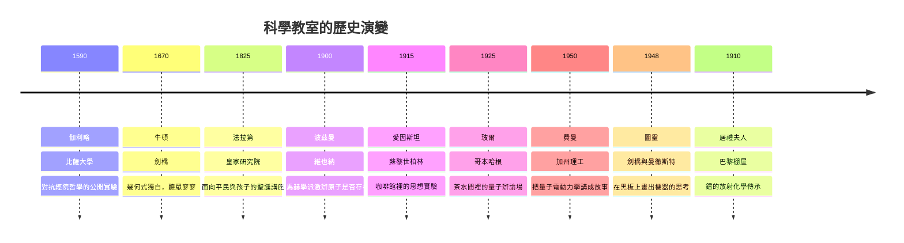

# 前言：推開歷史的教室大門——科學家的思維，是如何傳遞的？

## 科學不是被「發現」的，而是被「教出來」的嗎？

我們習慣把科學史寫成天才與靈感的傳奇：牛頓被蘋果砸中、愛因斯坦幻想騎在光束上、費曼在賭城算骰子。但傳奇的背後有一個被長期低估的事實——**每一場科學革命，都發生在教室裡，或者說，都必須通過「教學」才能完成**。

一個新理論若只有創始者一人懂，它就還不是科學，只是一種私人信仰。哥白尼的日心說躺了七十年才由伽利略搬上講台；量子力學若沒有玻爾在哥本哈根與一群二十幾歲的年輕人日以繼夜地辯論，可能只是幾篇無人引用的論文。科學的真正載體，不是論文，而是**一代一代傳遞思維方式的人**。

## 教室是時代的縮影

推開不同時代的教室大門，你會看到的不只是物理與化學，更是整個時代：

這張時間軸背後，是一整套互相驅動的關係網：

- **政治**：伽利略的講台受制於教會審查；愛因斯坦的沙龍被納粹驅散；圖靈的課堂籠罩在二戰密碼戰與戰後恐同氛圍之下。
- **經濟**：法拉第的聖誕講座是工業革命資助科學的產物；費曼的課堂靠冷戰時期美國對物理學的巨額投資。
- **制度**：牛頓的盧卡斯講座規定他必須每學期授課，這逼著孤僻的他站上講台；居禮夫人的棚屋實驗室讓女性第一次有機會進入科學行業。
- **思想**：從亞里士多德的權威演繹，到伽利略的實驗歸納，再到波普爾的可否證性——每一次教育哲學的轉向，都先在科學家的課堂上預演。

## 本書怎麼讀

本書分五篇九章，每章推開一扇教室的門：

| 篇 | 主題 | 人物 | 教室形態 |
|---|---|---|---|
| 一 | 直覺與實驗 | 伽利略、牛頓 | 大學講堂與斜塔 |
| 二 | 奇觀與熱情 | 法拉第、波茲曼 | 公開講座與激情演說 |
| 三 | 思想實驗與辯論 | 愛因斯坦、玻爾 | 沙龍與茶室 |
| 四 | 怪才與解構 | 費曼、圖靈 | 示範講堂與黑板 |
| 五 | 燃燒生命 | 居禮夫人 | 棚屋實驗室 |

這九種教室，其實是九種**知識傳遞的哲學**：權威詰問、嚴格公理化、劇場式奇觀、孤獨的信仰、平等的對話、辯證的碰撞、玩樂式拆解、沉默的邏輯、以身殉道的示範。沒有一種是標準答案，但它們共同回答了同一個問題——

**人類最困難的知識，究竟是如何從一顆頭腦進入另一顆頭腦的？**

現在，讓我們推開第一扇門。門後是 1589 年的比薩大學，一位二十五歲、脾氣火爆的數學講師，正準備當眾撕毀一本寫了一千八百年的教科書。
