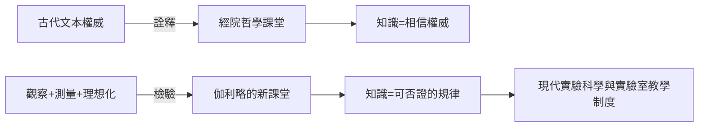

# 第 1 節 撕毀亞里士多德的教科書：為什麼實驗比古老的權威更可靠？

## 一本統治了歐洲一千八百年的教科書

1589 年，二十五歲的伽利略被聘為比薩大學的數學講師。他踏進講堂時，學生桌上擺的教科書是亞里士多德的《物理學》——這本書寫成於西元前四世紀，卻被中世紀經院哲學整合成一套不容置疑的知識體系。大學的課程表、學位制度、答辯儀式，全部建立在「亞氏學說為真」的前提上。

亞里士多德物理學的核心是一條直觀到近乎常識的定律：**重物下落得比輕物快**，且速度與重量成正比。石頭比羽毛快——這難道不是每天睜眼就能看見的事實？

## 權威 vs. 數據

經院哲學的方法論可以濃縮成一句話：**真理在古代文本裡，論證的任務是詮釋而非檢驗**。文藝復興後期，教會把亞里士多德—托勒密體系吸納進神學框架，挑戰亞氏就等於挑戰整個世界觀與權力結構。

伽利略在課堂上做的事，是教學法層面的革命。他不再「詮釋文本」，而是提出一個簡單到殘忍的邏輯論證：

> 若重的物體下落較快，把重物 $M$ 與輕物 $m$ 綁在一起：輕物應該拖慢重物，使整體速度介於兩者之間；但整體更重，又應該比 $M$ 更快。**同一個前提推出兩個矛盾的結論，前提必為假。**

這是歷史上第一次，一個物理命題在講台上被**邏輯處決**。隨後他把論證推向實驗：用斜面滾球（直接落體太快無法計時，他發明了「稀釋重力」的斜面法）測量距離與時間的關係，得到

$$
s = \frac{1}{2} g t^2
$$

——下落距離與時間平方成正比，**與物體重量無關**。

## 為什麼這一課這麼難上？

值得注意的是：伽利略並非靠「看見」推翻常識，而是靠**測量與理想化**。他意識到日常經驗充滿空氣阻力等干擾，必須在思想中剝離摩擦、構造「理想實驗」。這種「從雜訊中提煉規律」的思維，就是現代科學方法的胚胎。

前因：印刷術普及讓古本與異見同時流通、義大利城邦的商業競爭使工程學抬頭、望遠鏡與鐘錶等儀器成熟。後果：數十年後，「實驗室的院士」「儀器講座教授」這些制度在歐洲遍地開花——法蘭西科學院、皇家學會，全是伽利略那間教室的直系子孫。

下節，我們看他最著名的一次「公開課」。
