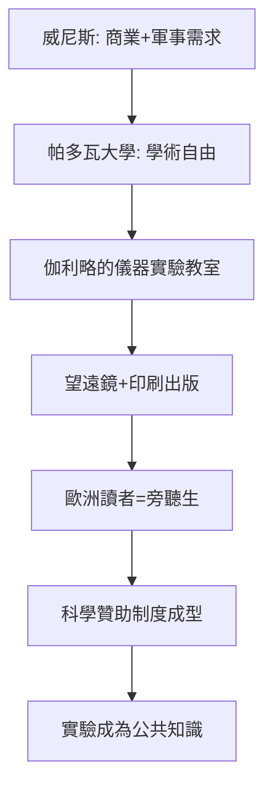

# 第 2 節 披薩斜塔的公開課：把物理學從書齋拉回現實世界的碰撞聲

## 一場可能是傳說、但完全符合其人格的公開實驗

關於伽利略在比薩斜塔上同時丟下兩顆重量不同的球、兩球同時落地的故事，最早見於他晚年的學生維維亞尼所寫的傳記，史家對其真實性有所保留。但這個故事之所以流傳四百年，是因為它精準地象徵了伽利略教學法的本質：**把爭論搬到眾人眼前，讓大自然自己宣布答案**。

無論斜塔那一幕是否真實發生，有確切記載的是：伽利略喜歡在課堂與公開場合進行演示實驗，邀請持異議的同僚親眼看、親手做。他著名的口頭禪式的立場是——文本讀一千遍，不如去量一量。

## 為什麼「公開」如此重要？

伽利略的實驗若關起門來做，只是私人娛樂。他的天才在於把實驗變成**公共事件**：

1. **利用大學的答辯制度**：中世紀大學的公開辯論（disputatio）本是經院哲學的儀式，伽利略把這個儀式劫持了——辯論的武器不再是引經據典，而是滾落的球體與擺動的吊燈。
2. **利用印刷術**：1610 年《星際信使》以拉丁文出版，數週內傳遍歐洲宮廷。他的「教室」不再有物理邊界，整個歐洲的讀者都是旁聽生。
3. **利用儀器的劇場性**：望遠鏡本身就是舞台道具。當美第奇家族的貴族們透過鏡筒親眼看見木星的四顆衛星，他們成了實驗的「見證人」——伽利略隨即把那四顆星命名為「美第奇星」，把科學贊助與教學傳播縫合在一起。

## 從書齋到工坊的社會學意義

傳統大學隸屬教會，培養神職與律政人才；而伽利略的實驗需要儀器、工匠與贊助金。他的人生軌跡清晰地展示了這條新路：從比薩大學（薪水微薄）轉往帕多瓦大學（威尼斯共和國管轄，教會勢力較弱、軍工與航海需求強盛），再進入佛羅倫斯宮廷擔任「首席哲學家與數學家」。

經濟動機驅動科學、科學成果又反哺贊助，這個正回饋環路正是十七世紀「科學革命」的引擎，而它的傳動軸，就是伽利略的公開課堂。

## 那聲「碰撞聲」教會了後人什麼？

斜塔課堂真正的遺產不是「兩球同時落地」這個結論，而是一種示範：**面對分歧，不要訴諸資歷與古書，要構造一個所有人都能重複的檢驗**。這正是後世「可重複性」原則的起源——今天的同儕審查、論文資料公開、實驗室開放日，全部是斜塔公開課的制度化延伸。
