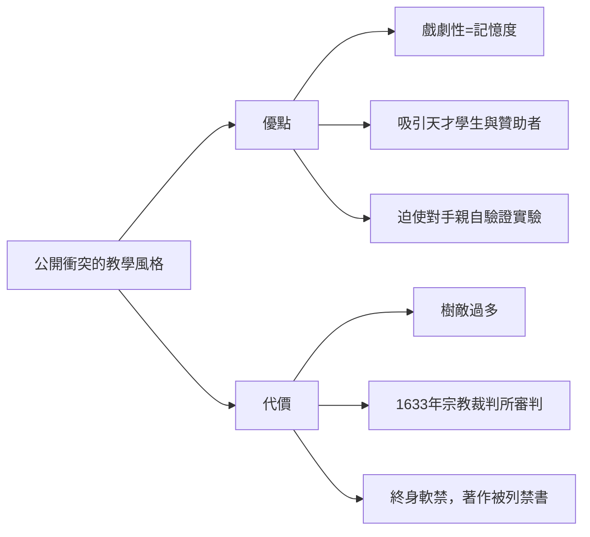

# 第 3 節 衝突的藝術：一個喜歡在課堂上「公開打臉同行」的激進教授

## 毒舌是教學法，也是自毀裝置

伽利略義大利文寫的對話錄有種罕見的魅力：機鋒、反諷、戲劇性。《兩大世界體系的對話》（1632）裡，他讓支持地心說的辛普利丘（Simplicio，名字本身就是「笨蛋」）不斷被駁倒，甚至讓教宗烏爾班八世本人的論點從辛普利丘口中說出、然後被嘲弄。

這是他的教學風格：**用衝突製造注意力，用羞辱製造記憶點**。在比薩任職期間，他寫詩諷刺同僚的服裝；在課堂上，他對亞里士多德派教授的不屑毫不掩飾。學生愛死了這位老師，同行恨透了這個狂人。

## 衝突的雙面刃

必須誠實地說：1633 年的審判不僅是神學的勝利，也部分是伽利略人際戰略的失敗。他在《對話》中把教宗的話放進小丑角色的嘴裡，等於當眾「打臉」了全歐洲最有權力的保護人。教學上的毒舌與政治上的天真，在他是同一種性格。

## 打臉的正面遺產：科學辯論的民主化

儘管個人下場悲慘，伽利略確立了一種至今仍在的模式：**科學進步需要公開的、對事不對人（他本人常做不到）的激烈交鋒**。

- 他證明真理不因地位而改變：講座教授、主教、神聖羅馬皇帝的意見，與一顆球落地的方式無關。
- 他示範了「以實驗回應質疑」而非「以權威回應質疑」。
- 他用義大利文（而非學者專屬的拉丁文）寫作科普對話錄，把科學爭論開放給受教育的大眾——這是四百年後科普寫作、科學播客與網路科學論戰的直系祖先。

## 給今日的教室

伽利略留下的教學悖論值得每位教師咀嚼：**製造衝突能催化學習，但衝突必須指向命題，而非人格**。他最失敗的課（羞辱辛普利丘）與最成功的課（邀請對手親自看望遠鏡）用的是同一種性格，結局卻相反。

差別只有一個：前者讓對手丟臉，後者讓對手**看見**。

學會讓人「看見」而不是「丟臉」，是這位激進教授用終身軟禁換來的最後一課。
