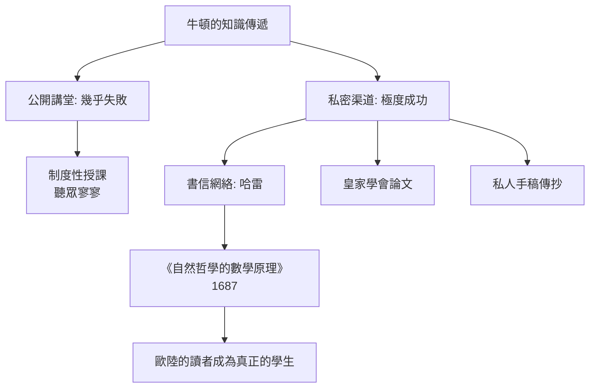

# 第 1 節 聽眾寥寥的冷清講課：沉浸在光學與微積分世界裏的孤獨天才

## 規定必須上課，但幾乎沒人來聽

1669 年，二十六歲的牛頓在老師巴羅的舉薦下接任劍橋三一學院的盧卡斯數學講座教授。按章程，他每學期必須每週講授一堂課，並將講稿存入大學圖書館。

結果是尷尬的：歷史記載牛頓的講課常常**聽眾寥寥，有時甚至無人出席**。有記述說他會對著空教室把課講完，或者在無人時只停留片刻便離開。他的講稿（存世的《光學講稿》《代數講稿》等）內容艱深、邏輯緊密、不加粉飾——與其說是課，不如說是他自己研究的紀錄。

## 為什麼最偉大的頭腦上不好課？

牛頓的課堂失敗不是偶然，而是三層結構的疊加：

1. **制度因素**：盧卡斯講座是榮譽職，薪水豐厚、無升遷壓力，制度「要求」他上課，卻沒有任何機制要求學生聽課。十七世紀劍橋大學部課程仍以亞里士多德主義為主，牛頓講的新數學根本不在考試範圍。
2. **知識落差**：微積分與光學實驗遠遠超前時代，學生缺乏預備知識。牛頓又不願意「降低高度」——他認為降低就是失真。
3. **性格因素**：牛頓極度內向、敏感於批評（與胡克、萊布尼茲的惡鬥足為明證），他不擅長、也不熱衷於取悅聽眾。

## 孤獨的另一面：一對一的高手傳承

有趣的是，牛頓的「教室」雖然對大眾關閉，卻對極少數人敞開。他透過書信指導編輯哈雷（正是哈雷說服並資助《原理》出版）；他在皇家學會提交論文；劍橋的少數追隨者（如惠斯頓）成為他思想的闡釋者。

這給出一個反直覺的歷史教訓：**牛頓真正的教室是印刷出來的《原理》**。那本書以嚴酷的幾何證明寫成，當時能全讀懂的人不超過一掌之數，但正是這種「只為能懂的人而寫」的密度，鍛造出十八世紀的理性主義傳統。書，是他向全歐洲上的課。

## 冷清講堂的深意

牛頓的案例暴露了知識傳遞的一個永恆難題：**創造知識的能力與傳遞知識的能力，是兩種不同的才能**。下一節我們看見，牛頓不是不會教——而是他選擇了一種只對「受過嚴酷訓練者」開放的教法。
