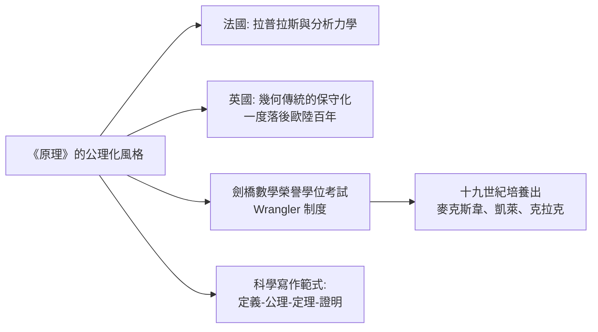

# 第 2 節 用幾何學建構宇宙：牛頓如何逼迫學生用最嚴苛的數學推導運動

## 「不要結論，要證明」

《自然哲學的數學原理》（1687）的結構是故意的挑釁：全書以歐幾里得《幾何原本》的方式寫成——定義、公理、三大運動定律，然後是一連串無情的命題與證明。牛頓刻意**不用他自己在二十年前發明的微積分流數記號**，而用古典幾何證明呈現一切。

為什麼？三個理由：

1. **無可反駁性**：幾何證明在當時具有兩千年的權威光環。用萊布尼茲式的新記號寫，會被歐陸學者攻擊「基礎不清」；用幾何寫，任何人質疑就必須指出證明哪一步錯——而那不可能。
2. **篩選讀者**：牛頓在給哈雷的信中承認，他故意把書寫得「深奧」以避開「在數學上一知半解的人」的糾纏。這是一種防禦性的教學設計。
3. **普遍必然性**：他想證明的不只是「行星這樣動」，而是「任何服從平方反比律的系統必然如此動」——即從軌道推出引力 $F \propto 1/r^2$，再反推開普勒三定律。

## 那堂課的內容長什麼樣

以命題 1 為例：由向心力與面積定律出發，逐步推出橢圓軌道、周期定律、引力與質量及距離的關係，最後飛躍到——**使蘋果落地的力與使月球繞地的力是同一個力**。

$$
F = G \frac{m_1 m_2}{r^2}
$$

「天地同一」是這堂課最震撼的結論：月亮就是一枚永遠掉不到地面的蘋果。牛頓用月地檢驗驗證了這一點，誤差在當時測量精度之內。

## 幾何式教學的深遠後果

矛盾的是：牛頓嚴苛的數學風格，一方面讓英國數學因死守幾何記號而落後萊布尼茲系統百年；另一方面催生了劍橋的數學榮譽學位考試（Mathematical Tripos）——這個以殘酷競爭著稱的「數學優等生」制度，成為十九世紀全世界最強的數學人才生產線，麥克斯韋正是其中的優等生。

## 這一課的教育哲學

牛頓的教學立場可以概括為：**真理的深度決定理解的門檻，教師的責任是把門檻如實標示，而非偷偷降低**。這與伽利略「降低門檻、邀請所有人看」的路線針鋒相對。

兩百年後，費曼將宣稱：任何無法講給大一新生聽的東西，我們自己其實還沒真正理解。這兩種立場的張力，構成了科學教育至今未解的核心難題。
