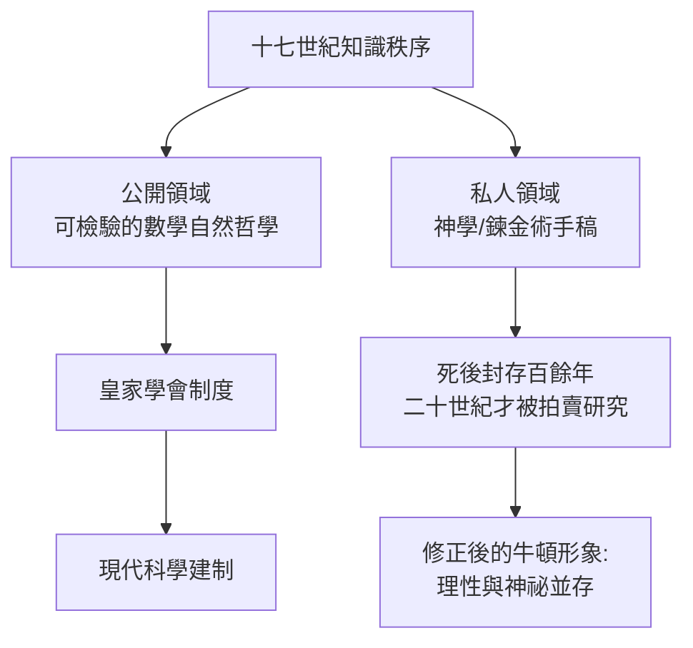

# 第 3 節 課堂外的面具：身為劍橋教授的嚴肅、固執與神祕學私房筆記

## 兩個牛頓

公開的牛頓：三一學院的教授、皇家學會會長、鑄幣廠廠長，理性王國的化身，啟蒙時代的圖騰。伏爾泰把他的葬禮描寫得如同君王國葬——伏爾泰感嘆：英國埋葬的是一位數學家，卻像埋葬一位國王。

私下的牛頓：一生留下約一百萬字的神學手稿與大量鍊金術實驗記錄。他研究《聖經》年代學、計算《啟示錄》的預言、堅持反三位一體的異端立場（為此差點放棄盧卡斯講座——該講座要求任職者受聖職，牛頓靠國王特許豁免）。他在鍊金術實驗室裡用「星芒」「綠獅子」等隱語記錄實驗，深夜與化學蒸氣為伴。

## 面具的政治功能

理解牛頓的雙面性，需要理解十七世紀英國的處境：

- **宗教氛圍**：內戰與復辟之後，異端立場足以毀掉前途。牛頓的神學研究若公開，他不可能成為皇家學會會長。面具是生存工具。
- **知識秩序**：當時「自然哲學」與「自然神學」並未分家。牛頓本人認為研究上帝的創造與研究創造的規律是同一件事的兩面——鍊金術的微粒思想甚至可能滋養了他的萬有引力想像（超距作用的「力」在機械論世界觀中本是異端）。
- **制度演變**：正是牛頓這一代人把「可公開檢驗的自然哲學」與「私人信仰」切分開來，才催生了現代的「科學」範疇。他是這個邊界的建造者，也是這個邊界最痛苦的居住者。

## 教學上的固執與威權

作為行政者，牛頓同樣嚴酷：掌管皇家學會期間近乎獨裁；在鑄幣廠他親自督辦偽幣犯的處決；與萊布尼茲的微積分優先權之爭中，他操縱委員會做出有利自己的裁決。他的學生與追隨者（如後來的劍橋學派）長期籠罩在「不容修改」的氛圍中——「牛頓說了」一度是劍橋考試的標準答案。

## 這一課教我們什麼

1. **科學家不是純粹理性的標本**。創造性的頭腦常常遊走於正統與異端、理性與想像之間。牛頓的鍊金術不是他的「污點」，而可能是他思想生態的一部分。
2. **制度的邊界塑造知識的形狀**。什麼可以寫進講稿、什麼必須鎖進箱子，這個邊界由宗教、政治與職業利益共同劃定。
3. **偉大教師未必是偉大的人**。牛頓對世界教的課（天地同一、公理化方法）影響深遠，但他作為導師的個人溫度接近於零。

知識的火炬可以由冷酷的手傳遞——這是牛頓講堂留下的、令人不安卻必要的教訓。
