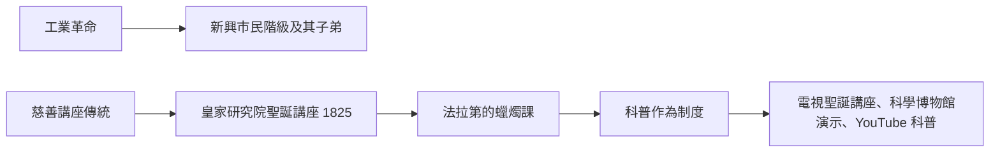

# 第 1 節 告別艱澀數學：法拉第如何用一枝蠟燭燃起孩子們對科學的渴望？

## 1825 年的聖誕傳統

1825 年，皇家研究院（Royal Institution）的年輕實驗室主任麥可·法拉第創立了**聖誕講座**（Christmas Lectures），專門面向青少年與一般大眾。這個制度的誕生有明確的經濟與社會背景：皇家研究院由貴族與富商捐資創辦，本以向紳士階級普及「應用科學」為業；工業革命催生了一個新的受眾——城市中的中產與勞工階級子弟。法拉第本人就是鐵匠之子、書店學徒出身，他比任何人都清楚：**天賦散落在所有階級，缺的只是一扇門**。

聖誕講座至今舉辦近兩百年，是全世界最長壽的科學普及系列。而其中最著名的，是法拉第 1848、1860 年兩度主講的《一支蠟燭的化學史》（The Chemical History of a Candle）。

## 一枝蠟燭就是一堂完整的自然課

法拉第的起點平凡到極致：一根蠟燭。但由此展開的課程覆蓋了當時化學與物理的核心：

- **燃燒**：蠟受熱熔化、沿燭芯上升、汽化、與氧結合——牽出物態變化與氧化反應；
- **產物檢驗**：以冷玻璃罩收集水汽、以石灰水檢出 $\mathrm{CO_2}$；
- **光與熱**：燭焰的亮區、暗區、焰心結構，牽出輻射與對流；
- **能量與物質守恆的直觀預告**：燭焰燒掉的物質沒有消失，只是轉變。

他的名言概括了這堂課的精神：

> 「世上沒有比這更好的入門之門——從一根蠟燭，你可以走進自然的每一個部分。」

## 教學法的三個特徵

1. **零公式的敘事**：法拉第數學薄弱（這是他終身的遺憾，也是他發明「力線」圖像語言的原因），他反過來把劣勢變成風格——用演示、圖像與故事承載概念。
2. **演示即敘事**：每場講座配幾十個實驗，實驗不是「驗證已講的理論」，而是**講述本身**。學生先看見奇觀，再自己長出疑問。
3. **對孩子的智性尊重**：他不使用「小孩子版本」，而是「可看見的版本」——降低的是預備知識門檻，不是思想的深度。

## 那扇門的後世迴響

「一枝蠟燭」成了科普寫作的典範：從一件日常之物出發，窮究到底，讓聽眾體驗「世界比看起來更深」。這種課堂的信念是——**科學不是職業知識，而是每個公民的視力**。一個看過燭焰分層的孩子，與一個只見過「亮光」的孩子，從此活在不同的世界裡。
