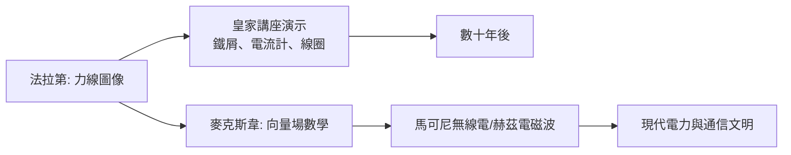

# 第 2 節 沉浸式互動劇場：在皇家研究院的講台上把電磁感應變成魔術

## 1831 年：他先感動了自己

1831 年，法拉第發現電磁感應：變化的磁場能在線圈中產生電流。這是發電機與一切電力文明的原理起點。但法拉第的興趣從來不只是「原理」——他要讓每個人都**看見那個瞬間**。

在皇家研究院的講台上，他的電磁感應演示是一場編排精確的劇場：

- 先讓觀眾看到「靜止的磁鐵旁，電流計紋絲不動」；
- 再看「磁鐵插入的瞬間，指針偏轉」；
- 然後是戲劇核心——**磁鐵停住不動，指針歸零；只有運動才有電**；
- 最後反轉：磁鐵不動，移動線圈，指針照樣偏轉。

觀眾被逼著自己想出答案：重要的不是磁鐵或線圈，而是兩者的**相對變化**。這正是互動式教學的精髓——結論由觀眾在驚訝中自己抵達。

## 力線：把看不見的變成看得見的

由於數學工具有限，法拉第發明了「力線」（lines of force）的圖像語言：在紙上撒鐵屑、讓磁場現形，用箭頭表達電場與磁場的空間結構。他甚至提出光可能就是力線的振動。

四十年後，麥克斯韋把力線翻譯成嚴格的數學：

$$
\nabla \times \mathbf{E} = -\frac{\partial \mathbf{B}}{\partial t}
$$

——這正是法拉第感應定律的微分形式。而麥克斯韋本人承認：他的《電磁通論》是「對法拉第力線的數學化」。**法拉第的課堂圖像，直接成為麥克斯韋方程組的語義基礎**。教學用的比喻，最終長成了物理學的骨架。

## 講台上的表演者

法拉第的講座有明確的舞台技術：提前數日排練、親自擦亮每件儀器、嚴格控制燈光與節奏、結尾必留一個「未解之謎」勾住聽眾。他對準備工作的執著近乎苛刻——「講座應該像刻在鋼上一樣精確」。

但他與「魔術師」的區別在於：魔術隱藏機關，法拉第**公開機關**。每次演示後，儀器任人檢視。奇觀是鉤子，可檢驗性是靈魂。

## 這堂課的遺產

皇家講座的模式直接催生了現代科普的各種形態：科學博物館的演示廳、電視科學節目（聖誕講座 1966 年起登上 BBC）、乃至今天的科普直播。其核心配方兩百年未變：

**先給一個看得見的奇觀，再給一個想得通的道理，最後留一個還沒有答案的問題。**
