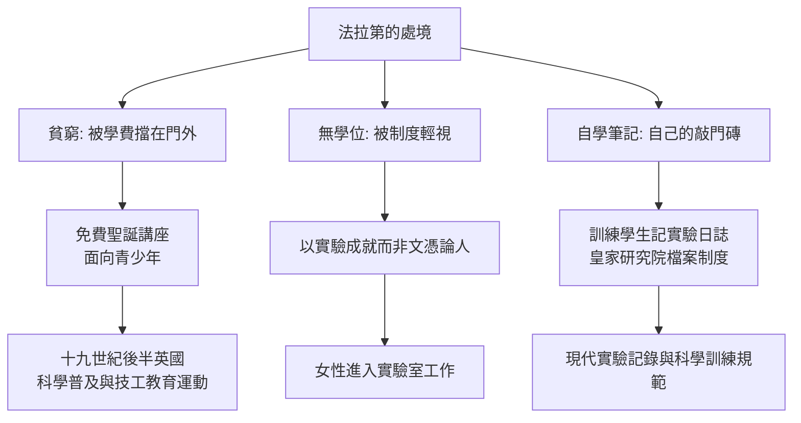

# 第 3 節 平民階級的逆襲：一個沒有受過正規高等教育的傳奇導師

## 鐵匠之子、書店學徒、裝訂工

1791 年，法拉第生於倫敦南區一個鐵匠家庭，家貧，只受過最基礎的讀寫教育。十三歲到書店做學徒，負責送報與裝訂。命運的轉折藏在裝訂桌上：他利用裝訂《大英百科全書》的機會讀到了「電學」條目，又用送報攢的幾個便士去聽化學家塔特姆的講座，用細心工整的筆記把聽到的內容裝訂成冊。

1812 年，皇家研究院的助理因故被解僱。法拉第把裝訂好的三百頁聽課筆記（包括他旁聽的戴維的四場講座筆記）寄給了戴維，請求一份工作。戴維的回覆傳說是：「把那些瓶子洗乾淨吧。」——1813 年，法拉第成為皇家研究院的實驗室助理，週薪二十五先令。

## 沒有學位的天才：階級與科學制度的碰撞

法拉第的一生處處撞上階級之牆：

- 他終身未進過大學，拉丁文與數學皆非所長，在以古典學與數學為榮的學界常被視為「工匠」；
- 1824 年他當選皇家學會會員時，唯一投反對票的正是恩人戴維（一說戴維忌妒其聲望，一說戴維反對「僕人翻身」，史家仍有爭論）；
- 他兩度拒絕皇家學會會長職位、拒絕封爵，終身以「法拉第先生」自居，貧窮的尊嚴是他刻意保留的鎧甲。

但「沒有正規教育」也反向塑造了他的獨到之處：**他不被學院的既有框架馴化**。學院教的是數學力學，他靠實驗與圖像思考——於是「場」這種學院派想不到、也畫不出來的概念，恰恰從一個裝訂工的手上誕生。

## 導師法拉第：為下一個學徒工開門

法拉第對學生的教學，處處是自身經歷的倒影：

他晚年主張公眾科學教育的文章（如《論科學的教育》）明確要求把自然知識納入普通教育——在那個課程表仍被古典語文統治的時代，這是激進的主張，也是今天「科學素養」概念的先聲。

## 情書一般優美的實驗日誌

法拉第的實驗日誌是科學史上的文學：敘事清晰、自我懷疑處毫不掩飾。失敗的實驗他照記不誤，並標注「No effect」。這種「記錄失敗」的示範，教會了後世學生：**實驗室筆記不是成果履歷，而是與自然的對話記錄**。

一個沒有文憑的人，最後成為十九世紀最偉大的實驗家與最成功的導師。法拉第教室的終極教訓是：**教育的本質是開門，不是發文憑**。
