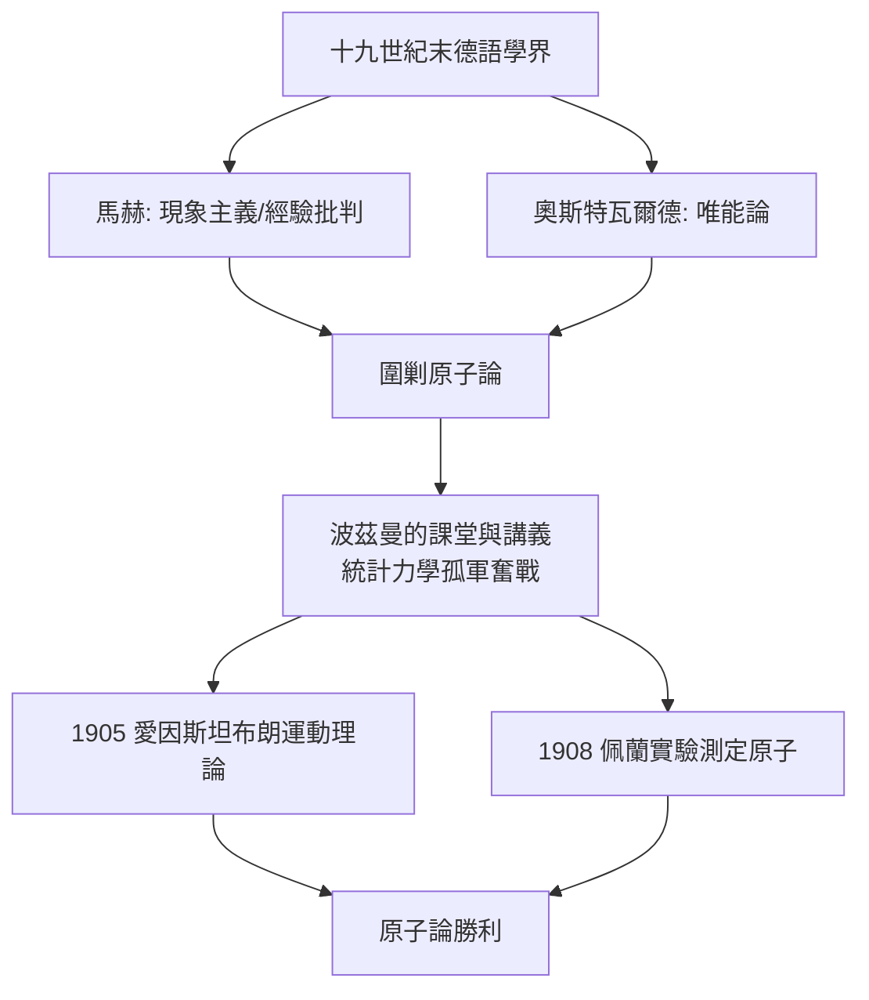

# 第 1 節 教室裏的孤獨戰士：面對學界冷嘲熱諷仍堅持原子論的悲壯身影

## 十九世紀末的「看不見之戰」

路德維希·波茲曼（Ludwig Boltzmann, 1844–1906）在維也納、格拉茨、慕尼黑、萊比錫輾轉任教的歲月裡，他的課堂同時是實驗室與戰場。他講授的統計力學主張：熱是大量分子的無規運動，宏觀的熵對應微觀狀態數：

$$
S = k \log W
$$

這個後來刻在他墓碑上的公式，在當時意味著**原子真實存在**——而十九世紀末的德語學界，恰恰流行懷疑原子。

反對陣營的領袖是同樣任教於維也納的恩斯特·馬赫：他認為原子是不可觀察的形而上虛構，科學應限於可感覺的現象。化學界的奧斯特瓦爾德則以「唯能論」取而代之。波茲曼的講課與論文，因此在長達二十年的時間裡處於被主流圍剿的位置。

## 課堂上的孤獨戰士

波茲曼的授課風格熱情奔放、旁徵博引，常常在推導中岔入哲學、詩與文學，學生又愛又怕。但不管講得多精彩，他心裡清楚：講台下坐著的年輕人，明天走進的仍是一個嘲笑原子論的學界。他在講義與演說中反覆遭遇同樣的問題——「你見過原子嗎？」

他的回答策略不是辯贏，而是**論證方法的根本澄清**：原子論不是形而上學教條，而是能統一解釋氣體、擴散、布朗運動、輻射的**工作假說**，其價值應由解釋力衡量。這種立場正是後來波普爾科學哲學「假說—檢驗」精神的先聲，而波普爾正是維也納出身的哲學家。

## 悲劇與平反

長年的孤立、雙相情感障礙與視力衰退交織。1906 年，波茲曼在義大利的里雅斯特附近的度假地自縊身亡，而原子論的勝利近在眼前：1905 年愛因斯坦用布朗運動給出原子的可測量預言，1908 年佩蘭以實驗完成驗證，奧斯特瓦爾德公開承認原子存在。那是他死後兩年。

他的學生里夏德·埃倫費斯特、保羅·厄任費斯脫一系，以及受他講義滋養的維也納學術圈，把統計力學的火種帶進了二十世紀的量子革命。

## 教師的形而上孤獨

波茲曼的故事揭示了科學教育最殘酷的一面：**當真理跑在時代前面，教師的工作是在教室裡獨自相信尚未被證實的東西，並把它教給將活在未來的學生**。他自己寫道：「我能從我的學生那裡得到的最好回報，是他們有一天比我看得更遠。」

他沒能活著看見，但他的學生看見了。
