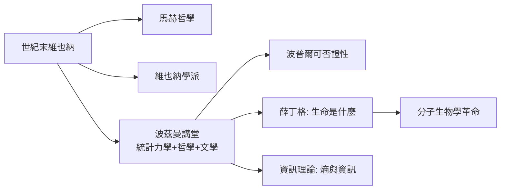

# 第 2 節 熵與混亂的激情演說：用哲學與詩意詮釋熱力學第二定律

## 一堂不只是物理課的課

波茲曼最著名的公開演說之一，是 1886 年在皇家科學院的節慶演說。他劈頭引用的是歌德《浮士德》式的問題，接著宣告：如果你問我，這個世界究竟是朝著光明前進、還是注定墮入混亂——我的科學回答是：**兩者都不對，因為「前進」與「墮落」這些概念本身，來自於我們把熵的混亂誤認為目的**。

一個熱力學教授，用文學與哲學開場講第二定律——這在當時的德語大學是極罕見的教學風格，卻恰恰是波茲曼課堂的標誌。

## 熵：一個需要詩意才能說清的概念

熱力學第二定律的表述枯燥無比：孤立系統的熵不減少。但波茲曼的統計詮釋賦予它驚人的思想深度：

$$
S = k \log W
$$

熵不是「混亂的程度」這種膚淺比喻，而是**宏觀狀態對應的微觀狀態數目**。秩序之所以罕見，不是因為自然偏愛混亂，而是因為**無序的排列方式遠多於有序**——一副洗過的牌「碰巧」回到原序的機率是 $1/52!$。

他最動人的教學手法，是把這個冷冰冰的機率論證轉譯成人類處境：

- 生命是熵的洪流中短暫的漩渦——我們之所以能維持秩序，是因為不斷把更大的混亂輸出給環境（這是薛丁格《生命是什麼》「負熵」概念的直接源頭，而薛丁格明言受波茲曼啟發）；
- 時間之箭不是形而上問題，而是統計問題：過去與未來的區別，僅僅是「微觀狀態數較少的方向」。

## 演說風格的社會背景

波茲曼的「哲學化授課」有其時代脈絡：

1. **德語大學的哲學傳統**：哲學是所有高級學位的文化必修，教授以能在哲學講壇發言為榮。波茲曼晚年甚至一度轉任哲學講座，與馬赫的繼任者們展開「科學哲學」之爭。
2. **世紀末維也納**：馬赫主義、佛洛伊德精神分析、維也納學派邏輯實證主義都在同一城市孕育。整座城市在爭論「什麼才算真知識」，波茲曼的講堂是這場大爭論的物理學戰線。
3. **文學素養**：他大量引用席勒、歌德、萊辛，用戲劇與詩承載科學思想——他相信科學與藝術服務同一個目標：「對清晰的熱愛」。

## 課堂遺產

波茲曼證明了：**最抽象的科學概念，恰恰最需要人文語言**。今天我們用「訊息的丟失」「可能性空間」來教熵，用薛丁格的貓講疊加，用「生日悖論」講機率——這些都是他示範過的路徑：把公式翻譯成人類的處境，思想才會留下。
