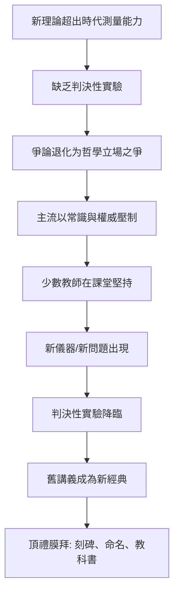

# 第 3 節 思想的先驅：那些在生前被質疑、死後才被頂禮膜拜的課堂講義

## 講義的奇蹟：死後三十年的暢銷書

波茲曼生前出版的《氣體理論講義》（Vorlesungen über Gasttheorie，1895–1898）當時問者寥寥。但正是這兩卷講義，成為二十世紀統計物理的教科書源頭：埃倫費斯特夫婦為《數學科學百科全書》撰寫的統計力學綜述（1911）以它為藍本；普朗克在推導黑體輻射、引入「能量量子」$E = h\nu$ 時，用的正是波茲曼的統計方法——而普朗克當年也是原子論的懷疑者，是他自己後來承認「唯有波茲曼的統計觀點」能解釋輻射。

愛因斯坦的評價最為扼要：「（他的）思想，其意義要到後來才被充分認識。」

## 為什麼先驅注定孤獨？

分析波茲曼式的悲劇，可以歸納出一個知識社會學的通用模式：

伽利略與牛頓之間的爭論、波茲曼與馬赫之爭、其後愛因斯坦與玻爾之爭，都是這個模式的變奏。共同點是：**裁判權最終在實驗手裡，但實驗總是遲到**。在實驗抵達之前的幾十年，教室是唯一能保存火種的地方——講義就是時間膠囊。

## 課堂講義作為科學史的隱形主體

教科書史研究有一個重要洞見：**教科書（講義）才是科學正規化與傳承的真正載體**。論文傳播發現，講義傳播的是「如何思考」：

| 載體 | 傳遞內容 | 生命週期 |
|---|---|---|
| 論文 | 一個結果 | 數年被取代 |
| 講義/教科書 | 思維框架與問題意識 | 數十年到數百年 |

波茲曼講義的偉大之處在於：他不是只寫下「氣體理論是對的」，而是完整展示了**如何在證據不足時為一個假說辯護、如何估計其解釋力、如何在反對聲中保持理智**。這種「帶著掙扎的教學」反而成為最珍貴的教材。

## 榮耀來得太遲：墓碑上的公式

1906 年波茲曼死後，物理學界迅速完成平反與神聖化：熵公式被刻上維也納中央公墓的墓碑；統計力學的常數以他命名（$k_B$，玻茲曼常數）；他的講義被一代代重印。

這提醒每一位教育者與學習者兩件事：

1. **對教師**：你在課堂上相信並講授的東西，不必等到全世界同意。你的責任是把思想完整、誠實地交給學生，時間會完成裁決。
2. **對學生**：判斷一門學問，不要只看它現在多受歡迎。被嘲笑的講義與被膜拜的講義，可能是同一疊紙。
