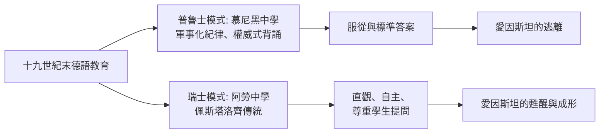

# 第 1 節 拒絕死記硬背：討厭傳統德國式軍事化教育的叛逆資優生

## 被學校訓斥的未來天才

「愛因斯坦在校成績很差」是流傳最廣的誤解之一——真相更有趣：他的成績很好（尤其數學與物理），但他**厭惡學校**。慕尼黑的路易波德中學以普魯士式紀律治校：背誦、操練、服從、體罰。十五歲的愛因斯坦設法離開學校（先藉故取得醫生證明，隨後全家遷往義大利），後來進入不設入學文憑門檻、鼓勵自主學習的瑞士阿勞州立中學，再到蘇黎世聯邦理工學院（ETH）。

他晚年回顧時的用詞毫不留情：德國式教育是「訓練學生成為有用的機器」，會摧毀神聖的好奇心。他甚至說：現代教學方法竟然還沒把神聖的求知欲完全扼殺，真是奇蹟。

## 兩種教育制度的對照

關鍵人物是瑞士教育家佩斯塔洛齊（Pestalozzi）的遺產——「由直觀出發、由學生自己的行動出發」的教育哲學滲透了阿勞中學。愛因斯坦終身引用的學習信條——**好奇心的神聖性、獨立思考高於知識本身**——正是阿勞課堂的產物。一個人的教育哲學，是被他自己受過的兩種教育撞擊出來的。

## ETH 歲月：翹課的物理系學生

在蘇黎世理工，愛因斯坦照樣「叛逆」：他只去上自己感興趣的課（韋伯的物理、閔可夫斯基的數學他都翹過或應付了事），大量自讀基爾霍夫、馬赫、玻茲曼與休謨、康德、馬赫的哲學。他與瑪麗奇等同學組成自學小組，戲稱「奧林匹亞科學院」，讀的書單橫跨哲學與科學——包括休謨的因果批判與馬赫對牛頓絕對時空的批判。

這份「課外書單」才是相對論的真正預備課程：**沒有馬赫與休謨對絕對時間的哲學爆破，就不會有 1905 年對「同時性」的操作性重定義**。

## 給教育者的第一課

愛因斯坦後來成為全世界最著名的科學教育發言人，他的主張處處針對自己的童年創傷：

- 「提出一個問題往往比解決一個問題更重要」；
- 「想像力比知識更重要，因為知識是有限的」；
- 「教育就是當你把學校教的一切都忘掉之後剩下的東西」。

他是證據：**最優秀的學生常常是制度的漏網者，而非制度的傑作**。教育的任務不是生產馴服的優等生，而是保護那種連體罰與排名都殺不死的好奇心。
