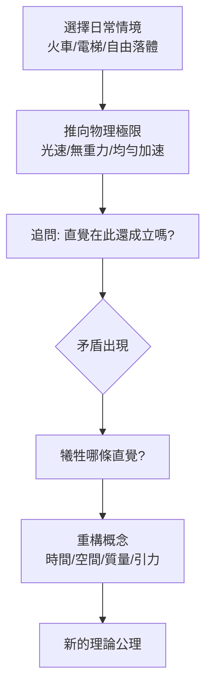

# 第 2 節 坐在光束上思考：愛因斯坦引導學生進行終極「思想實驗」的獨門招式

## 十六歲的問題，管了十年

愛因斯坦最著名的思想實驗誕生於他十六歲、還在阿勞中學讀書時：**如果我以光速追著一束光跑，我會看見什麼？**按牛頓力學，我應該看見一束凍結的、空間中靜止的電磁波——但馬克斯韋方程組裡根本不存在這種解。這個矛盾折磨了他十年，直到 1905 年狹義相對論以「光速不變」作為公理、以「同時性相對」作為代價才得以解決。

注意這個結構：這不是實驗，是**邏輯壓力測試**——把兩個都成立的理論推到極端，逼它們互相打架，然後看誰該讓步。

## 思想實驗作為教學法

愛因斯坦晚年向學生與訪客反覆使用同一套手法，其流程可以形式化：

幾個經典案例：

1. **火車與雷擊**：車站上同時的兩道閃光，在高速火車中央的乘客眼中並不同時——「同時」不是絕對的，它取決於參考系。
2. **電梯實驗**（相對論電梯）：封閉電梯中感受重力與以 $g$ 加速完全無法區分——等效原理，通往廣義相對論的大門。
3. **自由落體的人**：愛因斯坦稱之為「一生中最幸福的念頭」——自由落體者感覺不到自己的重量，說明引力可以被局域地「消除」，引力不是力而是時空幾何：

$$
R_{\mu\nu} - \tfrac{1}{2} R g_{\mu\nu} = \frac{8\pi G}{c^4} T_{\mu\nu}
$$

## 為什麼思想實驗對他特別有效？

因為愛因斯坦的物理學方法論本身就是「概念批判」：他認為物理學的進步不在於積累數據，而在於**審查那些我們以為天經地義的概念**（同時性、時間、距離）。他稱此為對概念的「自由創造」。對他而言，思想實驗不是教學輔助，而是理論本身產出的方式——因此他把學生帶上同一條生產線：不給結論，給情境與極限，讓學生自己撞上概念之牆。

## 教育後果

這套手法塑造了此後一個世紀物理教育的核心傳統：

- 每本現代相對論教科書都以火車、電梯、孿生子開場；
- 量子力學教學繼承了這個傳統（薛丁格的貓、EPR、量子擦除實驗）；
- 「思想實驗」進入哲學與法律、經濟課堂，成為跨學科的推理工具。

愛因斯坦示範的終極一課：**課堂上最有力的儀器，是學生自己的想像力——前提是有人教他們如何把想像推到邏輯的斷崖邊**。
