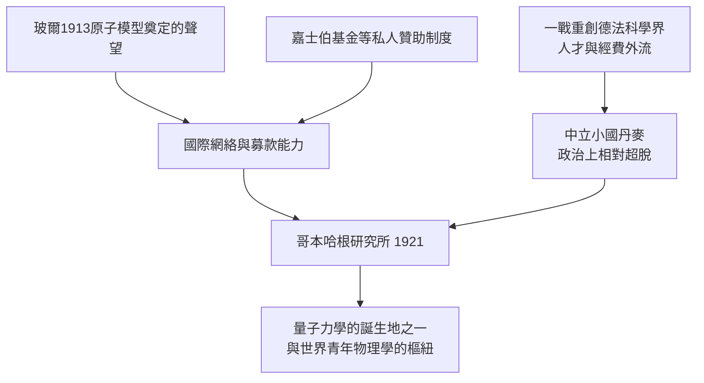

# 第 1 節 「大膽的假設」：哥本哈根研究所如何成為全世界青年物理學家的朝聖地？

## 一棟改建豪宅，一支青年軍

1921 年，尼爾斯·玻爾在哥本哈根大學旁一棟改建的豪宅裡創立了理論物理研究所（1965 年改名尼爾斯·玻爾研究所）。它很快成為量子力學的黃金年代（1925–1932）的世界中心。名單如星光：海森堡、鮑利、狄拉克、克喇末、約當、蘭道、奧本海默、德爾布呂克、伽莫夫……

玻爾的用人哲學在當時是革命性的：**年輕、有天賦、敢想**，比文憑與資歷重要得多。他親自為學生申請車馬費與獎學金（丹麥是小國，資金多來自嘉士伯基金會與國際基金），為學生找住處、寫推薦信、接待各國簽證——研究所一半是物理中心，一半是跨國青年旅舍。

## 為什麼偏偏是哥本哈根？

地緣政治意外地是功臣：一戰後德國科學家被國際學界排斥，丹麥中立國的身分使哥本哈根成為各方都能來的地方——德國人、英國人、蘇聯人、日本人、美國人在同一張桌上喝咖啡。玻爾的母語授課常常含糊不清，研究所的通用語是英語、德語、丹麥語混合的「哥本哈根方言」。

## 「大膽的假設」：玻爾的口頭禪

玻爾的教學名言是：「**你的想法很美，但要更大膽一點（We are all agreed that your theory is crazy. The question that divides us is whether it is crazy enough.）**」他對學生的要求不是正確，而是**野蠻的誠實與徹底的徹底**——任何一個字眼都要追問到底。

他的批評方式極具特色：不是否定，而是**複述**。他會把你的論點接過去，用他的語言重講一遍，講到你自己都開始懷疑原意——然後你們一起在懷疑中前進。學生們稱之為「被玻爾溫柔地碾過一遍」。

## 課堂的形態：沒有講台

研究所的日常是這樣的：上午玻爾遲遲不出現，青年人在黑板前隨意演算、互相攻擊彼此的論文；下午玻爾現身，站上黑板（他常常親自擦黑板、寫板書，擦著擦著就擦掉自己剛寫的），開始無限迴圈式的討論；晚上在嘉士伯別墅繼續。正式的「演講」極少，「共同生成」是常態。

這種模式後來被全世界效仿：戰後美國的研究型大學、先端研究所的「開放討論區」，都是哥本哈根茶室的直系後代。**玻爾證明了：研究所最深層的產品不是論文，而是人。**
