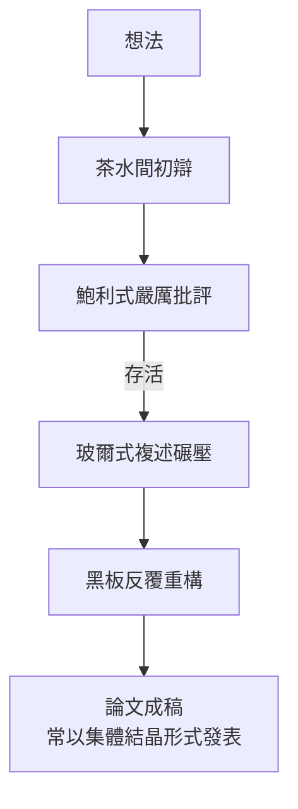

# 第 2 節 茶水間裏的世紀大辯論：玻爾與海森堡、鮑利激烈的「真理碰撞」

## 茶與黑板的戰場

哥本哈根研究所的茶水間，是科學史上產量最高的辯論場。日常景色是：玻爾與海森堡（或鮑利、或狄拉克）站在黑板前，從午後茶點一直吵到深夜。玻爾的特點是**寸步不讓又毫無敵意**——他可以和你爭一個措辭爭到凌晨三點，明天照樣請你共進晚餐。

最著名的兩場「碰撞」：

## 1927：不確定性 vs. 互補性

海森堡在哥本哈根推導出不確定性關係：

$$
\Delta x \, \Delta p \geq \frac{\hbar}{2}
$$

初稿《論量子理論運動學與力學的直觀內容》交給玻爾審閱，玻爾整晚批評：海森堡用「伽瑪射線顯微鏡」的論證依賴粒子圖像，而玻爾認為關鍵是**波粒二象性的互補**——兩種圖像互相排斥、又互相需要。爭論激烈到海森堡一度落淚（他後來回憶，玻爾把他逼到崩潰邊緣又親手把他拉回來）。最終論文加了一段附註承認玻爾觀點。兩個版本的不確定性敘事——「測量擾動」（海森堡）與「互補性」（玻爾）——並存至今，成為教科書的雙重血統。

## 鮑利：研究所的「上帝之鞭」

沃爾夫岡·鮑利是玻爾最有力的碰撞對象之一，以毒舌聞名，名言是對錯誤論文的評語：「連錯都不算（not even wrong）」。玻爾非常需要鮑利：鮑利的殘酷批評不是拆台，而是**品質控制**。玻爾晚年說：「我從來沒有比與鮑利辯論時更接近真理。」研究所流傳的規則是：有什麼新想法，先拿去給鮑利，能活下來的才值得繼續。

## 辯論的文化與制度基礎

這種「真理碰撞」的課堂有深厚的丹麥與德國文化土壤：

1. **克爾凱郭爾—赫夫丁的丹麥哲學傳統**：存在主義式的對話與主體性追問，滲透進玻爾對「語言邊界」的著迷；
2. **大學飲茶與講席制度**：德國研討班（Seminar）傳統本就強調對抗式討論，玻爾把它推向極端；
3. **小國的國際主義**：丹麥學界規模小，必須靠外部世界，於是包容異見成為生存策略。

## 撞出來的「哥本哈根詮釋」

1927 年科摩會議與索爾維會議上，玻爾與愛因斯坦的世紀之辯，其彈藥大半是茶水間裡準備的。辯論的最終結晶——以互補性、機率詮釋、測量問題為核心的「哥本哈根詮釋」——嚴格說不是玻爾一人所創，而是**一群二十幾歲的青年與一位四十歲的導師在茶與黑板之間撞擊三年的產物**。

這是本書反覆出現的主題的另一個變奏：科學不是天才的獨白，而是被良好組織的爭吵。
