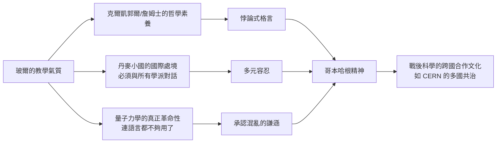

# 第 3 節 承認混亂的謙遜：玻爾如何教導學生擁抱量子世界的「不確定性」？

## 「真理的反面是另一個深刻的真理」

玻爾留下的教學語錄有一種奇特的風格：格言式的、近乎悖論的。最著名的一句是：

> 「淺顯真理的反面是謬誤。深刻真理的反面，是另一個深刻真理。」

這不是文學修辭，而是他教學法的心臟。玻爾深知量子力學帶給人類的真正課題不是計算，而是**如何與「無法用日常語言完整描述的世界」共處**。他把這種能力教給學生，教得比任何公式都認真。

## 互補性：一種「既…又…」的思維訓練

玻爾發現，波動與粒子、位置與動量、時間與能量——這些成對的概念**不能同時精確使用，卻又缺一不可**。他把這種結構命名為「互補性」（complementarity），並強調這是對古典邏輯「排中律」的溫和反叛：面對微觀世界，我們必須學會**在不同情境下使用不同、甚至互相排斥的描述，並誠實地指出邊界**。

他教的具體手法：

1. **追問語言**：他反覆說「我們在用語言談論自然，而我們是被語言塑造的」。學生的每一個詞（「粒子」「路徑」「觀測」）都會被他抓住追問其經典來源與適用範圍。
2. **畫邊界**：他堅持在每個論證中畫出「經典儀器」與「量子對象」的分界線，並承認這條線的移動是約定——這是後來測量問題與「量子—經典過渡」研究的起點。
3. **接受無法圖像化**：他教學生放下「為電子找到一幅肖像」的執念。可計算、可預言、可檢驗，比可想像更重要。

## 謙遜的社會學：玻爾為什麼這樣教？

值得一提的是政治維度：1939 年玻爾訪美帶去核分裂的消息；戰後他奔走於各國之間倡議核資訊的公開與國際管制（致羅斯福與邱吉爾的《開放世界》備忘錄——雖被冷遇）。他在課堂上教的「承認他人觀點的互補性」，直接延伸為他的政治哲學：**對立陣營的立場可能各自成立、必須對話**。冷戰時期科學家們的國際主義精神（帕格沃什運動、CERN 的多國共治），多少繼承了這種哥本哈根氣質。

## 給學習者的最後一課

玻爾的教室教的是一種少有人教的能力：**在不知道答案時，如何仍然聰明而誠實地思考**。

- 當兩個模型都「對」時，不要急著站隊，先弄清它們各自的適用範圍；
- 當語言失靈時，不要硬套舊詞，承認需要新概念；
- 當全世界都要求你「表態」時，準確性優先於立場。

量子世界的最大教訓或許不在物理，而在品格：**承認混亂，是智慧而不是軟弱**。
