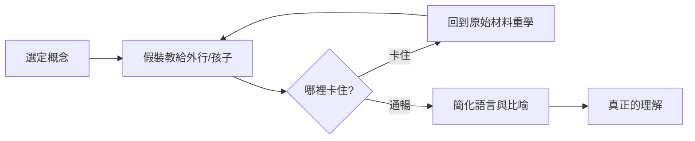

# 第 1 節 「費曼技巧」的原型：如何把世上最難懂的量子電動力學講得像童話？

## 1961–63：那套著名的紅皮書

1961 年，加州理工學院決定重編大學部基礎物理課程，講台交給理查·費曼。兩學年、一百多場演講，逐字速記後整理成《費曼物理學講義》三卷——出版近六十年仍是物理學最著名的講義，被一代代物理學家當成「重讀仍會有新收穫」的聖經。

諷刺的是：當年坐在台下的新生，多數跟不上這門課（出席率一路下滑，最後坐滿教室的是教授與研究生——他們才是真正的受益者）。費曼知道這一點，他給本科生上的課，實際上是**給「未來的物理學家」演示物理學應該被怎樣理解**。

## 量子電動力學：說給外行聽的奇蹟

費曼因量子電動力學（QED）獲 1965 年諾貝爾獎。QED 是人類歷史上最精確的理論——電子磁矩的理論預測與實驗吻合到小數點後第十位。1983 年，他把 QED 講給一般聽眾，成書《QED：光與物質的奇異理論》，全程只用箭頭與「小時鐘」（相位），一條公式沒列滿足不了了，但他成功了。核心思想：

- 粒子從 A 到 B，會走**所有可能的路徑**，每條路徑貢獻一個振幅（一個帶角度的小箭頭）；
- 把所有箭頭首尾相加，就是事件的機率幅：

$$
P = \left| \sum_{\text{所有路徑}} e^{i S/\hbar} \right|^2
$$

這就是路徑積分——他自己發明的表述方式——的童話版。費曼證明了：**不犧牲正確性的前提下，最深的理論可以只用「箭頭相加」講清楚**。

## 「費曼技巧」的誕生

費曼技巧——「如果你想真正理解某物，就把它講給一個孩子聽」——並非他本人命名，而是從他身上提煉的方法論。原型有三：

1. **講義即重構**：他備課的方式是從零重建整個主題，拒絕沿用教科書的既有敘事。「我不解釋它們是怎麼被講的，我重新想一遍。」
2. **找不到好講法 = 理解有洞**：他承認自己在講義裡刻意迴避了重力波的直觀解釋——他說他找不到「夠好」的講法，這本身就是誠實的知識狀態標示。
3. **對外行的講稿是品質檢驗**：他能向任何聽眾講任何主題；講不出來就回去重想。這個迴圈就是費曼技巧的完整版。

## 教學的代價與榮光

費曼為講義付出真實代價：兩年幾乎不做研究，事後他自己說「我教的那門課毀了我至少一年的研究」。但這套講義的長期回報超過多數論文：它影響的不是一個課題，而是**幾代人「如何思考物理」的預設**。

他晚年總結的那句話，已成為所有教師的試金石：

> 「我無法把它簡化到大一程度，就意味著我們其實還沒真正理解它。」
