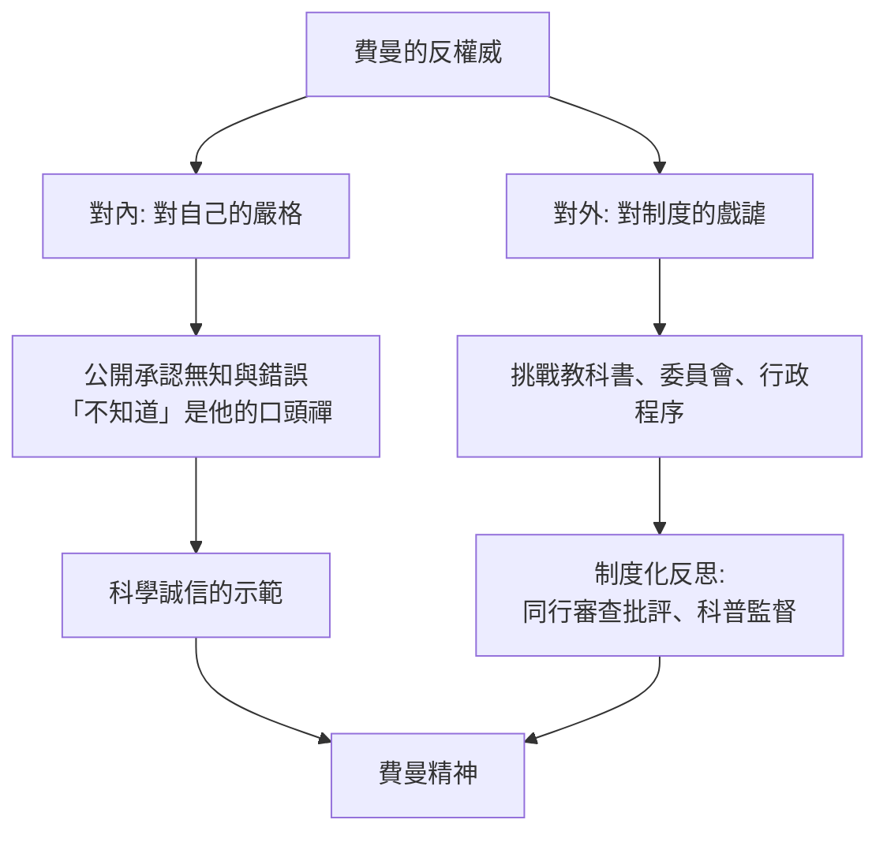

# 第 2 節 拒絕學術八股：費曼在課堂上挑戰權威、戲耍官僚的幽默日常

## 「Cargo Cult Science」：那場著名的畢業演說

1974 年，費曼在加州理工畢業典禮上發表演說《貨拜族科學》（Cargo Cult Science）。他描述二戰後南太平洋島民模仿機場：搭竹塔、點火把、學管制員揮手——形式全對，飛機就是不來。他說，科學界也有一模一樣的病：

- 只報告支持的結果，隱藏不利的數據；
- 用「統計顯著」包裝勉強的效應；
- 重複自己想重複的實驗，跳過不想重複的。

他開出的藥方是一種品格要求：**「第一原則是，你絕不能欺騙自己——而你自己是最容易被騙的人。」**（The first principle is that you must not fool yourself—and you are the easiest person to fool.）這場演說是「研究誠信教育」的經典文本，比科學界系統化討論可重複性危機早了四十年。

## 課堂上的反權威日常

費曼在加州理工的日常教學充滿反八股的劇場：

- **拆穿行話**：學生報告用一堆術語包裝，他會打斷：「用一句話說，你在講什麼？」講不出來，就是不懂。
- **當眾算錯**：他毫不掩飾地在黑板上演算失敗，重來，再失敗，再重來。學生看到的不是天才的不敗紀錄，而是**思考的實況**。他說過：「我寧願要無法回答的問題，也不要無法質疑的答案。」
- **戲耍行政**：他對官僚程序的不耐煩是傳奇。最著名的例子是與教育委員會的教科書評審事件（見下）。

## 加州教科書評審事件

1964 年，費曼被派任加州州立教科書評審委員——其他委員全是教育官僚。他發現自己被安排在酒店、被隔離、被要求不與同僚討論（據他自述是為了防止「偏見」），而其他委員根本沒讀書就打出評分。他索性獨自把一箱箱教科書全部讀完，寫下毒辣的逐條評語：插圖把科學家畫成戴眼鏡的白人男性刻板像、定義繞圈子、「能量使東西動起來」這類循環錯誤。他的報告在委員會被表決封存，多年後才出版。事件顯示的正是他的立場：**教育的官僚機器會自我複製平庸，而科學家的責任是把書真的打開來讀**。

## 挑戰權威的兩副面孔

必須持平地說，費曼式的戲謔也有陰影：他對哲學與人文的輕慢、某些回憶錄中對女性的態度，都受到後世批評。反權威若不加自省，會滑向新的傲慢——費曼自己教的最後一課恰好可以反照他自己：「絕不能欺騙自己」適用於每個人，包括費曼。

## 這一課的當代意義

在資訊爆炸與論文產量膨脹的今天，《貨拜族科學》讀來如同預言：p-hacking、掠奪性期刊、媒體化的科學新聞，全是「機場不來飛機」的現代版。費曼的教室留下的不是笑話，而是一條底線：**形式可以模仿，誠實無法表演。**
