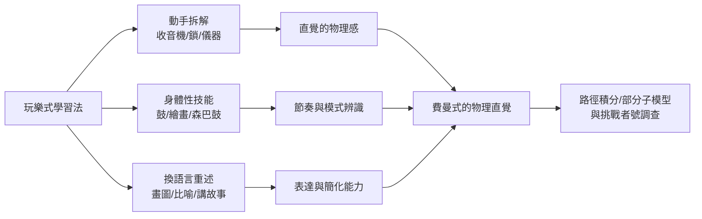

# 第 3 節 拆解萬物的雙手：從開鎖、打邦哥鼓到教物理的「玩樂式學習法」

## 一切始於修理收音機

費曼的學習哲學源頭在童年：父親梅爾維爾教小理查——不是「這是恐龍」，而是「這恐龍二十五呎高，那我們家院子裡，牠的頭要伸到二樓窗戶，但頭太大進不了窗」。**把抽象換算成可感**，這是費曼一生的認知習慣。少年時他靠修理收音機賺零用錢，學會的第一課是：不要等看懂了才動手，**拆開來、出錯、修好，就是理解的順序**。

普林斯頓博士期間他打開同事與保密實驗室的鎖，留紙條戲弄管理員——他自述動機不是偷，而是「想知道一個系統如何被防護，以及人們對自己系統的信任有多脆弱」。這種拆解本能，正是後來他分析問題的方式：把任何東西拆到不能再拆，再親手裝回去。

## 邦哥鼓、繪畫與「什麼都碰」的課表

費曼刻意維持業餘身分：學邦哥鼓（巴西嘉年華級的投入）、五十歲起認真學畫（畫到作品被畫廊賣出）、學開保險箱、研究瑪雅曆法、 physiology 與螞蟻的痕跡通信。他在《別鬧了，費曼先生》中的總結名言：

> 「物理對我而言，就像性對大多數人一樣——不是我不能談論它，而是我不願意只談論它，我要去做它。」

這種「玩樂式學習」不是消遣，而是一種**跨域遷移的訓練系統**：

## 玩樂的最高兌現：挑戰者號

1986 年挑戰者號太空梭爆炸，費曼被任命為調查委員會成員。官僚會議讓他厭煩，他索性自己跑去找工程師聊天——用「玩」的方式調查。在全國轉播的聽證會上，他把一塊 O 型環材料夾在 C 形鉗裡浸入冰水，幾秒鐘後拿出來捏給全國看：橡膠失去彈性。**一個玩具等級的實驗，瞬間擊穿數百頁的官方報告**。他後來另撰附錄，痛陳 NASA 風險評估「形式上安全、實質上自欺」——貨拜族科學的太空版。

## 對教育體系的挑戰

費曼對「死讀書」的攻擊不留情面：他批評巴西的物理教育（學生背得出定義、卻無法預測實驗結果——「你們沒有在教科學，你們在教詞彙」）；批評美國教科書的空洞；主張「知道一個東西的名字」與「知道那個東西」是兩回事。父親教他的那隻恐龍與鳥（「你可以知道那隻鳥全世界所有的語言名字，但你對鳥仍然一無所知」），他講了一輩子。

## 這一課的配方

費曼教室的可遷移配方：

1. **動手先於動眼**：拆開它，讓它壞一次；
2. **用身體學抽象**：把比例換算成院子、把相位畫成箭頭；
3. **保持業餘身分**：在陌生領域永遠當新手，防止專家的傲慢；
4. **玩是認真的**：邦哥鼓與路徑積分用的是同一顆腦袋。

他的墓誌銘式的話是：「我愛我的學生，但我更愛物理。」——而他的天才之處在於：他讓學生分不清這兩者的界線。
