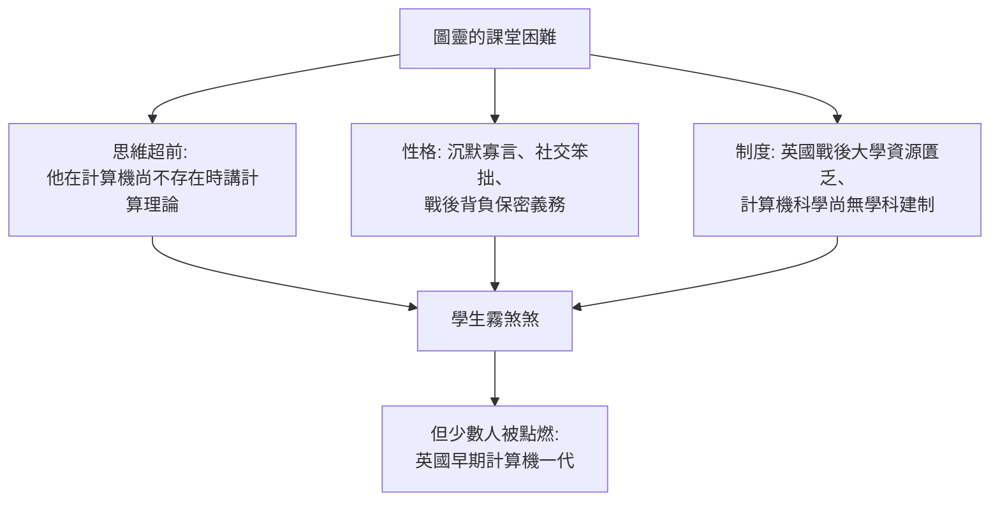

# 第 1 節 沉默寡言的邏輯奇才：不擅長社交、上課常讓學生聽得霧煞煞的怪咖教授

## 一個不符合教授模板的人

艾倫·圖靈（Alan Turing, 1912–1954）幾乎沒有一項特徵符合「優秀教師」的傳統模板：說話結巴、音調尖、埋頭於自己的思路、對寒暄毫無興趣。他在劍橋國王學院是研究員，在布萊切利園是密碼破譯核心，戰後先在倫敦的國家物理實驗室（NPL）設計 ACE 計算機，1948 年起在曼徹斯特大學擔任講師，負責與世界上第一台儲存程式計算機（曼徹斯特嬰兒機 Mark 1）相關的工作。

戰後英國大學的教學制度要求講授與輔導，圖靈的課堂以「難懂」聞名。回憶者描述：他講課像在自言自語，跳步極快，粉筆追不上腦子；學生若提問，他往往愣一下，然後換個起點從頭推。他的思路太快、太個人化，**聽懂他的人少，聽懂後改變人生的多**。

## 為什麼他的課這麼難？

三重障礙疊加：

1. **題材本身超前**：可計算性、判定問題、機器智能——這些領域在 1940 年代末根本沒有教科書，全世界懂的人屈指可數。
2. **保密的枷鎖**：布萊切利園的工作在戰後數十年是國家機密。圖靈不能談論自己最輝煌的成就，被迫以「沉默的奇才」示人；他的履歷上只有一段空白。
3. **社會的敵意**：他是同性戀，在當時的英國屬刑事犯罪。1952 年他因「嚴重猥褻」被定罪、被迫接受化學閹割，1954 年死於氰化物中毒（一般認定為自殺）。2013 年英國政府才正式道歉並赦免。

## 孤僻的另一面：嚴格而慷慨的導師

儘管笨拙，圖靈對學生的支援是實質的。他指導的研究生（如後來參與 Mark 1 程式設計的學者）回憶他願意花整個下午陪學生檢查程式邏輯；他批評殘酷但對事不對人；他自己的論文寫作同樣「不友好」——幾乎沒有多餘的字，每句都是邏輯負荷。

## 教育史的弔詭

圖靈的案例顯示教育史上一個反覆出現的弔詭：**最超前的思想往往由最不善表達的人攜帶**。伽利略善於表演而牛頓不善；費曼是舞台大師而圖靈是沉默的礦工。知識傳遞史因此需要兩種人：天才的創造者，與把天才轉譯給世界的轉譯者。圖靈缺少第二種人的支援——這既是他的悲劇，也是他的思想落地遲緩的原因之一。

下一節，我們看他在課堂與論文上投下的那枚炸彈：機器能思考嗎？
