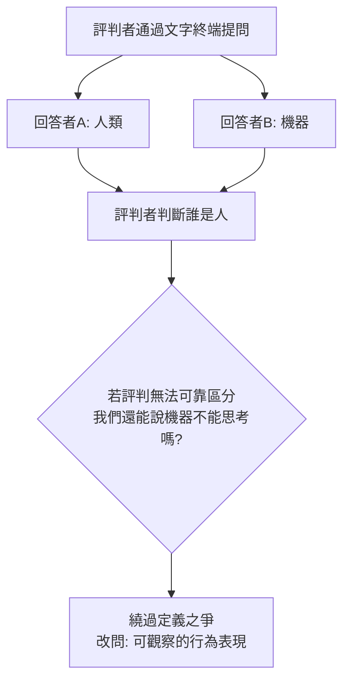

# 第 2 節 機器能思考嗎？圖靈在課堂上向傳統人類中心主義發出的終極挑戰

## 「計算機器與智能」：1950 年的那堂課

1950 年 10 月，圖靈在哲學季刊《Mind》發表《計算機器與智能》（Computing Machinery and Intelligence）——今天讀來，這篇論文就是一堂公開課：他預想了所有聽眾會提出的反對意見，逐一拆解，最後留下一個至今未決的問題。這是「思想實驗式授課」的極致。

他開場的姿態就是教學典範：不給定義「思考」（他說這個詞太模糊），而是**把問題換成一個可以玩的遊戲**——模仿遊戲，後世稱為圖靈測試：

這一招的教育學本質是**操作化**：把「什麼是思考」這種哲學死結，轉換為「機器的行為能否與人類不可區分」這種可檢驗問題——正是伽利略用測量取代權威、愛因斯坦用同時性操作取代形而上時間的同一條路線。

## 拆解九大反對意見：一堂示範性的辯論課

論文主體是圖靈預演的「神學反對」「意識反對」「機器不能創造新奇」「拉普拉斯決定論」等九種反駁，逐一回應。其中兩個回應最深刻：

1. **對「機器只會做被設計的事」**：他引入「學習機器」的概念——與其造一台成熟的成人智能機器，不如造一台**兒童機器**，再用教育去養它。這是機器學習的思想源頭，而它的比喻直接來自教育學。
2. **對「機器沒有情感與意識」**：他以極端冷靜的立場回答——我們判斷他人有無思想，本來就只靠外部觀察；對機器為何要用不同標準？這是對人類中心主義的正面爆破。

## 戰爭、計算與思想的前因

這個終極挑戰有其歷史前因：二戰期間，圖靈在布萊切利園領導破解德國 Enigma 密碼，設計了 Bombe 解碼機，每天處理海量邏輯運算。**戰爭把「純數學的抽象機器」變成「決定勝負的工程現實」**——圖靈 1936 年在論文中發明的通用圖靈機（一台能模擬任何機器的抽象機器），十年後變成真實佔地整間實驗室的計算機。戰後英國面臨帝國解體、經濟困頓、要靠科學重建，國家資助計算機研發（NPL、曼徹斯特）——圖靈的課堂正站在這個資源流上。

$$
\text{通用圖靈機: } U(\langle M \rangle, x) = M(x)
$$

一行式子蘊含的洞見：**硬體的差異是暫時的，程式（軟體）才是智能的載體**。

## 挑戰的後果

圖靈測試引發了此後七十年的人工智慧哲學戰爭：塞爾的「中文房間」、瑟爾對「強 AI」的批判、關於意識的整場辯論，全部以 1950 年那篇論文為起點。而在課堂層面，圖靈的挑戰改變了教育的自我理解——**教學的本質是改變一個資訊處理系統的狀態**，這個視角催生了認知科學、教學機器與今天的學習科學。

他那句彷彿預知自己命運的結語是：「我們只能看到前方很短的距離，但我們能看到，那裡有太多值得做的事。」

1954 年，他死於四十一歲。那裡的確有太多值得做的事——而人類花了七十年，仍在做他課堂上留下的作業。
