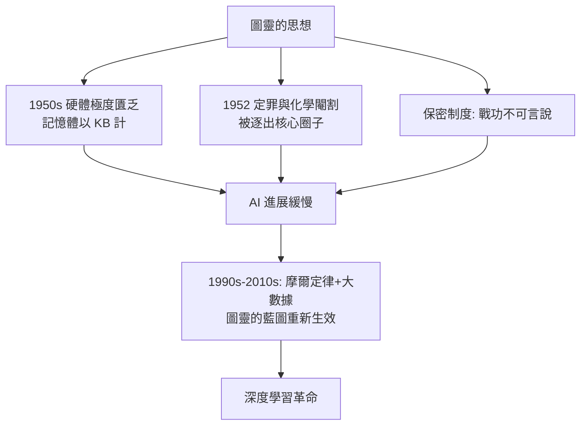

# 第 3 節 劃時代的預言：在沒有電腦的年代，他如何在黑板上畫出未來的人工智慧

## 1936：黑板上畫出的機器

圖靈的預言能力始於 1936 年那篇《論可計算數》——當時世界上還沒有任何電子計算機，他在劍橋的黑板與紙上演算出一台「想像中的機器」：一條無限長的紙帶、一個讀寫頭、一張狀態表。用最貧乏的硬體定義，他證明了：

1. 這台機器能計算一切「可計算」的東西（與遞迴函數等價）；
2. 存在一台**通用機器**，能模擬任何其他機器；
3. 同時，存在不可判定的問題（停機問題）：沒有任何程序能判定任意程序是否會停機。

$$
H(M, w) \text{ 不存在——停機問題不可判定}
$$

一個定義了「能做什麼」的理論，同時證明了「不能做什麼」。**這是人工智慧的全部疆界地圖，在電腦誕生前十三年就已畫完**。

## 1948–1954：曼徹斯特的黑板課堂

戰後在曼徹斯特大學，圖靈的授課與研究圍繞真實的機器展開。這幾年他的黑板上反覆出現的主題，今天讀來像預言清單：

| 圖靈當年的黑板 | 今日的實現 |
|---|---|
| 兒童機器 + 教育（學習機器） | 機器學習、強化學習 |
| 神經網路的未組織機器（1948 報告） | 連結主義、深度學習 |
| 模仿遊戲（1950） | 對話系統、聊天機器人評測 |
| 形態發生的化學基礎（1952） | 數理生物學、圖靈斑圖 |
| 遺傳演算法式的搜尋與變異 | 進化計算 |

1952 年的形態發生論文尤其驚人：他用偏微分方程證明均勻的化學系統可以自發產生斑紋（如動物花紋），方程組的解後來被稱為「圖靈斑圖」。**一位計算機科學之父，晚年轉身用數學解釋生命如何長出花紋**——他在黑板上的最後幾堂課，畫的是生物學的未來。

## 制度與時代：預言為何落地遲緩

圖靈的預言遲遲未被兌現，原因不全在科學：

1952 年的同性戀定罪剝奪了他的安全許可與社會位置，這位預言家在最後的歲月被自己的國家逐出舞台。**制度的壓迫不僅毀掉一個人，也延遲了一個領域的誕生**——這是科學史最沉痛的帳目之一。

## 課堂的最後一課

圖靈教室留給後世的三個教訓：

1. **理論先行於機器**：先想清楚什麼是可計算的，工程才不會盲目；
2. **承認極限也是預言**：停機問題與哥德爾不完備性告訴我們，智能與數學都有不可逾越的牆——今天的 AI 安全討論仍在這堵牆下進行；
3. **社會對異類的態度，決定科學的速度**：圖靈被虧欠的不只是道歉，而是那些本可能提早發生的課堂。

今天每一台與人對話的機器，都在回答 1950 年那篇論文的問題。而那台機器的第一張草圖，是一個沉默寡言的人在沒有電腦的年代，用粉筆畫在黑板上的。
