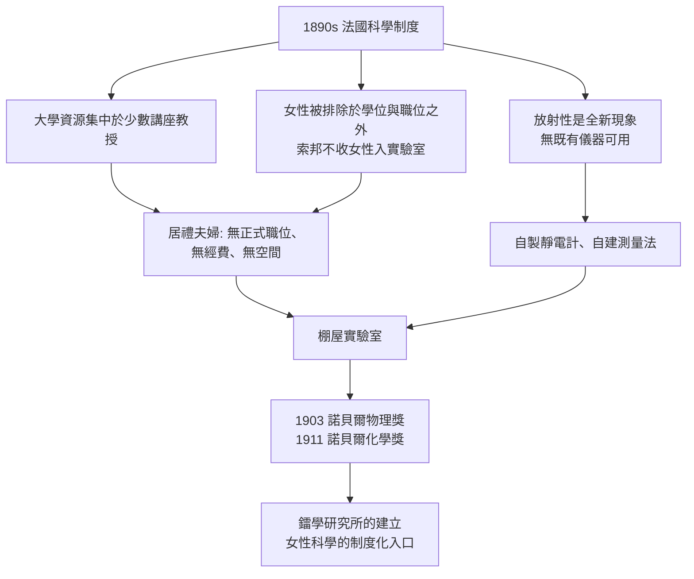

# 第 1 節 簡陋棚屋裏的聖殿：沒有奢華設備，只有對真理的極致純粹

## 一間漏雨的棚屋

1898 年，瑪麗·居禮與皮耶·居禮在巴黎理化學院得到一間「實驗室」：一間改裝的棚屋——漏雨、不通風、水泥地面瀝青屋頂、最基本的通風櫥都沒有。後來的諾貝爾獎得主、當時的德國化學家拉姆齊曾形容那根本不像化學實驗室。就在這裡，瑪麗處理了數噸的瀝青鈾礦渣，歷時近四年，於 1902 年提煉出 0.1 克氯化鐳。

她後來回憶：「就在這間可憐的棚屋裡，我們度過了一生中最幸福的歲月。」晚上回家前，兩人會回去看一眼——黑暗中，玻璃皿裡的鐳鹽發著幽幽藍光。「那些發光的容器，像懸在暗夜中的微弱燈火，永遠是我們記憶中最美的景象。」

## 條件的匱乏為何與科學純粹性互為因果

棚屋不只是環境悲慘，它有一整套制度背景：

三個驅動關係值得注意：

1. **性別制度的排除，反而鍛造了自給自足**：瑪麗在巴黎求學時窮到昏倒仍堅持讀完索邦（物理、數學雙學位第一名），她習慣了「制度不給，就自己建」。
2. **定量方法的執念**：她最早的貢獻是證明放射性強度**只與鈾含量成正比、與化合物形式無關**——放射性是原子自身的性質。這個結論建立在她極端嚴格的定量測量上。棚屋裡最精密的儀器，是皮耶與她兄弟改裝的壓電石英靜電計。**科學的純粹性不在設備，在測量的紀律**。
3. **經濟的弔詭**：他們拒絕為提鐳方法申請專利。「鐳屬於全人類」——這個決定讓製鐳工業得以在世界各地廉價發展，也讓居禮夫婦終身不富。科學與商業的邊界，由科學家本人劃定。

## 聖殿的意義

棚屋後來成為傳奇：1911 年她第二次獲諾貝爾獎（史上首位兩度獲獎者）；法國終於為她建立鐳學研究所（居禮館），她親任所長，把棚屋的傳統——**極致純粹的定量方法 + 門永遠為青年敞開**——帶進了新聖殿。而下一節我們會看到，這個聖殿最特別之處，是它對女性與外國青年敞開的程度，在當時的世界首屈一指。
