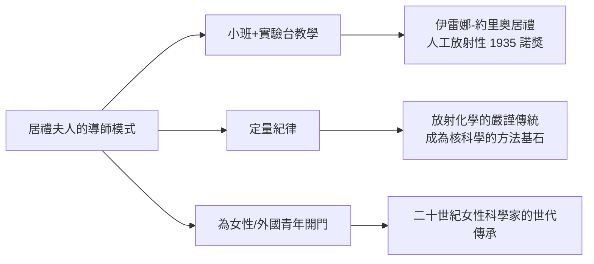

# 第 2 節 嚴格而溫柔的導師：居禮夫人如何帶領女性與青年學者叩開放射化學的大門

## 一所史上最小的「大學」

1907 年前後，瑪麗·居禮做了一件法國學界前所未有的事：她組織了一個**合作教學實驗班**——由一群不滿傳統大學死板教學的學者（包括物理學家朗之萬、數學家阿達瑪等）為少數學生開小班，物理、化學、數學輪流教，親自動手為主。這個實驗班只辦了兩年，卻是她教育理念的完整展示：**教學的單位不是講堂，而是實驗台**。

1912 年居禮館落成後，她的「教室」制度化為放射學實驗室，培養出包括她女兒伊雷娜·約里奧-居禮（1935 年諾貝爾化學獎）在內的一整代放射化學家，學生來自十餘國——包括遠道而來的中國學生（如施士元，1933 年在居禮門下獲博士學位，後為中國核物理教育奠基者之一）。

## 嚴格：數據面前沒有例外

居禮夫人的教學以嚴酷著稱，其嚴格有明確的技術內核：

1. **定量至上**：她的口頭要求是測量、測量、再測量。學生的報告若有粗略估計，會被退回重做。她說過：「實驗中必須重視的是數據的確實性，而非理論的美麗。」
2. **親自示範**：身為所長與諾獎得主，她仍親自指導學生操作儀器、檢查靜電計的讀數。學生回憶她會靜靜站在實驗台旁看你做完整個過程。
3. **對自己的標準更高**：她拒絕用法國制度給她的榮譽減免自己的工作。第一次世界大戰期間，她帶著女兒伊雷娜把 X 光機裝上汽車（「小居禮」），親赴前線為傷兵做放射診斷——五十歲的諾獎得主在戰地醫院站手術台旁。

## 溫柔：為被排除者開門

她的溫柔同樣具體：

- **女性**：居禮館僱用與培養的女性研究員比例遠高於同時代機構。她知道制度之牆在哪裡，因為她一寸寸撞過：索邦曾不收她進實驗室、1903 年諾獎最初只提名皮耶與貝克勒，是皮耶堅持才加上她的名字、1911 年她角逐法國科學院院士以一兩票之差落敗（科學院以她是女性兼猶太裔背景的輿論攻擊為由拒絕，她從此不再申請）。
- **外國人**：居禮館的國際學生比例在當時極罕見。她的小國出身（波蘭，亡國狀態下的被統治者）使她對「被排除者」有本能的敏感。她堅持新發現以祖國命名——釙（polonium）。
- **基金會制度**：她推動以私人募款支持科研（美國記者梅洛尼夫人發起的美國居禮鐳基金，兩度贈她一克鐳），開創了科學慈善贊助的模式。

## 為什麼她的嚴格與溫柔不矛盾？

因為兩者來自同一個信念：**科學是少數真正一視同仁的活動**。數據不看你國籍與性別，實驗不因你的身分而給你第二種真理。嚴格是對學生最大的尊重——她把你當成「能達到真理的人」來要求；溫柔是把門打開——她親手拆掉她自己曾經撞得頭破血流的那堵牆。
