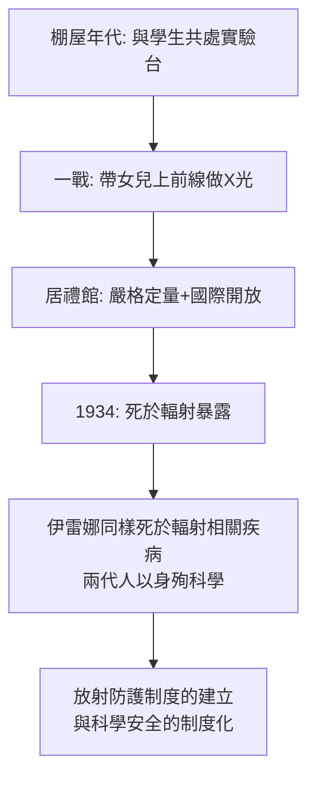

# 第 3 節 用生命上完的最後一課：輻射記錄背後不滅的科學家風骨

## 她的筆記本至今仍有輻射

巴黎國家圖書館保存著居禮夫人的實驗筆記與食譜式的工作手冊，紙頁上有她的指紋與放射性沾染——這些紙張**至今仍有放射性**，讀者需簽署免責文件、在監管下閱覽。她的遺體 1995 年遷入先賢祠（史上首位憑自身成就入祠的女性），棺木檢測出鐳-226 污染，需以鉛襯防護。

這是歷史上最觸目的隱喻：**一位科學家以身體記錄了她研究的物質**。她長期暴露於 X 光與放射性之下（戰地 X 光工作尤其致命），1934 年死於再生不良性貧血（今認定與輻射暴露高度相關），終年六十六歲。

## 最後一課的兩層含義

### 一、她根本不認為自己在犧牲

居禮夫人拒絕「殉道者」的敘事。她的日記與書信顯示，她對輻射危險的認識有限（當時科學界整體如此——早期的「鐳療法」甚至被當成保健品），而她對工作的態度是全然的投入而非苦行。她真正的風骨在別處：

1. **拒絕專利、拒絕榮譽的腐蝕**：「鐳不應使任何人發財，它屬於全人類。」榮譽到來時她的反應是厭倦——她說獎章給孩子當玩具。
2. **德雷福斯事件中的立場**：1890 年代末法國社因德雷福斯案撕裂，她與皮耶公開站在為猶太軍官平反的一邊——在排猶浪潮中，科學家的誠實延伸為公共的誠實。
3. **朗之萬事件的代價**：1911 年她與已分居的物理學家朗之萬的戀情被媒體炒作，報紙叫她「波蘭蕩婦」、群眾在她家門口騷擾，法國科學院藉此拒絕她入會。她在給朗之萬的信中寫下科學史上最有尊嚴的私人宣言之一：「**我的個人生活與我的科學工作毫無關係……我對科學的熱愛獨立於生活中的一切事件。**」數週後，她第二次獲得諾貝爾獎——瑞典科學院明確表示此獎與緋聞無關。她照常前往斯德哥爾摩領獎。

### 二、以身作則的教育學

居禮夫人的「最後一課」是她整個教學法的終點：她要求學生純粹、嚴格、誠實——而她本人就是這三個詞的活體標本。

她的死直接推動了輻射防護與實驗室安全規範的建立——這是科學史上最沉重的傳承：**安全制度是用第一代實踐者的生命寫成的**。

## 對今天的讀者

居禮夫人的教室提醒我們三件事：

1. **純粹性是行為，不是姿態**：拒絕專利、直面緋聞、戰地服務——她的「風骨」由一個個具體決定構成，而非口號。
2. **科學的代價要被看見**：今天實驗室的安全规程、輻射劑量限值、倫理審查，都是她那一代人用健康換來的。使用這些制度，就是對她們最起碼的致敬。
3. **導師的示範比任何講義長久**：伊雷娜·約里奧-居禮後來對自己學生的要求，幾乎是母親的複刻。生命有限，課堂無限——這是本書最後想留在讀者心中的畫面：那間棚屋的藍光，如今照耀在世界上每一間認真做測量的實驗室裡。
