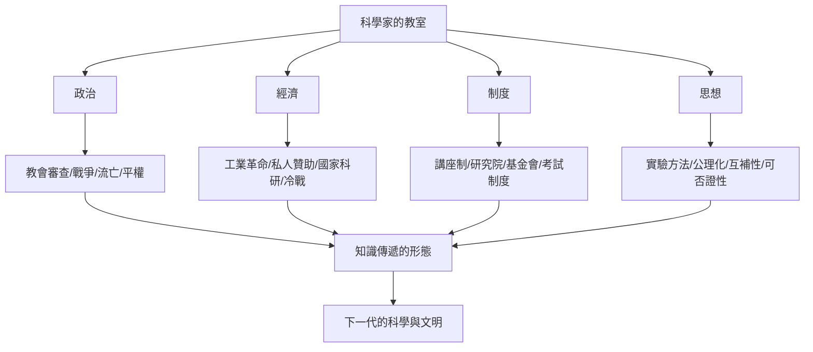

# 結語：坐在巨人的講台下——我們究竟該如何學習科學？

## 九間教室，九種傳遞哲學

走完全部九間教室，把每位的教學哲學並排放在一起：

| 人物 | 教室 | 核心方法 | 教育哲學 |
|---|---|---|---|
| 伽利略 | 斜塔與講堂 | 公開實驗、邏輯處決權威 | 真理由檢驗而非資歷決定 |
| 牛頓 | 三一學院 | 公理化幾何、嚴苛證明 | 門檻如實標示，不降低 |
| 法拉第 | 皇家講座 | 蠟燭式演示、零公式 | 降低門檻而非深度 |
| 波茲曼 | 維也納講堂 | 哲學與詩意承載抽象 | 在反對聲中教未來的真理 |
| 愛因斯坦 | 咖啡沙龍 | 思想實驗、平等對話 | 概念批判高於知識積累 |
| 玻爾 | 哥本哈根茶室 | 集體辯論、複述碾壓 | 真理在碰撞中生成 |
| 費曼 | 加州理工 | 費曼技巧、玩樂拆解 | 講不清=沒懂 |
| 圖靈 | 曼徹斯特黑板 | 操作化問題、極限預言 | 換掉死結，改問可檢驗的問題 |
| 居禮夫人 | 棚屋實驗室 | 實驗台小班、以身作則 | 嚴格是尊重，開門是責任 |

九人互補得驚人：伽利略與法拉第降低門檻，牛頓拒絕降低；費曼靠表演，圖靈靠沉默；玻爾信賴集體，愛因斯坦信賴孤獨的想像；居禮夫人則證明——**方法終究要由人格來承載**。

## 貫穿九間教室的四條線索

回顧全書，驅動這些教室的，從來不只是個人天賦：

1. **政治決定教室能否開門**：伽利略被審判、愛因斯坦被驅逐、圖靈被定罪、居禮夫人被性別排除——也正因如此，自由與開放不是學術的裝飾品，而是學術的生存條件。
2. **經濟決定教室的規模**：從皇家研究院的慈善贊助到冷戰的國家科研，誰付錢、誰能坐進教室，是每個時代的真實問題。
3. **制度決定知識的壽命**：論文會過時，講義與制度（聖誕講座、Tripos、研究所、安全規範）才是跨越世代的載體。
4. **思想決定教室的靈魂**：從「權威說了算」到「數據說了算」再到「碰撞與否證說了算」，九間教室共同完成了這場教育哲學的漫長遷徙。

## 那麼，我們究竟該如何學習？

從九位老師身上，可以提煉出一套彼此互補的學習守則：

1. **像伽利略一樣檢驗**：對任何結論問一句——「能做一個實驗嗎？」
2. **像牛頓一樣嚴格**：不滿足於記住結論，追問每一步推導。
3. **像法拉第一樣從具體開始**：一根蠟燭、一台收音機、一個真實現象。
4. **像波茲曼一樣堅持**：你的理解超前於周圍環境時，別急著放棄。
5. **像愛因斯坦一樣做思想實驗**：把直覺推到極限，看它哪裡斷裂。
6. **像玻爾的學生一樣辯論**：找一個會碾壓你的鮑利，活下來的想法才值得保留。
7. **像費曼一樣重講**：講給孩子聽，卡住的地方就是你的知識之洞。
8. **像圖靈一樣操作化**：把爭不清的定義，換成可檢驗的問題。
9. **像居禮夫人一樣誠實**：測量如實，失敗照記，數據面前人人平等。

## 最後的話

這本書的每一章都在回答同一個問題：科學家的思維，是如何傳遞的？而九間教室給出的共同答案是——**靠人，靠開門的人**。

知識不會自動流動。它需要一個願意公開實驗的伽利略、一個肯為學生寫推薦信的玻爾、一個把手上的鐳寫進教科書而拒絕專利的居禮夫人。科學史上的每個偉大時代，本質上都是一次成功的「教學」。

現在，教室的大門在你身後關上，你在門外，手裡拿著九位老師留下的思考工具。巨人的講台空著——

下一個坐上去的人，也許剛剛讀完這本書。
