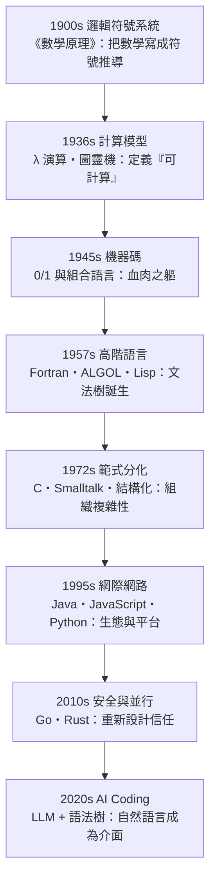

# 前言：理性大廈的裂痕與對話的演進

## 一切始於一場崩塌

1900 年 8 月，巴黎。希爾伯特在第二屆國際數學家大會上提出著名的 23 個問題，其中第二個問題問的是：**數學能否被完全公理化、且公理系統的一致性能被證明？** 這不是單純的數學好奇。十九世紀末，集合論悖論（羅素悖論：包含所有不包含自己的集合的集合）讓數學基礎出現裂痕。數學家們想要一座永不出錯的理性大廈——**用純粹符號、純粹規則，把全部數學建立起來，並機械化地判定任何命題的真偽**。

三十年後，這座大廈被兩聲巨響震碎：1931 年哥德爾不完備定理，1936 年圖靈的停機問題。但弔詭的是——**正是這場崩塌，讓人類第一次精確定義了「什麼是計算」**。程式語言，就誕生在這片廢墟上。

## 本書的主線：一場不斷升級的「對話」

人類與機器溝通的每一層介面，都是一次抽象化的跳躍。抽象不是逃避細節，而是**把細節封裝成可靠的積木**：

## 三個視角交錯全書

**1. 數學的視角（真理）**：希爾伯特、哥德爾、邱奇、圖靈——程式語言的理論基因來自邏輯學危機。$\lambda$ 演算（1936）直接是 Lisp（1958）與一切函數式語言的祖先。

**2. 語言學的視角（文法）**：喬姆斯基 1956 年的生成語法理論，讓程式語言獲得了嚴格的「文法分類學」——喬姆斯基譜系至今是每個編譯器工程師的常識。而 BNF（巴科斯-瑙爾範式）意外地把語言學與編譯器焊在一起。

**3. 工業的視角（機器）**：從 IBM 打孔卡經濟、冷戰軍方資助（Fortran 是炸彈計算、ALGOL 是學術共識、Internet 是國防計畫）、軟體危機與 NATO 會議（1968，「軟體工程」一詞誕生）、開源運動、到雲端與 AI——**經濟與政治壓力始終在決定哪種語言存活**。

## 歷史的規律

讀完全書你會看到重複出現的模式：

| 規律 | 例子 |
|------|------|
| 理論搶跑應用數十年 | $\lambda$ 演算（1936）→ Lisp（1958）；圖靈機（1936）→ 電腦（1945） |
| 效率懷疑論總是輸 | 「高階語言太慢」（Fortran）→「GC 太慢」（Java）→「解釋型太慢」（Python）——每次硬體與演算法都翻案 |
| 語言之爭其實是社群之爭 | ALGOL vs Fortran 是歐洲學院 vs 美國產業；動態 vs 靜態是個人開發者 vs 企業 IT |
| 每一代抽象化都擴大程式員人口 | 機器碼（數十人）→ 組合語言（數千）→ 高階語言（數百萬）→ AI Coding（數億？） |

現在，讓我們回到 1900 年的巴黎，回到那個相信「萬物皆可形式化」的偉大時代。

---
[下一節：1.1 希爾伯特計畫](01.1-希爾伯特計畫.md)
