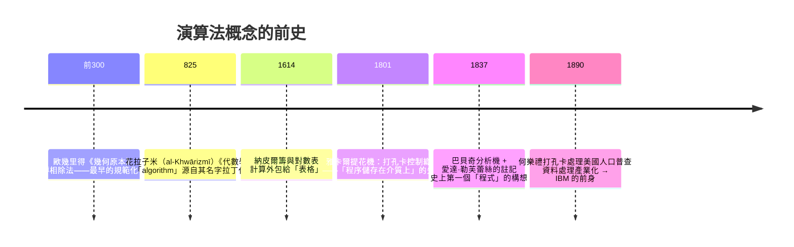

# 1.2 判定問題（Entscheidungsproblem）：尋找「萬能演算法」之浪漫妄想

## 什麼是判定問題？

希爾伯特在 1928 年的《數學基礎》中把計畫精煉成三個問題，其中第二個就是**判定問題**：

> **是否存在一個機械程序（procedure），對任何形式語言中的命題，都能在有限步驟內判定它是可證明的還是不可證明的？**

「機械程序」這四個字，正是問題的深淵所在。1928 年的人類，**沒有「演算法」的精確定義**——大家都知道「像歐幾里得輾轉相除法那樣一步一步算」的意思，但無法說清楚「任何可能的機械程序」的邊界在哪裡。

要證明這種程序**存在**，隨便給一個就夠；要證明它**不存在**，必須先窮盡定義「程序」這個概念。**證否逼出了定義——這是全書反覆出現的引擎。**

## 演算法概念的史前史

「按部就班的計算」比電腦古老得多：

**兩條歷史支流值得細看**：

- **愛達·勒芙蕾絲（Ada Lovelace, 1843）** 在翻譯門內格雷斯基關於分析機的文章時寫下註記 G：計算伯努利數的一系列操作表——史上第一個發表的程式。她更預言：「分析機編織代數圖樣，正如雅卡爾織機編織花朵。」她甚至看出機器可以操作符號而不只是數字（音樂！）。**但巴貝奇的分析機從未建成**——英國政府因成本失控拒絕繼續資助（工程超支殺死偉大專案，不是新聞）。愛達之後，英國數學界對計算機械的興趣沉寂了半個世紀——**失敗的工程有時會凍結一個領域幾代人。**
- **打孔卡的商業帝國**：1890 年人口普查用何樂禮製表機把處理時間從 8 年壓到 1 年，催生了 CTR 公司——1924 年更名 **IBM**。二十世紀前半，「計算」不是科學家的事，是**會計與人口統計的商業需求**。二戰時電腦的誕生，正是這條商業支流與軍事需求匯流。

## 1928–1936：一批人同時逼近答案

判定問題像一塊大石，1920s 末全世界最聰明的人都在推它：

| 人物 | 路線 | 特色 |
|------|------|------|
| 哥德爾 | 一般遞歸函數 | 用「數論函數」刻畫可計算 |
| 邱奇 | $\lambda$ 演算 | 最小化：函數與代入 |
| 圖靈 | 圖靈機 | 物理化：紙帶、讀寫頭、狀態 |
| 波斯特 | 波斯特系統 | 字串改寫規則 |
| 克萊尼 | 遞歸函數 | 整理哥德爾—赫布蘭德定義 |

五條完全不同的路，最後被證明**計算能力完全相同**。當多個獨立發明的方法在能力上重合，人們才敢相信：**「直觀可計算」這個模糊概念，終於有了一個不會再變的數學對應物。**（這個論證策略與「極限的 $\varepsilon$-$\delta$ 定義」一致：定義的正確性由收斂的獨立路徑擔保。）

## 國際競爭的時代背景

這場競賽發生在大蕭條與納粹崛起之間。哥廷根是中心，普林斯頓（IAS，1930 成立——班伯格夫婦賣掉百貨公司捐建的**私人財富資助純數學**的範本）是新磁石。馮·諾伊曼 1930 年赴普林斯頓；哥德爾 1933 年首次訪問（維也納的政治動盪讓他反覆往返，1940 年最終橫穿西伯利亞鐵路逃亡美國）；圖靈 1936–38 在普林斯頓跟隨邱奇讀博士。

**知識地理的劇變**：判定問題的答案將由德語世界提出問題、由英美體系收割成果。1933 年納粹清洗大學（哥廷根數學系一夜之間失去半數教授，外爾嘆道：「哥廷根已死」），直接為美國的計算科學霸權鋪路。**基礎研究的地理，是政治的函數。**

## 判定問題的具體形狀

用現代語言重述：給定一阶邏輯公式 $\varphi$，是否存在演算法 $A$ 使得

$$A(\varphi) = \begin{cases} \text{「可證」} & \text{若 } \varphi \text{ 在所有模型中為真} \\ \text{「不可證」} & \text{否則} \end{cases}$$

希爾伯特預期答案是「存在」。這個浪漫有其時代理由：萊布尼茨三百年前就夢想的 **characteristica universalis**（普遍文字）與 **Calculemus**（「讓我們來算一算」——用計算終結哲學爭論）。希爾伯特計畫本質上是萊布尼茨之夢的數學加強版。

1936 年，答案揭曉：**不存在**。邱奇與圖靈各自證明。但正如第二章與第三章將展示的——證明「不可能」所需要的機器，比萊布尼茨夢想的萬能機器更偉大。

---
[下一節：1.3 符號邏輯的崛起](01.3-符號邏輯的崛起.md)
