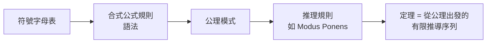
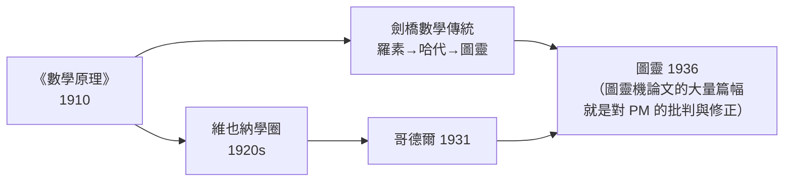

# 1.3 符號邏輯的崛起：羅素、懷特海與《數學原理》的嚴密公理化嘗試

## 從萊布尼茨到弗雷格：邏輯的兩千年冬眠與解凍

亞里士多德的三段論統治邏輯兩千年，但它處理不了數學需要的推理（關係、量詞、多層嵌套）。萊布尼茨 1679 年就夢想用符號取代自然語言爭論，可惜只留下手稿。真正的解凍始於：

- **布爾（George Boole, 1847《邏輯的數學分析》）**：把邏輯變成代數——「與、或、非」對應乘、加、補。一個自學成才的鞋匠之子、英國中學校長，為了「用代數做神學推理」開創了邏輯代數。**一百多年後，每一個邏輯閘門都是布爾代數的物理化身**——他不可能預見電腦，但他造出了電腦的句法。
- **弗雷格（Gottlob Frege, 1879《概念文字》Begriffsschrift）**：發明量詞（$\forall, \exists$）與現代謂詞邏輯，提出「意義與指稱」區分——分析哲學的整個傳統由此而來。諷刺的是，弗雷格的著作當時幾乎無人閱讀（他的二維記號系統太難排版也難讀）——**記號的可用性，本身就是學科成敗的變數**（對比：皮亞諾的記號被羅素採用而普及）。
- **皮亞諾（Giuseppe Peano, 1889）**：用精煉的符號公理化自然數（皮亞諾公理），其記號體系（$\in, \cup, \exists$）成為今天的標準。

## 羅素悖論與《數學原理》

伯特蘭·羅素（Bertrand Russell）發現弗雷格體系自爆（1901 年悖論）後，與老師懷特海（Alfred North Whitehead）開始了十年的豪賭：**把全部數學從純邏輯推導出來**。成果是三卷本《數學原理》（*Principia Mathematica*, 1910–1913）。

書中最著名的事實：**命題「$1 + 1 = 2$」直到第 2 卷 300 多頁處才被證明**（*54.43），附註還得補一句「以上命題偶爾有用」——這句英式冷幽默背後，是形式化的全部代價。

解決悖論的技術是**類型論（type theory）**：

- 個體是類型 0，個體的集合是類型 1，集合的集合是類型 2……
- 「$x \in x$」在類型上不合法——悖論連寫出來的資格都沒有

**注意這個思想的命運**：類型論在邏輯學界一度式微（被集合論公理化 ZFC 壓過），卻在程式語言裡獲得永生——從 1970s 的 ML、Haskell 的 Hindley–Milner 類型推斷，到 Rust 的所有權類型、TypeScript 的漸進類型，**每一個現代編譯器都在執行羅素當年防悖論的檢查**。你今天寫的每一行程式碼通過型別檢查時，都是在向《數學原理》致敬。

## 公理化方法的勝利與極限

《數學原理》確立了形式系統的標準結構，這正是後來一切「程式語言規範」的原型：

一個「證明」被定義為**可以用機械檢查的有限字串序列**——這個觀念是哥德爾證明、圖靈機、乃至現代形式驗證（Coq、Lean）的共同起點。萊布尼茨的「Calculemus」在此第一次成為精確技術。

## 維也納學圈與邏輯實證主義：思想的社會載體

《數學原理》的影響經由一個思想社團放大：**維也納學圈**（維也納學圈，1924–1936，石里克主持）。成員（卡爾納普、紐拉特、哥德爾在邊緣參與）把弗雷格—羅素邏輯當作「科學世界觀」的基石，主張：哲學問題可化約為邏輯與語言問題。

社會與政治背景：一戰後奧地利的崩解、理性主義對浪漫主義與神秘主義浪潮（維也納當時盛行的通靈術、瓦格納式美學）的對抗。學圈 1929 年宣言《科學世界觀：維也納學圈》把邏輯分析與反形上學連成一場**文化政治運動**。1930s 納粹與奧地利法西斯主義興起，學圈成員流亡（石里克 1936 年被學生槍殺）——**邏輯實證主義的離散，是二十世紀知識分子流亡史的縮影，也把分析哲學的重心搬到了英美。**

## 傳播鏈：從《數學原理》到圖靈

圖靈 1936 年論文的標題直白得驚人：**《論可計算數及其在判定問題上的應用》**——他就是要處理希爾伯特的問題，而他選的切入點，是挑戰《數學原理》本身。羅素當時的私人助理與圖靈有交集；羅素晚年評價圖靈機：「我很高興相信它，因為它讓整個數學基礎問題顯得沒那麼嚴重了。」

## 小結

- 符號邏輯用 80 年（布爾 1847 → PM 1910）把「推理」變成可機械檢查的字串操作
- 類型論的悖論防禦思想在語言設計中永生
- 邏輯學的興衰與維也納、哥廷根、普林斯頓的地緣政治同步
- 一切就緒：現在人類有了形式系統的精確概念，只差一記重錘——哥德爾的鐵錘。

---
[下一節：2.1 邏輯的極限](02.1-邏輯的極限.md)
