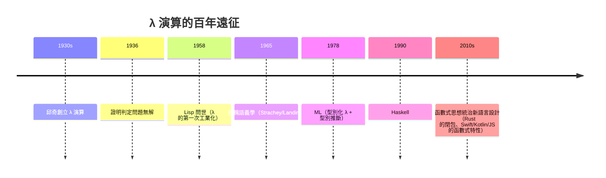

# 3.1 阿隆佐·邱奇與 $\lambda$ 演算：用最純粹的函數綁定與代換建立可計算世界

## 一位安靜的普林斯頓教授

阿隆佐·邱奇（Alonzo Church, 1903–1995）——普林斯頓的邏輯學教授，性情溫和、生活規律、終身如一。他培養出的博士名單是計算科學的群英譜：**圖靈、克萊尼、Rosser、Curry 的合作者們**……而他本人的貢獻卻樸素得近乎禁欲：

> **$\lambda$ 演算：整個宇宙只有兩樣東西——函數與代入。**

## 三個構件

**1. 變數與抽象**：$\lambda x. M$ 表示「以 $x$ 為自變數的函數，函數體為 $M$」。
例：$\lambda x. x$ 是恆等函數；$\lambda x. x + 1$ 是後繼概念（假設已有 $+$）。

**2. 應用**：$M\,N$ 表示「把 $N$ 代入函數 $M$」。

**3. $\beta$ 規約（唯一的計算規則）**：

$$(\lambda x. M)\,N \;\to\; M[x := N]$$

把 $M$ 中所有自由的 $x$ 替換成 $N$。**計算 = 不斷規約，直到無法規約。** 沒有迴圈、沒有狀態、沒有賦值——一切都是代入。

## 用純函數造出整個數學

最驚人的展示：邱奇數——**用函數本身表示自然數**。數 $n$ 是「把 $f$ 疊代 $n$ 次」的函數：

$$\begin{aligned}
0 &\equiv \lambda f.\lambda x.\,x \\
1 &\equiv \lambda f.\lambda x.\,f\,x \\
2 &\equiv \lambda f.\lambda x.\,f\,(f\,x) \\
3 &\equiv \lambda f.\lambda x.\,f\,(f\,(f\,x))
\end{aligned}$$

加法、乘法直接從疊代組合出來：

$$\text{ADD} \equiv \lambda m.\lambda n.\lambda f.\lambda x.\,m\,f\,(n\,f\,x) \qquad\qquad \text{MUL} \equiv \lambda m.\lambda n.\lambda f.\,m\,(n\,f)$$

驗證 MUL：$\text{MUL}\ 2\ 3\ f = 2\,(3\,f) = f^2 \circ f^3 = f^5$。✓ **乘法就是函數複合**——這種「把資料編碼為行為」的風格，是函數式思想的全部精髓。

布爾值、序對、遞歸也全部可造。遞歸尤其深刻：$\lambda$ 演算中函數不能「叫自己的名字」（沒有命名！），解法是 **Y 組合子**：

$$Y = \lambda f.\left(\lambda x. f\,(x\,x)\right)\left(\lambda x. f\,(x\,x)\right)$$

滿足 $Y\,g = g\,(Y\,g)$——**自我複製的公式**，讓函數能「透過自應用」實現遞歸。Curry–Howard 對應（1934/1958）更進一步：**證明 = 程式，命題 = 類型，證明化簡 = 求值**——哥德爾的邏輯與邱奇的函數在此合流。

## 1936 年：邱奇給出判定問題的否定答案

邱奇 1936 年發表《一個不可解的初等數論問題》，定義 $\lambda$-可定義函數為「有效可計算」的候選（**邱奇論題**），然後證明：

- 對任何 $\lambda$-項，可以機械判定其「是否有規範形」（是否算得出來）嗎？——**不可判定**
- 由此推出希爾伯特的判定問題**無解**

一個月後圖靈的論文到達普林斯頓（圖靈不知道邱奇的工作，獨立證明同一結論）。邱奇審稿後寫信給圖靈的導師，建議他來普林斯頓讀博士。**兩篇否定判決書，開啟了計算機科學。**

## $\lambda$ 演算的「埋沒」與復活

諷刺的是，1940s–50s 沒有人用 $\lambda$ 演算寫程式——它太純、太抽象，而當時的工程需求（磁鼓、打孔卡、彈道）需要的是 Fortran 那種「離數學公式近、離機器也近」的語言。$\lambda$ 演算沉睡在邏輯學文獻中，直到：

- **1958 年 Lisp**：麥卡錫直接以 $\lambda$ 演算（配 S 表示法）為核心（第 7 章）
- **1965 年 Strachey 與 Landin**：指出程式語言的語義可用 $\lambda$ 演算建模；Landin 的 ISWIM 語言成為 ML、Haskell 的祖先
- **1978 年 ML、1990 年 Haskell**：型別化 $\lambda$ 演算成為語言設計的標準語言
- **現代**：閉包（closure）、箭頭函數、柯里化、不可變資料、React 的函數式組件——**$\lambda$ 演算從邏輯教材走進了每一行前端代碼**

## 制度註腳：普林斯頓的體系

邱奇的安靜帝國依靠的是**美國數學的升級**：1920s 前美國數學偏工程應用，一戰後大量資源（含洛克菲勒基金會的國際交換計畫）把歐洲邏輯學（希爾伯特學派、波蘭學派）的成果引進。普林斯頓 IAS（1930）成為哥德爾、馮·諾伊曼的港灣，而普林斯頓大學數學系（邱奇）則成為培養圖靈式人物的工廠。**戰間期的學術全球化，意外地為戰後的計算革命備好了人員名單**——曼哈頓計畫、ENIAC 團隊的骨幹都與這個網絡重疊。

下一節，一個英國年輕人從完全不同的方向——從「機器」而非「函數」——登上了同一座山頂。

---
[下一節：3.2 圖靈機](03.2-圖靈機.md)
