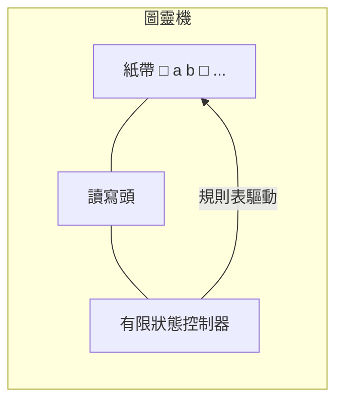

# 3.2 阿蘭·圖靈與圖靈機：無限紙帶與狀態轉移，證明停機問題無解

## 1935 年的劍橋：一個問題的嗅覺

阿蘭·圖靈（Alan Turing, 1912–1954）在劍橋國王學院讀本科時就讀過《數學原理》與哥德爾的論文（當時是紐曼(Max Newman)開設的基礎課程把哥德爾介紹給了他）。1935 年他決定正面攻擊希爾伯特的判定問題。

他的直覺與邱奇完全不同：**先回答「人類計算員在做什麼」，再談機器。**

## 把「計算」拆到原子

圖靈問：一個拿著紙筆的人，計算時到底能做什麼？他逐條分析（論文第 9 節）：

1. 在紙上寫下有限種符號 → 紙可以切成一格一格，**每格一個符號**
2. 人一次只看有限範圍 → 可以簡化為**一次只看一格**
3. 人在有限個心理狀態之間切換 → 有限**狀態**
4. 下一步行動由「當前符號 + 當前狀態」唯一決定 → **轉移規則表**

於是得到圖靈機（Turing machine）：

- **無限紙帶**：一格一符號（空白算一種）
- **讀寫頭**：讀當前格、寫、左移、右移
- **有限狀態集** + **轉移函數** $\delta(\text{state}, \text{symbol}) \to (\text{new symbol}, \text{move}, \text{new state})$
- **停機狀態**：進入即結束

**每一個元件都是對「人類計算」的最小抽象**——沒有多餘的浪漫。這就是為什麼圖靈機比其他模型更有說服力：它不是發明的數學遊戲，而是**對計算現象的現象學還原**。

## 通用圖靈機：程式的誕生

關鍵一步（論文第 6、7 節）：圖靈注意到，**轉移規則表本身可以用編碼寫在紙帶上**。於是可以造一台特殊的圖靈機 $U$（通用機）：

> $U$ 讀入「機器 $M$ 的編碼 $\langle M\rangle$ + 輸入 $w$」，然後**模擬 $M$ 在 $w$ 上運行**。

$$U(\langle M\rangle, w) = M(w)$$

**1936 年——比第一台電腦早九年——「儲存程式」的概念已在紙上成立**：資料（輸入）與程式（機器描述）同質，都是紙帶上的符號；軟體與硬體的分離、作業系統、解譯器、虛擬機，全部包含在這個公式裡。馮·諾伊曼 1945 年的架構（第 4 章）是它的工程實現，而他本人清楚知道思想源頭。

## 停機問題：萬能檢查器不存在

定義問題：給定機器 $M$ 與輸入 $w$，是否存在演算法判斷 $M(w)$ 會停機還是永轉？

**反證**（圖靈版的對角線法）。假設存在判斷器 $\text{HALT}(M, w)$。構造惡魔機器 $D$：

$$D(M):\ \text{若 } \text{HALT}(M, M) \text{ 為「停」→ 進入死循環；否則停機}$$

現在問：$D(D)$ 會停機嗎？

- 若 $D(D)$ 停 → 由定義 $D$ 檢查 $\text{HALT}(D,D)$ 得「停」→ $D$ 進入**死循環**——矛盾
- 若 $D(D)$ 不停 → 檢查得「不停」→ $D$ **停機**——矛盾

所以 $\text{HALT}$ 不存在。∎

注意結構與哥德爾證明完全同構（說謊者句 ↔ $D(D)$），只是**繞過了算術化**——機器模擬機器，比質數冪積編碼直觀得多。這也是為什麼圖靈的證明成為計算機科學的入門第一課：**可讀性就是傳播力**。

## 不可判定性的清單（停機問題的家族）

停機問題一成立，一大片問題連坐（歸約技術）：

| 問題 | 結論 |
|------|------|
| 判斷程式是否輸出特定值 | 不可判定 |
| 判斷兩個程式是否等價 | 不可判定（Rice 定理：任何非平凡語義性質皆不可判定） |
| 判斷程式是否有記憶體洩漏 / 空指標 / 病毒行為 | 不可判定 |
| 一階邏輯判定問題（希爾伯特的原始問題） | 不可判定（停機問題可編碼進它） |

**工程含義**：所有靜態分析工具（編譯器警告、防毒、型別檢查、AI 代碼審查）註定**不完備**——要嘛漏報、要嘛誤報。現代工具鏈的全部設計（樂觀/悲觀策略、可判定子集、型別系統），都是在這片不可判定海域上的航道規劃。

## 圖靈其人與時代

圖靈的天才伴隨著社會的殘酷：

- **1939–45 布萊切利園**：領導破解恩尼格瑪密碼（設計 Bombe 解碼機），史家估計縮短二戰兩年以上、拯救數百萬生命。**戰時秘密制度讓他的功績封存數十年**——英雄史由檔案解密重寫，是二十世紀的常態
- **1948–51**：曼徹斯特大學，參與首批儲存程式電腦（Manchester Baby, 1948）的程式設計；寫下第一個西洋棋程式的思路與「圖靈測試」（1950《計算機器與智能》——本書第 17 章的預言書）
- **1952 年被捕**：同性戀在英國是刑事罪，他被定罪、接受化學閹割；1954 年中毒身亡（氰化物，普遍認為自殺）。**法律與社會偏見殺死了計算機科學之父**——2013 年英國女王正式赦免，2017 年「圖靈法」追溯赦免同類受害者
- 英國 50 鎊紙鈔（2021）印上圖靈像——**一個被國家定罪的人，被印上國家的鈔票**，這遲到的正名本身就是一部社會思想史

## 小結

圖靈機的三重遺產：

1. **理論**：計算的精確定義 + 不可判定性的宇宙邊界
2. **工程**：通用機 = 儲存程式 = 一切現代電腦的原型
3. **倫理**：圖靈測試開啟「機器能否思考」的論域，至今未決

---
[下一節：3.3 邱奇-圖靈等價性](03.3-邱奇圖靈等價性.md)
